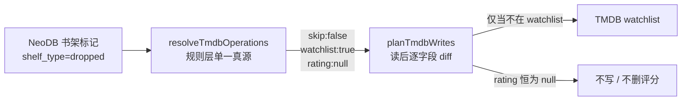

## Product Overview

调整链路⑤（NeoDB → TMDB）的状态映射：NeoDB 的 `dropped`（弃看）不再被跳过，而是与 `progress`、`wishlist` 一样加入 TMDB 的 watchlist，并在默认运行中实际生效。

## Core Features

- `dropped` 的映射结果与 `progress` 完全一致：`skip = false`、`watchlist = true`、`rating = null`，即加入 watchlist、不写评分，也绝不删除 TMDB 上已有的评分。
- 即使该 NeoDB 标记带有评分（`rating_grade > 0`），`dropped` 也不把评分推给 TMDB；评分逻辑仍只由 `complete` 触发。
- `dropped` 纳入默认处理的书架列表，顺序排在最后（`wishlist, progress, complete, dropped`），默认运行即可看到弃看条目进入待看列表，且不会挤占前三个书架的条数配额。
- 用户若显式设置 `SYNC_SHELF_TYPES` 且未包含 `dropped`，行为仍按用户配置执行，不强制纳入。
- 原先的「书架无对应映射即跳过」（`shelf-not-mapped`）分支保留为防御性兜底，但四种书架现在都有映射，正常情况下不再触发。
- 其余链路不受影响：链路② 对 `dropped` 的覆盖守卫、链路④ 将 Bangumi「抛弃」映射为 `dropped` 的逻辑均保持不变。
- 文档（README、参考手册、决策记录、环境变量样例）与新行为保持一致，不出现「dropped 跳过」的旧描述。


## Tech Stack

沿用现有技术栈，不引入新依赖：TypeScript + tsx 直跑、vitest 单测、`scripts/verify-*.ts` 离线断言、Prettier / ESLint / `tsc --noEmit`。

## Implementation Approach

映射行为的唯一真源是 `src/rules/tmdb-mapping.ts` 的 `resolveTmdbOperations()`，本次只改 `dropped` 一个分支，让其返回与 `progress` 相同的计划；同时在 `src/sync-config.ts` 的默认书架列表中加入 `dropped`，否则默认运行根本不会读取该书架，改动等于不生效。

关键决策与理由：

- **不写评分、也不删评分**：`rating: null` 在 `planTmdbWrites` 中的契约是「既不 POST 也不 DELETE」，这与 `progress` 一致，也延续了「永不删除用户手设评分」的保护。
- **保留 `skip` 机制**：`TmdbOperationPlan.skip`、路径里的跳过分支、`skippedShelf` 计数与 `shelf-not-mapped` slug 都不删除，只改注释说明其为兜底。理由是把变更面压到最小，同时为将来出现「TMDB 装不下的书架状态」保留点名能力。
- **默认顺序 `wishlist, progress, complete, dropped`**：`SYNC_MAX_ITEMS` 是按「真正进入 TMDB 的条数」计的总熔断，dropped 放最后可保证常规运行先处理完前三个书架。
- **幂等不变**：已加入 watchlist 的 dropped 条目在下一轮会被 `account_states` 比对判为无差异，不产生写请求；这与现有 `progress` 行为一致。

性能与流量：默认每轮多翻一个书架、多出若干条 `account_states` 读请求；dropped 条目经分类门控后只有 movie / tv 会真正进入 TMDB 解析，图书 / 音乐 / 游戏仍在零请求阶段被 `no-tmdb-category` 跳过。

## Implementation Notes

- 只改 `dropped` 分支，不动 `wishlist` / `progress` / `complete` 分支，避免回归；`ratingGrade` 仍只被 `complete` 读取。
- 路径层不改逻辑：`toShelfType('dropped')` 已能正确归一，`syncMark` 会把新计划交给既有的类别门控、增量指纹、去重与 `planTmdbWrites`。
- 计数器语义不变：dropped 条目从此计入 `scanned` / `processed` / `written` / `unchanged`，不再计入 `skippedShelf`；`report.skipped` 的求和公式无需改动。
- 兼容性：显式配置 `SYNC_SHELF_TYPES` 的用户行为不变；未配置的用户默认多同步一个书架，需在文档中明说这一行为变化。
- 校验脚本计数会变化（`verify-tmdb-mapping.ts` 预计由 57 条增至 58 条），README 里三处「62 个 vitest 用例 + 326 条断言」需按实测更新，避免文档数字再次过期。
- 本机 `npm` 不在 PATH，验证一律用本地二进制；Prettier 检查需加 `--end-of-line auto`（`core.autocrlf=true` 会把所有 CRLF 文件误判为不合格式）。

## Architecture Design

改动落在既有的「规则层单一真源 + 配置层默认值 + 校验脚本 + 文档」结构内，不新增模块、不改变数据流：



## Directory Structure

```text
project-root/
├── src/
│   ├── rules/
│   │   └── tmdb-mapping.ts        # [MODIFY] 文件头映射表与「后果」说明改为 dropped 归入 watchlist；resolveTmdbOperations 的 dropped 分支改为 { skip:false, watchlist:true, rating:null }，reason 与 progress 同风格（如「弃看 → TMDB 无该状态，归入 watchlist」）
│   ├── sync-config.ts             # [MODIFY] DEFAULT_TMDB_SHELF_TYPES 追加 'dropped'（置于末尾），改写原先「刻意不含 dropped」的注释，说明其现在与 progress 同义、不再是空操作
│   └── paths/
│       └── neodb-to-tmdb.ts       # [MODIFY] 仅更新 plan.skip 分支注释：由「例如 dropped」改为「防御性兜底，当前四种书架都有映射，正常不会触发」；逻辑、skippedShelf 计数与 shelf-not-mapped slug 不变
├── scripts/
│   └── verify-tmdb-mapping.ts     # [MODIFY] dropped 映射断言改为 not skipped / 加入 watchlist / 不写评分；幂等块拆为「不在 watchlist → 只写 watchlist、不写评分」与「已在 watchlist → shouldWrite=false」，并保留「不删除已有评分」的断言
├── README.md                      # [MODIFY] 状态对照表、链路⑤状态映射表、⑤冲突判定与仲裁规则、边界表、SYNC_SHELF_TYPES 默认值与说明、以及 verify:all 断言计数全部同步
├── docs/
│   ├── reference.md               # [MODIFY] reason 表 shelf-not-mapped 行改为「防御性兜底：当前四种书架都有映射，正常不会出现」
│   └── decisions.md               # [MODIFY] 按惯例追加「## 13. dropped 归入 watchlist（2026-10-29）」，记录取舍与代价（弃看与想看/在看在 TMDB 上无法区分）
└── .env.example                   # [MODIFY] SYNC_SHELF_TYPES 注释：默认值改为 wishlist,progress,complete,dropped，删掉「dropped 会被映射跳过」的旧说明
```

## Key Code Structures

```ts
// src/rules/tmdb-mapping.ts —— dropped 的目标返回值（与 progress 同形）
case 'dropped':
  return {
    skip: false,
    // TMDB 没有「弃看」态：与 progress 一样按「还想看」处理，且不触碰评分。
    // 弃看与在看/想看因此无法区分，这是刻意的取舍。
    watchlist: true,
    rating: null,
    reason: '弃看 → TMDB 无该状态，归入 watchlist',
  };
```

