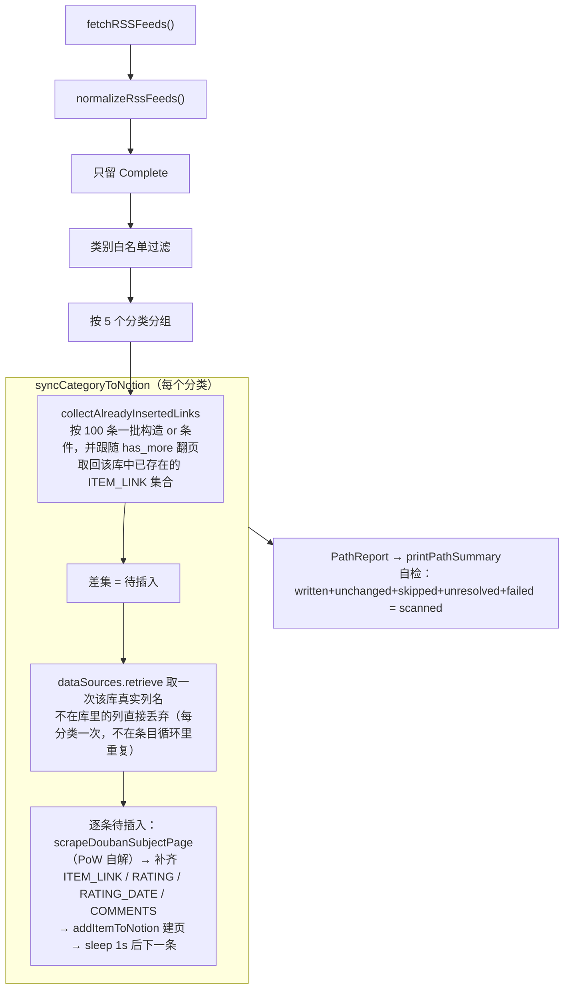
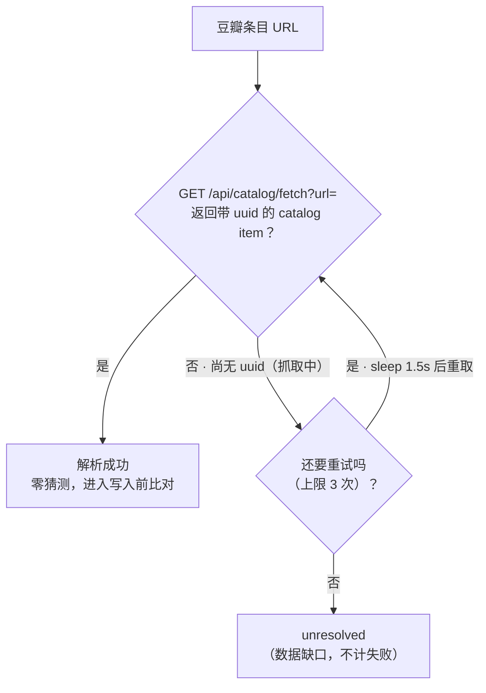
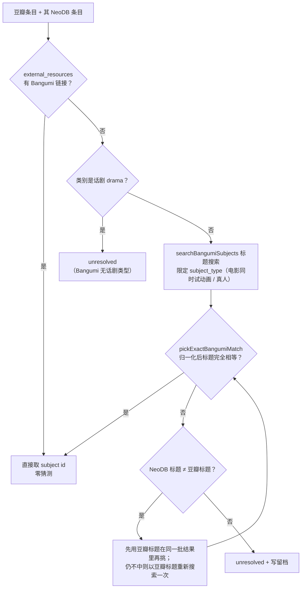
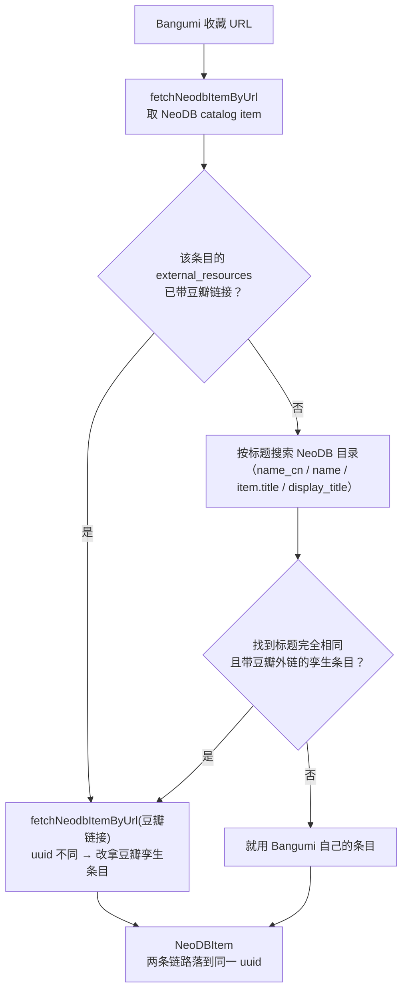
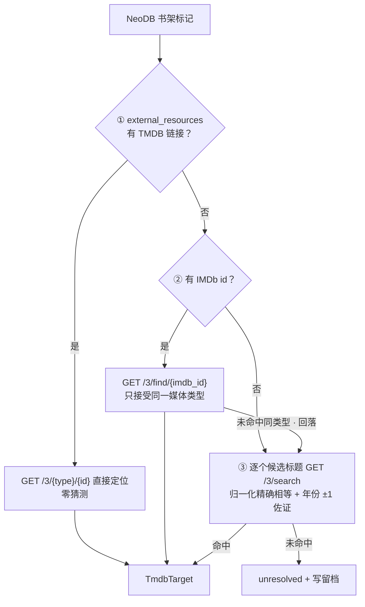

# Audiovisual-Transporter

个人书影音收藏的**跨平台归档与迁移**工具。它把豆瓣、Bangumi、NeoDB、TMDB 四个平台的收藏标记打通：豆瓣的记录向外留档，Bangumi 的收藏回灌 NeoDB，NeoDB 的书架镜像到 TMDB。

TypeScript 编写，`tsx` 直跑，无需构建。技术基础上延续 [douban-backup](https://github.com/viazure/douban-backup) 的全部能力，并新增 **NeoDB 书架 → TMDB** 单向同步。


---

## 目录

**快速上手**

- [一页速览](#一页速览)
- [入门指南](#入门指南)

**理解设计**

- [架构与分层](#架构与分层)
- [五条链路](#五条链路)
- [平台读写边界](#平台读写边界)
- [接口依据](#接口依据)
- [同步范围与幂等](#同步范围与幂等)
- [异常处理与结果契约](#异常处理与结果契约)

**配置与部署**

- [配置](#配置)

**参考**

- [数据格式示例](#数据格式示例)
- [常见问题](#常见问题)
- [License](#license)

---

## 一页速览

**它解决什么问题**：豆瓣是中文书影音记录的主要入口，但数据不在你手里。这个工具做两件事——

1. **留档**：把豆瓣的收藏导出到 Notion（结构化表格）、NeoDB（开放社交平台）、Bangumi（动画/漫画强项），任一平台出问题都不至于全部丢失。
2. **打通**：把 NeoDB 的书架状态镜像到 TMDB，让 TMDB 上的观影记录与评分自动跟随 NeoDB。

### 数据流总图

```
┌────────────────────────────────────────────────────────────────────────────────────────────┐
│                                      豆瓣 RSS 兴趣流                                       │
│                                   clients/douban-rss.ts                                    │
│                            每轮仅返回最近约 10 条（豆瓣侧限制）                            │
└────────────────────────────────────────────────────────────────────────────────────────────┘
                                               │ fetchRSSFeeds()
                                               │ 浏览器 UA + 对 401/403 限次重试
┌────────────────────────────────────────────────────────────────────────────────────────────┐
│                          归一化 normalizeRssFeeds() → FeedItem[]                           │
│                  状态 Complete / Progress / Wishlist · 分类 · 评分 · 短评                  │
└──────────────┬───────────────────────────────┬───────────────────────────────┬─────────────┘
               │ ① 仅 Complete                 │ ② 三种状态                    │ ③ 三种状态
               ▼                               ▼                               ▼
┌────────────────────────────┐  ┌────────────────────────────┐  ┌────────────────────────────┐
│ ① 豆瓣 → Notion（默认关）  │  │  ② 豆瓣 → NeoDB（默认开）  │  │ ③ 豆瓣 → Bangumi（默认开） │
│      仅 Complete 状态      │  │       三种状态全处理       │  │       三种状态全处理       │
│    clients/notion.ts +     │  │  clients/neodb-catalog.ts  │  │     clients/bangumi.ts     │
│    douban-subject-page/    │  │       解析豆瓣 URL；       │  │    NeoDB 外链优先，否则    │
│      parsers 抓详情页      │  │   clients/neodb-shelf.ts   │  │       标题精确匹配；       │
│   查重（分批 or + 翻页）   │  │    upsert 标记 / 评分 /    │  │    upsert 只写 4 字段：    │
│      后建页；不做匹配      │  │ 短评 / 可见性（不写进度）  │  │ type/rate/comment/private  │
└────────────────────────────┘  └────────────────────────────┘  └────────────────────────────┘
               ▼                               ▼                               ▼
          ┌─────────┐                    ┌──────────┐                    ┌──────────┐
          │ Notion  │                    │  NeoDB   │                    │ Bangumi  │
          └─────────┘                    └──────────┘                    └──────────┘

  ┌────────────────────────┐
  │    Bangumi 收藏列表    │
  │   clients/bangumi.ts   │
  │   GET /v0/users/{u}/   │
  │  collections（分页）   │
  └───────────┬────────────┘
              │ 默认每页 50 条、只取第一页
              │ （BANGUMI_COLLECTION_LIMIT）
              ▼
  ┌────────────────────────────────────────────────────────────────────────────────────────┐
  │                            链路④ Bangumi → NeoDB（默认开）                             │
  │                     paths/bangumi-to-neodb.ts + clients/neodb-*.ts                     │
  │                  孪生对齐（优先落到带豆瓣链接的同一 uuid）后写标记；                   │
  │                    进度同步默认关（SYNC_BANGUMI_NEODB_PROGRESS=0）                     │
  └────────────────────────────────────────────────────────────────────────────────────────┘
                                               │
                                               ▼
                                         ┌──────────┐
                                         │  NeoDB   │
                                         └──────────┘

  ┌────────────────────────────────────────────────────────────────────────────────────────┐
  │                              链路⑤ NeoDB → TMDB（默认关）                              │
  │                    独立入口 src/neodb-to-tmdb-cli.ts，不读豆瓣 RSS                     │
  └────────────────────────────────────────────────────────────────────────────────────────┘
                                               │ clients/neodb-shelf.ts 读书架
                                               │ （每书架最多 10 页，NEODB_MAX_PAGES）
                                               ▼
  ┌────────────────────────────────────────────────────────────────────────────────────────┐
  │                            paths/neodb-to-tmdb.ts 三级匹配                             │
  │                        ① TMDB 外链 → ② IMDb id → ③ 标题 + 年份                         │
  │                          （归一化精确相等，年份容差 ±1 佐证）                          │
  └────────────────────────────────────────────────────────────────────────────────────────┘
                                               │ clients/tmdb.ts 先读 account_states
                                               │ 逐字段 diff，只写有差异的 rating / watchlist
                                               ▼
                                          ┌────────┐
                                          │  TMDB  │
                                          └────────┘
```

> 箭头 = **运行时数据流向**（不是 import 方向）；import 方向见[架构与分层](#架构与分层)。NeoDB 与 Bangumi 各只画了一个方框，却承担两种角色：被写目标（②④ / ③）与下游链路的数据源（→④ / →⑤）。链路①②③ 同源（同一份 `FeedItem[]`），④⑤ 各自独立取数——⑤ 更是独立入口，不读豆瓣 RSS。每张图的匹配细节见[五条链路](#五条链路)各节。

### 关键数字

| 项                    | 值         | 说明                                                        |
| --------------------- | ---------- | ----------------------------------------------------------- |
| 同步链路              | **5 条**   | 全部**单向、幂等**；①②③ 同源（豆瓣 RSS），④⑤ 独立           |
| `src/` 文件           | **27 个**  | `clients/` 9 · `rules/` 6 · `paths/` 5 · 顶层 7             |
| 离线断言              | **232 条** | `npm run verify:all`，不需网络与凭据                        |
| 环境变量              | **47 个**  | 用户可配置；另有 2 个 CI 注入变量。名称属于对外接口，不改名 |
| `process.exit()`      | **0 处**   | 无实际调用；失败一律走 `PathReport` → 退出码                |
| 硬编码 `neodb.social` | **1 处**   | 仅 `sync-config.ts` 的默认值；全部请求走 `NEODB_BASE_URL`   |

### 三条设计原则

- **幂等** — 重复运行任意多次，结果一致。每条记录先读目标平台现状，逐字段比对，不需要的写操作一个都不发。
- **保留既有数据** — NeoDB 无评分时**绝不清除** TMDB 上已有的评分。删除会抹掉你手写的数据。
- **宁可漏配，不可错配** — 找不到精确匹配的条目直接跳过并记录，绝不「猜最接近的那个」。

### 与 douban-backup 的关系

|          | douban-backup           | 本项目                                                           |
| -------- | ----------------------- | ---------------------------------------------------------------- |
| 链路数   | 4 条                    | **5 条**（+ NeoDB → TMDB）                                       |
| 数据流向 | 豆瓣/Bangumi → 其他平台 | 增加平台之间的横向同步                                           |
| 代码关系 | —                       | 行为延续；代码经模块化重构（分层 / 拆文件 / 改名），并追加新模块 |

> **血缘说明**：[bambooom/douban-backup](https://github.com/bambooom/douban-backup) 是原版（豆瓣 → Notion / NeoDB），[viazure/douban-backup](https://github.com/viazure/douban-backup) 是增加了 Bangumi 功能的 fork——本项目的 Bangumi 链路即来自这一支。Bangumi 客户端的默认 UA 仍标识上游项目（`clients/bangumi.ts` 的 `douban-backup/1.0 (…/bambooom/douban-backup)`，可用 `BANGUMI_USER_AGENT` 覆盖）；这是**刻意保留的运行时值**，本次未改。

**如果不需要 TMDB**，把 `SYNC_NEODB_TMDB` 保持为 `0`，四条豆瓣/Bangumi 链路的行为与 douban-backup 一致。

---

## 入门指南

三步跑起来。每一步只给最少信息，细节分别见[五条链路 · 总览](#总览)与[配置](#配置)。

### 第一步 · 决定开哪条链路

五条链路**各自独立开关、互不依赖**——开哪条只填哪条需要的参数，其余设为 `0` 即可。「链路 — 开关 — 默认值 — 用途」对照见[五条链路 · 总览](#总览)：

- **开箱即用的三条**（默认即开启）：豆瓣 → NeoDB、豆瓣 → Bangumi、Bangumi → NeoDB
- **需要显式开启的两条**（默认关闭）：豆瓣 → Notion、NeoDB → TMDB
- ⚠️ 三条 `Douban→*` 全部关闭时，程序跳过拉取豆瓣 RSS（省一次网络请求），`DOUBAN_USER_ID` 可以不填

### 第二步 · 填写参数

```bash
git clone <your-repo-url> Audiovisual-Transporter
cd Audiovisual-Transporter
npm ci
cp .env.example .env      # Windows: copy .env.example .env
```

编辑 `.env`，**按第一步决定的链路填写**（完整说明见[配置 · 凭证](#凭证)）：

- 无论开哪条链路：`NEODB_API_TOKEN`
- 开 `Douban→*` 才需要：`DOUBAN_USER_ID`
- 开 Bangumi 相关链路才需要：`BANGUMI_ACCESS_TOKEN`
- 开 `SYNC_DOUBAN_NOTION` 才需要：`NOTION_TOKEN` ＋ 至少一个 `NOTION_*_DATABASE_ID`
- 开 `SYNC_NEODB_TMDB` 才需要：`TMDB_API_KEY` ＋（`TMDB_ACCESS_TOKEN` 或 `TMDB_SESSION_ID` 二选一，写权限必需）

### 第三步 · 运行验证

```bash
npm run verify:all           # 离线自测：232 条断言，不联网
SYNC_DRY_RUN=1 npm run sync  # 空跑：只打印计划，不写任何数据
npm run sync                 # 正式同步全部链路
```

建议按顺序执行，尤其是**先空跑再实跑**。只跑单条链路用 `npm run sync:neodb-tmdb`（链路⑤）或 `npm run sync:bangumi-full`（链路④全量）。

---

## 架构与分层

### 分层图（箭头 = import 方向）

> 层间箭头是**粗粒度**的：表示「该层至少一个模块 import 下一层」，标签是实测的文件数比；精确到文件的 import 见下方引用矩阵。


**层 × 基础模块引用矩阵**（import 实测，2026-10 复审）：

| 被引用模块       | 入口层（3 文件） |     编排层 paths/（5）      | 客户端层 clients/（9）                       | 规则层 rules/（6） |
| ---------------- | :--------------: | :-------------------------: | -------------------------------------------- | :----------------: |
| `types.ts`       |       3/3        |             5/5             | 8/9（除 `neodb-http`）                       |        6/6         |
| `sync-config.ts` |       3/3        |             5/5             | 3/9（`neodb-http` / `neodb-shelf` / `tmdb`） |        0/6         |
| `utils.ts`       |       0/3        | 4/5（除 `douban-to-neodb`） | 5/9                                          |        0/6         |
| `sync-report.ts` |       3/3        |             5/5             | 0/9                                          |        0/6         |

> 规则层对基础模块**只 import `types.ts`**：`NeodbMergeProfile` 类型已从 `sync-config.ts` 搬入 `types.ts`，规则层对配置中枢的依赖（连类型导入）已清零。「规则层零 I/O、零 env」由下方 grep 边界继续证明。

三条**可执行**的边界约束（不是口号，是 grep 命令）：

| 边界                        | 命令                                                                  | 期望   |
| --------------------------- | --------------------------------------------------------------------- | ------ |
| `rules/` 零 I/O、零 env     | `grep -rnE "got\|jsdom\|@notionhq\|process\.env\|node:fs" src/rules/` | 0 命中 |
| `clients/` 不反向依赖编排层 | `grep -rn "paths/\|sync-report" src/clients/`                         | 0 命中 |
| `paths/` 不直接发请求       | `grep -rn "from 'got'" src/paths/`                                    | 0 命中 |

### 目录结构

```
Audiovisual-Transporter/
├── src/                          核心源码（27 个文件）
│   ├── index.ts                  总入口：按开关调度所有链路，豆瓣 RSS 只抓一次；豆瓣链路失败被捕获后继续，其余失败设退出码 1
│   ├── neodb-to-tmdb-cli.ts      NeoDB → TMDB 独立入口：只跑链路⑤，不影响原有 cron；不带命令行参数
│   ├── bangumi-to-neodb-full-cli.ts  Bangumi 全量入口：追加执行补齐历史（fullSync = true）；不带命令行参数
│   ├── sync-config.ts            配置中枢：集中解析全部环境变量，并打印成一行便于审计；含 syncConfig 与 neodbTmdbConfig 两组
│   ├── types.ts                  共享词汇表 + cols.json 的唯一入口；NeodbItem 为两条链路的合并超集，PathReport 为各链路的结果契约
│   ├── utils.ts                  通用工具 + 增量状态 + 留档日志（原子写；留档按 source::id upsert + 首末时间戳）
│   ├── sync-report.ts            结果展示层：汇总、自检、未匹配条目分组列出；Actions 注解仅在 CI 输出
│   │
│   ├── clients/                  外部平台：传输 + 各平台自己的线格式（9）
│   │   ├── douban-rss.ts                 RSS 拉取与归一化（状态解码、星级/短评提取）；浏览器 UA + 401/403 上限重试
│   │   ├── douban-subject-page.ts        条目页抓取：sha512 PoW 自解（上限 2000 万次）+ 模块级 CookieJar
│   │   ├── douban-subject-parsers.ts     条目页 → Notion 列值，纯函数（5 个 buildXxxItem，可直接用 fixture 断言）
│   │   ├── neodb-http.ts                 NeoDB 传输层：凭据、请求头、错误助手、节流；唯一的 base URL 来源（NEODB_BASE_URL）
│   │   ├── neodb-catalog.ts              目录查询（按外链/标题解析）+ 孪生条目解析
│   │   ├── neodb-shelf.ts                标记读写、进度读写（302/307 重定向重试）、书架分页
│   │   ├── bangumi.ts                    Bangumi 客户端（收藏读写、搜索走 POST、精确匹配选取、分页失败返回 null）
│   │   ├── tmdb.ts                       TMDB 客户端（凭据解析 v4→v3/Bearer、读现状、评分/watchlist 写；写不重试）
│   │   └── notion.ts                     Notion 客户端（SDK data_source 模式）+ 列类型表 + 属性载荷构造
│   │
│   ├── rules/                    纯逻辑：零 I/O、零环境读取（6）
│   │   ├── douban.ts                     豆瓣词汇 + 星级换算（全仓唯一一处）
│   │   ├── bangumi-neodb.ts              Bangumi ↔ NeoDB 映射与守卫（含两张「不覆盖对方表达不了的状态」守卫表）
│   │   ├── neodb-mark-merge.ts           标记合并：评分/短评按 profile，状态恒跟随来源
│   │   ├── tmdb-mapping.ts               状态映射定义 ★ 改行为改这里（complete 的评分分支在此）
│   │   ├── tmdb-matching.ts              标题匹配（决定写到哪个真实实体）；normalizeTitleKey 与之共用
│   │   └── tmdb-write-plan.ts            写入计划计算（幂等核心）：想要的状态 vs TMDB 现状做差分
│   │
│   └── paths/                    5 条链路编排（各自返回 PathReport；只做调度与错误隔离，不含业务规则）
│       ├── douban-to-notion.ts           链路①：按分类分组、查重去重、抓详情页建页
│       ├── douban-to-neodb.ts            链路②：白名单过滤后逐条同步标记（条目级编排 syncFeedItemToNeodb 在此）
│       ├── douban-to-bangumi.ts          链路③：条目匹配后逐条 upsert 收藏
│       ├── bangumi-to-neodb.ts           链路④：收藏分页遍历、孪生对齐、合并写入
│       └── neodb-to-tmdb.ts              链路⑤：书架遍历、三级匹配、读后 diff 写入
│
├── scripts/                      辅助脚本
│   ├── probe-neodb-shelf.ts          探测 NeoDB 书架响应结构（原始 JSON 存 .cache/）
│   ├── verify-tmdb-mapping.ts        映射逻辑离线断言（57 项）
│   ├── verify-rules.ts               纯规则离线断言（100 项）
│   ├── verify-douban-parsers.ts      解析器离线断言（75 项）
│   ├── image-downloader.d.ts         image-downloader 的手写类型声明
│   └── download-douban-note-images.ts 下载豆瓣日记配图（未接通：缺 image-downloader 依赖）
├── tests/fixtures/                解析器断言用的 HTML fixture（5 个，手工构造）
├── archive/                       已废弃：旧爬虫 + 历史回填脚本，仅供追溯（非运行时）
├── userscript/                    浏览器用户脚本，手动导出用（非运行时）
├── docs/                          README 配图
├── cols.json                      Notion 数据库列定义
├── .github/workflows/             定时同步工作流
├── .env.example                   配置模板
└── README.md
```

<details>
<summary><b>更名对照（历史文件名 → 现行位置）</b></summary>

`handle-notion.ts → paths/douban-to-notion.ts` · `handle-neodb.ts → paths/douban-to-neodb.ts` · `handle-bangumi.ts → paths/douban-to-bangumi.ts` · `handle-bangumi-neodb.ts → paths/bangumi-to-neodb.ts` · `handle-neodb-tmdb.ts → paths/neodb-to-tmdb.ts` · `handle-rss.ts → clients/douban-rss.ts` · `handle-douban.ts → clients/douban-subject-page.ts + douban-subject-parsers.ts` · `const.ts → rules/douban.ts + rules/bangumi-neodb.ts` · `neodb-merge.ts → rules/neodb-mark-merge.ts` · `tmdb-merge.ts → rules/tmdb-write-plan.ts` · `sync-tmdb-only.ts → neodb-to-tmdb-cli.ts` · `sync-bangumi-full.ts → bangumi-to-neodb-full-cli.ts` · `scripts/update-notion.ts → archive/update-notion.ts` · `db-notes-img-dl.ts → scripts/download-douban-note-images.ts`

</details>

### 离线断言（共 232 项）

```bash
npm run verify:all      # 依次跑三个脚本；CI 在同步之前先跑它
```

- 全部**不需要网络、不需要凭据、不引入测试框架**，几秒内跑完；`verify:mapping`（57 项）/ `verify:rules`（100 项）/ `verify:parsers`（75 项）可单独运行。
- **关于 `tests/fixtures/*.html` 的诚实说明**：这五个 fixture 的标记结构是**由解析器使用的选择器反推构造**的，并非从豆瓣抓取。它们能让每个分支都有用例、并把期望值（含若干「怪癖」）精确钉住，因此任何改变解析行为的编辑都会立刻失败；但它们**无法**证明这些选择器今天仍与线上一致。下次改动解析器时，请用真实抓取的 HTML 替换它们——那是唯一能补上这一点的升级。

> ⚠️ 关于「唯一的 env 读取点」：**目前并非事实**。除 `sync-config.ts` 外，还有 5 个文件直接读 `process.env`：`clients/bangumi.ts`（4 个 Bangumi 变量）、`clients/douban-rss.ts`（UA 与 `DOUBAN_USER_ID`）、`clients/neodb-http.ts`（`NEODB_API_TOKEN` / `NEODB_VISIBILITY`）、`clients/notion.ts`（`NOTION_TOKEN`）、`sync-report.ts`（2 个 CI 注入变量）。`sync-config.ts` 是**集中解析开关与配置的中心**，但「所有 env 只此一处」仍是待办目标。

---

## 五条链路

### 总览

| #   | 链路               | 开关                  |  默认  | 说明                                          |
| --- | ------------------ | --------------------- | :----: | --------------------------------------------- |
| 1   | 豆瓣 RSS → Notion  | `SYNC_DOUBAN_NOTION`  |   关   | 抓取详情页建页，仅处理「看过/听过/读过/玩过」 |
| 2   | 豆瓣 RSS → NeoDB   | `SYNC_DOUBAN_NEODB`   | **开** | 写入标记、评分、短评（不写进度）              |
| 3   | 豆瓣 RSS → Bangumi | `SYNC_DOUBAN_BANGUMI` | **开** | 写入收藏标记（标题精确匹配）                  |
| 4   | Bangumi → NeoDB    | `SYNC_BANGUMI_NEODB`  | **开** | 反向补齐 NeoDB，支持全量同步                  |
| 5   | **NeoDB → TMDB**   | `SYNC_NEODB_TMDB`     |   关   | 见[链路 5](#链路-5neodb--tmdb)                |

> 开关取值 `1`/`true`/`yes`/`on` 为开启；`0`/`false`/`off`/留空为关闭。关闭全部 `Douban→*` 时会跳过拉取豆瓣 RSS。**上表是全仓开关信息的唯一出处**——其他地方只讲行为，不再复刻默认值。

#### 状态对照（一张表覆盖全部五条链路的状态语义）

| 豆瓣状态词                | 中间状态 | NeoDB `shelf_type` | Bangumi collection type | TMDB 操作（链路⑤，经 NeoDB）                              |
| ------------------------- | -------- | ------------------ | ----------------------- | --------------------------------------------------------- |
| 看过 / 读过 / 玩过 / 听过 | Complete | `complete`         | 2 看过                  | 有评分 → 写评分 + 移出 watchlist；无评分 → 加入 watchlist |
| 在看 / 在读 / 在玩 / 在听 | Progress | `progress`         | 3 在看                  | 加入 watchlist（TMDB 无「在看」态）                       |
| 想看 / 想读 / 想玩 / 想听 | Wishlist | `wishlist`         | 1 想看                  | 加入 watchlist                                            |
| （豆瓣没有）              | Dropped  | `dropped`          | 5 抛弃                  | **跳过**，不做任何操作                                    |
| （豆瓣没有）              | —        | —                  | 4 搁置                  | 反向映射时归入 `progress`（NeoDB 无搁置态）               |

> 豆瓣没有「弃看」状态，所以链路②**不会写入** `dropped`；Bangumi 的第 4、5 类**只会由反向链路④产生**。

### 通用约定

- **匹配原则**：优先使用平台之间已有的 ID 链接（零猜测），其次才做标题精确匹配——匹配不到就跳过并记录，绝不写到「看起来最像」的条目上（同[设计原则](#三条设计原则)）。
- **类别过滤**：每条链路都能配类别白名单；填了值却**无可识别类别**时，该链路拒绝同步任何条目（fail-closed），避免拼写错误演变成意外全量写入。
- **异常隔离**：单条失败不中断整批；豆瓣链路整体失败也不会挡住后面的 Bangumi → NeoDB。详见[异常处理与结果契约](#异常处理与结果契约)。

### 豆瓣 RSS → Notion

> 链路①，默认关。这是五条链路里机制最特殊的一条：不做匹配、直接追加，且要抓取豆瓣详情页。

▸ **前置过滤**：只处理 `Complete` 状态（看过 / 读过 / 玩过 / 听过）。在看、想看这类半途状态不建页面——因为没有「完成日期」可填。

▸ **来源 → Notion 属性**：

| 来源           | Notion 属性                                           | 说明                                         |
| -------------- | ----------------------------------------------------- | -------------------------------------------- |
| 标题           | 各库 TITLE 属性                                       | 电影 / 音乐 / 图书 / 游戏 / 话剧共五个数据库 |
| 海报 / 封面    | `POSTER` / `COVER`                                    | 豆瓣图（文件属性）                           |
| 评分（1–5 星） | `RATING`                                              | 多选属性，保留原始星数                       |
| 评分日期       | `RATING_DATE`                                         | 即条目完成时间；缺失则留空不写               |
| 短评           | `COMMENTS`                                            | 富文本，超 2000 字符截断                     |
| 条目链接       | `ITEM_LINK`                                           | 豆瓣 URL                                     |
| 通用元数据     | `YEAR` `GENRE` `IMDB_LINK` `RELEASE_DATE`             | 从豆瓣详情页抓取                             |
| 电影专属       | `DIRECTORS` `SCREENWRITERS` `ACTORS`                  | 导演 / 编剧 / 演员（≤5 人）                  |
| 图书专属       | `WRITER` `PUBLISHING_HOUSE` `ISBN` `PUBLICATION_DATE` | 作者 / 出版社 / ISBN / 出版日期              |
| 音乐专属       | `MUSICIAN`                                            | 音乐人                                       |

> 属性名与类型由项目根目录的 **`cols.json`** 定义，你的 Notion 数据库必须与之一致，否则写入会失败。写入时遍历 `clients/notion.ts` 的 `NOTION_COLUMN_TYPES`（类型上已排除 `NAME`），**不依赖 JSON 键顺序**；不在库里的列会在写入前被丢弃。

▸ **执行流程图**（箭头 = 执行顺序，不是 import 方向）：



▸ **去重的两个要点**（单次查询做不到，所以有 `collectAlreadyInsertedLinks`）：

1. **分批构造过滤条件**——Notion 对单个 `or` 的子句数量有上限，条目按 100 条一批发送；
2. **跟随分页**——查询响应是分页的，只读第一页会让后面几页的条目看起来「尚未插入」，从而被重复创建。

### 豆瓣 RSS → NeoDB / Bangumi

> 链路②（默认开）与链路③（默认开）。两条链路**同源**——从同一份归一化后的 `FeedItem[]` 出发，共用状态识别与星级换算；差异集中在「匹配方式」「写入前比对」与「目标端字段制式」。

**共同的前置处理**：

1. 用 `DOUBAN_USER_ID` 拉取豆瓣 RSS（三条链路全关时会跳过）
2. 解析条目的状态前缀（`看过` `在看` `想看` `读过` `在听` `玩过` …），归一为三种中间状态：**Complete** / **Progress** / **Wishlist**——三种状态两条链路都处理
3. 按该链路的类别白名单过滤（`SYNC_DOUBAN_*_CATEGORIES`）
4. 评分与短评的写法相同：豆瓣 1–5 星 ×2 得 1–10（NeoDB `rating_grade` / Bangumi `rate`），短评原样写入（NeoDB `comment_text` / Bangumi `comment`）

**两条链路的差异与字段映射（合并）**

| 维度                             | → NeoDB（链路②）                                                                 | → Bangumi（链路③）                                                                                |
| -------------------------------- | -------------------------------------------------------------------------------- | ------------------------------------------------------------------------------------------------- |
| **目标端形态**                   | 标记 upsert（`POST /api/me/shelf/item/{uuid}`）                                  | 收藏 upsert（`POST /v0/users/-/collections/{id}`）                                                |
| **状态字段**                     | `shelf_type`                                                                     | collection `type`（取值见[总览的状态对照](#状态对照一张表覆盖全部五条链路的状态语义)）            |
| **匹配方式**                     | 豆瓣 URL 交 NeoDB `catalog/fetch` 解析                                           | 先查 NeoDB 外链，否则标题精确搜索（话剧仅外链）                                                   |
| **写入前比对字段**               | **4 个**：状态 / 评分 / 短评 / 可见性（`mergeNeodbMark`）                        | **3 个**：type / rate / comment（`douban-to-bangumi.ts:163-171`；`private` 不参与比对）           |
| **标记时间**                     | `created_time` **每次写入都带**（取 RSS 条目时间，`douban-to-neodb.ts:113,161`） | **写不进去**（Bangumi payload 只有 type / rate / comment / private 四个字段）                     |
| **可见性**                       | `visibility` 三态：0 公开 / 1 关注者 / 2 私密（`NEODB_VISIBILITY`）              | `private` 布尔（`BANGUMI_PRIVATE`）                                                               |
| **目标端「豆瓣表达不了」的状态** | `dropped` → 跳过不覆盖（`DOUBAN_EXPRESSED_STATUSES` 守卫，`rules/douban.ts`）    | 搁置(4) / 抛弃(5) → 跳过不覆盖（`BANGUMI_STATUSES_ABSENT_FROM_DOUBAN`，`rules/bangumi-neodb.ts`） |

> 进度不在上表：**两条链路都不写进度**——NeoDB 侧的进度只由链路④写入（`SYNC_BANGUMI_NEODB_PROGRESS`，默认关），Bangumi 侧的进度只由链路④读取（作为同步来源）。

#### 链路② 豆瓣 RSS → NeoDB

> 官方文档：[NeoDB 开发者页面](https://neodb.social/developer/)

▸ **匹配级联**（把豆瓣条目交给 NeoDB 自己解析；解析中的抓取会轮询重试）：



> 请求本身抛错（网络 / 鉴权）时走同一条落点：`fetchNeodbItemByUrl` 的 catch 直接返回 `null`，上游按未解析跳过。端点与字段口径见[接口依据 · NeoDB 侧](#neodb-侧)。

▸ **逐条同步逻辑**（`paths/douban-to-neodb.ts` 的 `syncFeedItemToNeodb`——链路②的条目级编排，与其余四条链路一样住在 `paths/`）：

1. 解析不出 NeoDB 条目 → `unresolved`（数据缺口，不是错误，不让 CI 变红）
2. 读现有标记；现有状态是豆瓣表达不了的（如 `dropped`）→ **跳过不覆盖**
3. `mergeNeodbMark` 按 `SYNC_DOUBAN_NEODB_MERGE` 合并：状态永远跟随来源；`neodb_prefer`（默认）下 NeoDB 已有非空评分/短评予以保留
4. `markNeodbItem` 写入；`post_to_fediverse` 固定 `false`，同步永不发联邦帖
5. 条间等待 `NEODB_REQUEST_DELAY_MS`

▸ **接口依据**：NeoDB 侧的端点、响应结构与字段口径见[接口依据 · NeoDB 侧](#neodb-侧)。

#### 链路③ 豆瓣 RSS → Bangumi

> 官方文档：[Bangumi API](https://bangumi.github.io/api/)　·　[个人令牌页面](https://next.bgm.tv/demo/access-token)

▸ **匹配级联**（两级递进，越靠前越零猜测）：



> 第二级**只认精确匹配**：搜索结果与候选关键词归一化后必须完全相等（同[设计原则](#三条设计原则)「宁可漏配，不可错配」）。换标题重搜只会发生在一级落空、且 NeoDB 标题与豆瓣条目标题确实不同的时候。

▸ **类别限制**：话剧（drama）在 Bangumi 没有对应类型，只有 NeoDB 上已存在 Bangumi 链接时才会同步。

▸ **写入前比对**：先读现有收藏，三字段（type / rate / comment）全部相同则不写；目标端已是「搁置 / 抛弃」时**保留不覆盖**（豆瓣 RSS 表达不了这两种状态）。未匹配 → `unresolved` 并写留档。

### 链路 4：Bangumi → NeoDB

▸ **匹配级联**（`resolveNeodbItemForBangumiUrl()`，四级，越靠前越对齐）：



> 第三级的标题搜索**先按类别查一遍、找不到再不限类别查一遍**（类别由 `subject_type` 映射而来）；候选取 Bangumi 的 `name_cn` / `name` 与 NeoDB 条目的 `title` / `display_title`，全部要求归一化后完全相等。

▸ **为什么要这样对齐**：让 Bangumi → NeoDB 与豆瓣 → NeoDB **落在同一个 NeoDB 条目上**。否则同一部作品会在两个 uuid 下各存一份标记，你在 NeoDB 上会看到重复条目。

▸ **字段映射**：

| Bangumi 侧                 | NeoDB 侧       | 换算说明                                                                                                      |
| -------------------------- | -------------- | ------------------------------------------------------------------------------------------------------------- |
| collection type            | `shelf_type`   | 见[总览的状态对照](#状态对照一张表覆盖全部五条链路的状态语义)；搁置(4) 折叠为 `progress`，抛弃(5) → `dropped` |
| rate                       | `rating_grade` | 直接对应（同为 1–10）                                                                                         |
| comment                    | `comment_text` | 原样写入                                                                                                      |
| `ep_status` / `vol_status` | progress       | 见下方进度映射                                                                                                |
| （无对应字段）             | `visibility`   | 由 `NEODB_VISIBILITY` 指定                                                                                    |

▸ **标记时间的不对称**：新建标记时带 `created_time`（取 `collection.updated_at`），但**更新时故意不传**——Bangumi 的 `updated_at` 不足以可信到可以覆盖 NeoDB 已有的标记日期。

▸ **进度映射**（仅 `SYNC_BANGUMI_NEODB_PROGRESS=1` 时执行）：

| Bangumi subject_type | 类别        | NeoDB 进度类型 | 取值来源                           |
| -------------------- | ----------- | -------------- | ---------------------------------- |
| 2 / 6                | 动画 / 真人 | `episode`      | `ep_status`                        |
| 1                    | 书籍        | `chapter`      | `vol_status`，为空则用 `ep_status` |
| 3                    | 音乐        | `track`        | `ep_status`                        |
| 4                    | 游戏        | —              | **跳过**                           |

▸ **异常处理**（与链路②③统一整理在[异常处理与结果契约](#异常处理与结果契约)，此处仅列本链路特有的）：

- 进度类型与 NeoDB 条目类别不匹配时**不发请求**（例如给 movie 发 `episode` 会被 NeoDB 以 400 拒绝）
- 零进度不发送，**不会清空**既有进度；默认关闭进度同步（`SYNC_BANGUMI_NEODB_PROGRESS=0`）
- 类别白名单只含 `manga` 不含 `book` 时，非漫画书籍**逐条**跳过（这类条目不视为未解析）
- 分页请求失败（401 / 网络 / 限流）→ 告警并**停止本趟遍历**，不会被误判为「没有更多收藏」

### 链路 5：NeoDB → TMDB

> 官方文档：[TMDB API](https://developer.themoviedb.org/docs)

**匹配级联（三级，越靠前越精确）**：



> 上图只是**匹配级联**。完整链路在匹配之前还有两道**零成本闸门**：先按 `NEODB_CATEGORIES_WITHOUT_TMDB`（图书 / 音乐 / 游戏 / 播客 / 演出）做类别门控，TMDB 根本不存在的类别直接跳过、不发一个请求；再过内容指纹（`SYNC_INCREMENTAL`），未变化的条目在匹配前就返回。匹配成功之后才是 `account_states` 读后 diff（见[同步范围与幂等](#同步范围与幂等)）。

**为什么第三级这么保守**：标题搜索按 `display_title` → `title` → `localized_title` 的次序逐个候选（同名作品、译名差异、翻拍让标题搜索成为三级里最容易错配的一级），所以只接受**精确匹配**；IMDb 命中也只接受**同一媒体类型**的条目——一个 IMDb id 可能同时解析出电影与剧集，错配比漏配危害大，绝不跨媒介回退。

▸ **状态映射规则**（本章核心。权威定义在 **`src/rules/tmdb-mapping.ts` 的 `resolveTmdbOperations()`**，改行为只改这里）：

| NeoDB 状态      | 条件               | TMDB 操作                           | TMDB 能否承载                           |
| --------------- | ------------------ | ----------------------------------- | --------------------------------------- |
| `wishlist` 想看 | —                  | 加入 watchlist                      | ✅ 完整承载                             |
| `progress` 在看 | —                  | 加入 watchlist（TMDB 无「在看」态） | ⚠️ 与「想看」无法区分                   |
| `complete` 看过 | `rating_grade > 0` | **写入评分** ＋ **移出 watchlist**  | ✅ 评分是 TMDB 唯一能表达「看过」的方式 |
| `complete` 看过 | 无评分             | 加入 watchlist                      | ⚠️ 无评分时退化为与「想看」相同         |
| `dropped` 弃看  | —                  | **跳过**，不做任何操作              | —（TMDB 无对应状态，**不当作想看**）    |

**执行顺序固定为「先写评分 → 再调整 watchlist」**。因为 TMDB 的 `add-rating` 本身会隐式把条目移出 watchlist；先评分、后显式移除，最终状态就不依赖这个未写进官方文档的行为。

▸ **冲突处理**：

| 冲突场景                  | 处理方式                              | 可配置                   |
| ------------------------- | ------------------------------------- | ------------------------ |
| 两边都有评分              | 默认保留 TMDB 的，可改为 NeoDB 覆盖   | ✅ `SYNC_RATING_PROFILE` |
| NeoDB 无评分、TMDB 有评分 | **绝不清除**（只「不写」，不 DELETE） | —                        |
| 目标状态已满足            | 比对后相同则不发请求                  | —                        |
| 同一作品在多个书架        | 运行内按 `mediaType:id` 去重          | —                        |
| TMDB 找不到匹配           | 跳过并记入 `SYNC_UNMATCHED_LOG`       | —                        |
| 单条目失败                | 记录后继续，不影响整批                | —                        |

▸ **执行节奏**：**全量扫描 + 幂等增量写入**。每次运行都完整遍历 NeoDB 书架并逐条匹配（不先看一遍就无法知道哪些需要更新），但匹配后先读 TMDB 现状做差异比对，只写有差异的字段——已符合的条目一个请求都不发。细节见[同步范围与幂等](#同步范围与幂等)。

### 双路冲突：豆瓣 → NeoDB 与 Bangumi → NeoDB

这是唯一存在「两条链路可能写同一个目标」的场景。处理分两层：

**第一层 · 匹配阶段：主动对齐到同一条目**

如链路 4 所述，Bangumi → NeoDB 会刻意寻找「带豆瓣链接的 twin」，让两条链路落到**同一个 uuid**。这是**从源头避免冲突**——不是事后补救。

**第二层 · 写入阶段：`mergeNeodbMark` 合并**

若两条链路确实指向同一条目，写入时按以下规则合并：

- **状态（shelf_type）：永远跟随来源**。后执行的那条会覆盖前一条的状态。
- **评分与短评**：按各自的 merge 配置决定
  - `neodb_prefer`（默认）：NeoDB 上**已有值非空则保留**，只填空缺
  - `overwrite`：总是用来源值覆盖

**执行顺序会造成实际差异**：`index.ts` 中豆瓣链路先跑、Bangumi → NeoDB 后跑。所以同一作品若两边状态不同，**最终以 Bangumi 为准**。

想改变这个结果，有三种做法：

1. 关闭 `SYNC_BANGUMI_NEODB`，只用豆瓣作为状态来源
2. 两条链路的 merge 都设 `overwrite`，状态以最后执行的为准（仍是 Bangumi）
3. 若只想让 Bangumi 补充而不覆盖，把 `SYNC_DOUBAN_NEODB_MERGE` 设为 `overwrite`、`SYNC_BANGUMI_NEODB_MERGE` 保持 `neodb_prefer`

**两种配置的直觉理解**：

- `neodb_prefer` = 「NeoDB 上已有的，别动」（保护你手动改过的数据）
- `overwrite` = 「以来源为准，覆盖过去」

⚠️ 注意：状态**不受** merge 配置影响——它永远以来源为准。merge 只保护评分和短评。

---

## 平台读写边界

本项目对每个平台**只做必要的读写**。下表按代码里实际调用的端点整理——超出这张表的操作不会发生。

**读**

| 平台    | 端点                                     | 用途                                             |
| ------- | ---------------------------------------- | ------------------------------------------------ |
| 豆瓣    | RSS `/feed/people/{id}/interests`        | 拉取最近收藏                                     |
| 豆瓣    | 详情页 HTML                              | 抓取年份 / 导演 / 演员等元数据                   |
| Notion  | `POST /v1/data_sources/{id}/query`       | 按 `ITEM_LINK` 查重（分批 or 条件 + 翻页）       |
| Notion  | `GET /v1/data_sources/{id}`              | 读该库真实列名（每分类一次，不在条目循环里重复） |
| Bangumi | `GET /v0/me`                             | 解析用户名                                       |
| Bangumi | `GET /v0/users/{u}/collections`          | 收藏列表（分页）                                 |
| Bangumi | `GET /v0/users/{u}/collections/{id}`     | 读单个收藏（幂等基准）                           |
| Bangumi | `GET /v0/subjects/{id}`                  | 条目详情（判定漫画平台）                         |
| Bangumi | `POST /v0/search/subjects`               | 标题搜索（**搜索走 POST**）                      |
| NeoDB   | `GET /api/catalog/fetch?url=`            | 用外链解析条目                                   |
| NeoDB   | `GET /api/catalog/search`                | 目录搜索                                         |
| NeoDB   | `GET /api/me/shelf/{type}`               | 书架列表（分页）                                 |
| NeoDB   | `GET /api/me/shelf/item/{uuid}`          | 读单个标记                                       |
| NeoDB   | `GET /api/me/shelf/item/{uuid}/progress` | 读单个进度                                       |
| NeoDB   | `GET /api/me`                            | 当前账号                                         |
| NeoDB   | `GET /api/token`                         | 凭据探测                                         |
| TMDB    | `GET /3/account`                         | 解析 account_id，兼作凭证探测                    |
| TMDB    | `GET /3/{type}/{id}/account_states`      | 读现状（幂等基准）                               |
| TMDB    | `GET /3/search/{type}`                   | 标题搜索                                         |
| TMDB    | `GET /3/find/{imdb_id}`                  | IMDb 精确查找                                    |
| TMDB    | `GET /3/{type}/{id}`                     | 按 ID 取详情                                     |

**写**

| 平台    | 端点                                      | 可写字段                                                                   | **不能**写                                       |
| ------- | ----------------------------------------- | -------------------------------------------------------------------------- | ------------------------------------------------ |
| 豆瓣    | —                                         | **无**（没有写入 API，全程只读）                                           | 一切                                             |
| Notion  | `POST /v1/pages`                          | 建页（`parent` 为 `data_source_id`，海报/封面同时设为页面 cover）          | 更新与删除页面；目标库中不存在的列（写入前丢弃） |
| Bangumi | `POST /v0/users/-/collections/{id}`       | `type` 收藏状态、`rate` 评分、`comment` 短评、`private` 可见性             | 标记时间（payload 只含这 4 个字段）              |
| NeoDB   | `POST /api/me/shelf/item/{uuid}`          | `shelf_type`、`rating_grade`、`comment_text`、`visibility`、`created_time` | —                                                |
| NeoDB   | `POST /api/me/shelf/item/{uuid}/progress` | `type` / `value`（集 / 章 / 曲）                                           | —                                                |
| TMDB    | `POST /3/{type}/{id}/rating`              | **仅评分**                                                                 | —                                                |
| TMDB    | `POST /3/account/{id}/watchlist`          | **仅 watchlist 增删**                                                      | —                                                |

### TMDB：能力边界

这套同步**注定是有损的**。状态类内容（想看 / 在看 / 看过 / 弃看）的有损方式是[链路 5](#链路-5neodb--tmdb)「状态映射规则」表的主题（那张表多了「TMDB 能否承载」一列），此处不再重复；下表覆盖**状态之外**的内容，与状态映射合起来就是链路⑤「有损」的全部根源：

| 想同步的内容                     | TMDB 能否承载 | 实际结果                        |
| -------------------------------- | ------------- | ------------------------------- |
| 评分                             | ✅            | 0.5–10，步进 0.5                |
| 短评                             | ❌            | **丢弃**——无写入接口            |
| 进度（看到第几集）               | ❌            | **丢弃**——无对应字段            |
| 图书 / 音乐 / 游戏 / 播客 / 演出 | ❌            | **整条跳过**——TMDB 无这些类型   |
| 反向回写（TMDB 改动回流）        | ❌            | **单向**，不回写                |
| `favorite` 收藏                  | ✅ 但未使用   | TMDB 支持，本项目不用           |
| 用户自建 List                    | ✅ 但未使用   | 可承载「看过/在看」，本项目不用 |

**接口依据**——TMDB 侧实际调用的端点见[接口依据 · TMDB 侧](#tmdb-侧)。

---

## 接口依据

原先散在链路②与 TMDB 节里的两份「结构怎么来的」，合并到这一章。与[平台读写边界](#平台读写边界)的分工：那张表按**读 / 写**列出全部平台的端点；这里补充**响应结构与字段口径**——同样的端点不重复第二遍。

### NeoDB 侧

结构来自官方 API 参考与两个独立客户端类型定义的交叉验证。

| 端点 / 字段                | 说明                                                                                                     |
| -------------------------- | -------------------------------------------------------------------------------------------------------- |
| `GET /api/me/shelf/{type}` | `type` 是**路径参数**（`wishlist` / `progress` / `complete` / `dropped`），查询参数为 `category`、`page` |
| `GET /api/catalog/fetch`   | 用 `?url=` 传入豆瓣链接，解析出 catalog item（无 `uuid` 时轮询重试）                                     |
| 响应结构                   | `{ data: MarkSchema[], pages, count }`；`MarkSchema` **内联完整 `item`**，无需二次请求                   |
| `rating_grade`             | 0–10 整数，**`0` 表示未评分**                                                                            |
| 年份字段                   | movie / tv 为 `year`，图书为 `pub_year`                                                                  |

运行 `npm run probe:neodb` 可随时复核上述假设（原始响应存 `.cache/`）。

### TMDB 侧

只列本项目**实际调用**的端点：

| 端点                                       | 用途                                |
| ------------------------------------------ | ----------------------------------- |
| `GET /3/{movie\|tv}/{id}/account_states`   | 读现状——幂等比对的基准              |
| `POST /3/{movie\|tv}/{id}/rating`          | 写评分                              |
| `POST /3/account/{id}/watchlist`           | 加入 / 移出 watchlist               |
| `GET /3/search/{movie\|tv}`                | 标题搜索（三级匹配的最后一级）      |
| `GET /3/find/{imdb_id}`                    | IMDb ID 精确查找（零误匹配）        |
| `GET /3/account`                           | 解析 account_id，兼作凭证有效性探测 |
| `POST /3/authentication/session/convert/4` | 尝试把 v4 token 换成 session id     |

> 写权限需要 v3 session id 或 user-scoped 的 v4 token；判据与排错步骤见[常见问题](#同步报-401说-tmdb-无法写入)——注意 JWT 里的 `scopes:["api_read"]` **不能**作为判据。

---

## 同步范围与幂等

### 同步范围：并不遍历全部收藏

两条链路都**不遍历全部收藏**，但机制不同：

| 链路            | 默认行为                                     | 全量模式                                             |
| --------------- | -------------------------------------------- | ---------------------------------------------------- |
| Bangumi → NeoDB | **只取第一页**（`BANGUMI_COLLECTION_LIMIT`） | `BANGUMI_FULL_SYNC=1` 或 `npm run sync:bangumi-full` |
| NeoDB → TMDB    | 逐书架翻页，最多 `NEODB_MAX_PAGES` 页 / 书架 | —（没有全量开关，调大两个上限即可）                  |

<details>
<summary><b>Bangumi → NeoDB：默认只取的第一页，是怎么筛出来的</b></summary>

请求打到 `GET /v0/users/{username}/collections`，**只带 `limit` 与 `offset`，不传 `type` 参数**（见 `src/clients/bangumi.ts` 的 `listBangumiCollections`）。由此产生两个结论：

- **不按状态筛选**：`type` 留空即返回**全部收藏状态**——「想看」「在看」「看过」「搁置」「抛弃」都混在结果里，按 Bangumi API 的默认顺序排列（实践上约等于标记时间倒序），**不是**只取「在看 / 已看 / 想看」三种。它也不做「最新记录」的二次排序，代码没有排序逻辑。
- **不按类别筛选**：类别过滤发生在**取回之后**。`SYNC_BANGUMI_NEODB_CATEGORIES` 先转成 `subject_type` 查询参数（如只填 `anime` 就只请求 subject_type=2），未指定的剩余类型才在本地逐条判断。

> 一个例外：漫画检查。当白名单只含 `manga` 不含 `book` 时，需要额外调 `GET /v0/subjects/{id}` 判断 `platform` 是否为「漫画」，非漫画的书籍跳过——这是**逐条**请求，所以该模式下会显著变慢。

**开启全量后是否覆盖全部收藏**：是。`fullSync` 时的循环会以 `offset += page.data.length` 持续翻页，直到 `offset >= page.total` 或 API 返回空页（见 `src/paths/bangumi-to-neodb.ts` 的分页循环）。也就是把该 `subject_type` 下的**全部收藏条目**都走一遍。

但有两点需要注意：

1. **仍然受类别白名单约束**——全量指的是「翻完所有页」，不是「无视白名单」。未在白名单内的类别仍会被跳过。
2. **受状态映射约束**——即使被翻到，「抛弃」状态按映射规则仍会跳过（见 `BANGUMI_TO_NEODB_STATUS`）；无对应 NeoDB 条目的记录也会跳过。

</details>

<details>
<summary><b>NeoDB → TMDB：为什么没有全量开关</b></summary>

它**默认就在尽量翻页**（不像 Bangumi 那样只取第一页），所以「全量」在它这里不是开关，而是**上限**问题：

| 机制               | 作用                                                     |
| ------------------ | -------------------------------------------------------- |
| `SYNC_SHELF_TYPES` | 决定跑哪几个书架；`dropped` 通常排除以省请求（原因见下） |
| `NEODB_MAX_PAGES`  | 每个书架最多翻几页。翻到上限会打警告说「还有剩余」       |
| `SYNC_MAX_ITEMS`   | **跨书架、跨类别的总熔断**，达到即停止整轮               |

因此它的范围特征与 Bangumi → NeoDB 有三点本质差异：

1. **覆盖面更广但有硬顶**：翻页上限远高于 Bangumi 侧的「只取第一页」；但每个书架的上限是硬性的，超出的旧记录不会被检查（会打 `NEODB_MAX_PAGES` 警告）。
2. **受总熔断约束**：`SYNC_MAX_ITEMS` 是全局计数，与 `NEODB_MAX_PAGES` 是**两道独立的闸**，谁先到谁生效。
3. **可以做到「事实全量」**：把 `NEODB_MAX_PAGES` 与 `SYNC_MAX_ITEMS` 同时调大（并确认 `SYNC_SHELF_TYPES` 包含 `dropped`），即可覆盖全部收藏——这与 Bangumi 侧的 `BANGUMI_FULL_SYNC=1` 效果等价，**只是通过调参实现，而非专门的开关**。

> 为什么不直接给个全量开关：`dropped` 在映射里本就被跳过（写了也是空操作），默认排除它是为了**省请求**；而 `wishlist/progress/complete` 三个书架本就该全覆盖，无需开关——真正的限制只在翻页上限，调整它即可。

**为什么默认只取最近一批**：日常使用中变化的总是最近几条，处理「最近的一批」就够，全量留给首次补齐历史。注意 Bangumi 的 `updated_at` 字段**不可靠**（代码注释明确说明），所以「最近」实际依赖 API 返回的默认顺序。

</details>

### 请求节流

| 链路              | 节流方式                                           | 默认值  |
| ----------------- | -------------------------------------------------- | ------- |
| ① 豆瓣 → Notion   | 每条之间固定等待                                   | 1000 ms |
| ② 豆瓣 → NeoDB    | `NEODB_REQUEST_DELAY_MS`                           | 见配置  |
| ③ 豆瓣 → Bangumi  | 固定等待                                           | 400 ms  |
| ④ Bangumi → NeoDB | 固定等待                                           | 400 ms  |
| ⑤ NeoDB → TMDB    | `NEODB_REQUEST_DELAY_MS` + `TMDB_REQUEST_DELAY_MS` | 见配置  |

> 链路①③④ 的等待是代码里的**固定值**（无旋钮），故直接给出；链路②⑤ 走环境变量，默认值见[配置 · 服务地址与限流](#服务地址与限流)——全仓数值默认值只在配置章出现一次。

### 幂等：两条链路的结构并不相同

「三层节流」这个说法**只完整适用于 NeoDB → TMDB**。Bangumi → NeoDB 有三层结构中的第一层的缺失与第三层的替代，但两者的写入前比对机制完全不同：

| 节流层             | NeoDB → TMDB                                           | Bangumi → NeoDB                   |
| ------------------ | ------------------------------------------------------ | --------------------------------- |
| ① 内容指纹跳过     | ✅ `SYNC_INCREMENTAL`，未变化条目**在匹配前**就 return | ❌ 无（每轮都重新解析并比对）     |
| ② 写入前字段级比对 | ✅ 先读 `account_states`，逐字段 diff                  | ⚠️ **有比对，但机制不同**（见下） |
| ③ 熔断上限         | ✅ `SYNC_MAX_ITEMS`（跨书架跨类别总计）                | ❌ 无（由「只取第一页」天然限流） |

**为什么 Bangumi → NeoDB 不需要 `account_states`**：TMDB 的 `account_states` 是**独立的第三方接口**，读它才能知道目标端现状。而 NeoDB 侧读取标记用的是同一个客户端的 `getNeodbMark(uuid)`，返回结构与写入体同源，可直接做字段级比对——**不需要为「读现状」额外设计一套枚举接口**。两者目的相同（避免无差异写入），手段因目标平台的 API 形态而异。

**NeoDB → TMDB 的三层节流汇总**：

1. **指纹跳过**（`SYNC_INCREMENTAL`，本地默认 1）——用「书架状态 + 评分 + 短评」算内容指纹，**未变化的条目在匹配之前就 return**，零 TMDB 请求
2. **幂等写入**——变化过的条目也要先读 `account_states` 比对，只写有差异的字段
3. **熔断**（`SYNC_MAX_ITEMS`）——单次运行的处理上限

所以稳态运行的主要开销是**书架分页读取**（不遍历就无法知道哪些变了），而不是写入。想进一步压低请求量可调小 `NEODB_MAX_PAGES`，代价是较早的条目不再被检查。

> ⚠️ **注意 `SYNC_INCREMENTAL` 在 CI 中的行为**：它默认 `0`（见[配置 · GitHub Actions 部署](#github-actions-部署)）。此时第 ① 层失效，`skippedCached` 恒为 0——但第 ② 层仍然生效，**重复运行依旧不会产生重复写入**，只是每个条目都要多花一次 `account_states` 读取。日志中 `skippedCached: 0` 与 `incremental=false` 同时出现，正是这个原因。

### 写入前到底比对了什么

两条链路都是**先读现状、再逐字段 diff、只写有差异的部分**。

**NeoDB → TMDB：读 `account_states` 逐字段比对**

写入前先调 `GET /3/{type}/{id}/account_states`，然后 `planTmdbWrites()` 对两个字段分别判断：

| 字段          | 比对依据                                           | 判定规则                         |
| ------------- | -------------------------------------------------- | -------------------------------- |
| **watchlist** | `account_states.watchlist`（布尔）                 | 与计划目标相等 → 不写；不等 → 写 |
| **rating**    | `account_states.rated`（`{value}` **或 `false`**） | 与计划目标相等 → 不写；不等 → 写 |

两个关键细节：

1. **`rated` 是联合类型**——可能是 `{ value: 8 }`，也可能是 `false`（未评分）。`extractTmdbRating()` 统一归一：非对象或非数字一律返回 `null`。
2. **`tmdb_prefer` 下会「锁定」已有评分**——若 TMDB 已有评分且 profile 为 `tmdb_prefer`，则把 TMDB 的现有值当作目标值，与现状自然相等 → **恒不写入**。这就是日志里反复出现 `NeoDB prefer: keeping existing rating` 的成因。

比对结果汇总为 `shouldWrite`：**`false` 时调用方不得发出任何写入请求**（`planTmdbWrites` 的契约注释明确写了这一点）。写入时**按字段分别发请求**——`setRating` 与 `setWatchlist` 各自独立判断，**不存在的字段根本不会出现在 payload 里**，所以不存在「全量覆盖」。

> `plan === null` 的字段（如日志中的 `rating untouched`）表示**映射上就不该动这个字段**，此时既不 POST 也不 DELETE——**绝不删除**用户手动在 TMDB 设的评分。这是刻意的保护。

**Bangumi → NeoDB：读 `getNeodbMark` 逐字段比对**

写入前先调 `getNeodbMark(uuid)` 拿到 NeoDB 现有标记，交由 `mergeNeodbMark()` 比对**四个字段**：

| 字段             | 比对依据                             | 判定规则                                     |
| ---------------- | ------------------------------------ | -------------------------------------------- |
| **shelf_type**   | 现有 `shelf_type`                    | 与来源不等 → 写（**状态永远以来源为准**）    |
| **rating_grade** | 现有 `rating_grade`（`0` = 未评分）  | `neodb_prefer` 下现有非 0 则保留；否则用来源 |
| **comment_text** | 现有 `comment_text`（空串 = 无短评） | `neodb_prefer` 下现有非空则保留；否则用来源  |
| **visibility**   | 现有 `visibility`                    | 与配置的 `NEODB_VISIBILITY` 不等 → 写        |

四个字段**全部相等时 `shouldWrite = false`**，日志打印 `NeoDB mark unchanged, skip`——这正是全量日志中该行批量出现的原因。

**与 TMDB 侧的两个差异**：

1. **没有「独立读现状接口」这一步**——`getNeodbMark` 与写入体同源，省去了一次专门的探测调用。
2. **`neodb_prefer` 是「填空」而非「锁定」**——TMDB 侧是「已有值就整体保留」；NeoDB 侧是「已有非空值才保留」，来源值仍可能填补空缺字段。

**更新时为何不传 `created_time`**：Bangumi → NeoDB 新建标记时会带上 `createdTime`（`collection.updated_at`），但**更新时故意不传**（代码注释：`Do not pass createdTime on update — preserves NeoDB mark date`），以免旧标记的日期被「最近一次同步」刷新。链路②则相反：每次写入都带 `created_time`（取 RSS 条目时间）。

### 每次运行输出什么

所有链路都会在结束时**先汇总计数、再列出需要人工过目的条目**，最后合成一个总表。同样的内容还会以 Markdown 写入 CI 的作业摘要，供事后回看。

▸ **单条链路**（每条链路各自输出）：

```
[info] Bangumi → NeoDB: scanned 50, written 38, unchanged 6, skipped 0, unresolved 6, failed 0
[info] Bangumi → NeoDB self-check: 38+6+0+6+0 = 50 ✔
[warn] 6 unresolved item(s) — no counterpart at the destination:
[warn]   · 学园奶爸
[warn]   · 剧场版宝可梦: 时拉比 穿梭时空的相遇
[warn]   …（最多列 20 条，超出显示 "… and N more"）
[warn] 6 unmatched item(s) written to .cache/unmatched.json.
```

▸ **运行结束时的总表**（`index.ts` 在所有链路跑完后输出）：

```
┌──────────────────────────────────────────────────────────────────────────────────────────────┐
│ Sync finished — 5 path(s) ran, none failed                                                     │
│                                                                                                │
│ Douban → Notion    scanned    4   written    2   unresolved    0   failed    0   ok           │
│ Douban → NeoDB     scanned   10   written    0   unresolved    0   failed    0   ok           │
│ Douban → Bangumi   scanned   10   written    0   unresolved    3   failed    0   ok, 3 unreso… │
│ Bangumi → NeoDB    scanned   50   written    3   unresolved    2   failed    0   ok, 2 unreso… │
│ NeoDB → TMDB       scanned  200   written    5   unresolved   44   failed    0   capped, 44 u… │
└──────────────────────────────────────────────────────────────────────────────────────────────┘
```

▸ **`self-check` 行**是刻意加的一致性校验：`written + unchanged + skipped + unresolved + failed` 应当等于 `scanned`。

- 输出 `✔` → 计数闭合，没有漏算
- 输出 `✘ expected N` → 要么统计逻辑有漏算，要么**日志被截断**了（终端回滚缓冲上限会导致只保存后半段）；把输出重定向到文件（`npm run sync > run.log 2>&1`）重跑即可排除截断因素

▸ **CI 中的额外呈现**（`GITHUB_ACTIONS=true` 时自动启用，本地不输出）：

| 命令                         | 作用                                        |
| ---------------------------- | ------------------------------------------- |
| `::group::` / `::endgroup::` | 把未匹配清单折叠起来，日志默认只占一行      |
| `::notice::`                 | 未匹配条数汇总到运行页顶部的 Annotations 区 |
| `::warning::`                | 有链路失败时同样上报到 Annotations          |

▸ **CI 中的作业摘要**（写入 `$GITHUB_STEP_SUMMARY`；本地该变量不存在，自动跳过）：

运行页顶部会出现一块 **Markdown 面板**，含总表与完整的未匹配清单：

| Path            | Scanned | Written | Unchanged | Skipped | Unresolved | Failed | State                |
| --------------- | ------: | ------: | --------: | ------: | ---------: | -----: | -------------------- |
| Bangumi → NeoDB |      50 |      38 |         6 |       0 |          6 |      0 | ok, 6 unresolved     |
| NeoDB → TMDB    |     200 |       1 |       193 |       0 |          6 |      0 | capped, 6 unresolved |

> **为什么用作业摘要而不是 `actions/upload-artifact`**：GitHub 计费文档明确**日志与作业摘要不计入存储配额**（而 GitHub Free 的工件存储仅 500 MB，且与 GitHub Packages 共享同一配额池）；面板无需下载即可阅读；并且**不需要改动 `sync.yml`**——该变量由 GitHub 注入到运行 `npm run sync` 的那个步骤环境里。唯一代价是不可下载、不可脚本消费；将来真需要脚本消费再补 artifact。

▸ **未匹配条目的留档格式**——各链路写入**同一个文件**（`SYNC_UNMATCHED_LOG`），用 `source` 区分来源：

```json
[
  {
    "source": "bangumi→neodb",
    "reason": "neodb-unresolved",
    "title": "宝贝老板",
    "externalId": "208044",
    "externalUrl": "https://bgm.tv/subject/208044",
    "subjectType": 2,
    "collectionType": 2,
    "firstSeenAt": "2026-10-01T00:00:00.000Z",
    "lastSeenAt": "2026-10-13T00:00:00.000Z"
  },
  {
    "source": "neodb→tmdb",
    "reason": "no-tmdb-match",
    "uuid": "…",
    "shelfType": "complete",
    "category": "movie",
    "title": "…",
    "titles": ["…"],
    "externalResources": [{ "url": "…" }],
    "firstSeenAt": "2026-10-13T00:00:00.000Z",
    "lastSeenAt": "2026-10-13T00:00:00.000Z"
  },
  {
    "source": "douban→bangumi",
    "reason": "no-bangumi-match",
    "title": "江南",
    "externalId": "https://music.douban.com/subject/1406731/",
    "externalUrl": "https://music.douban.com/subject/1406731/",
    "firstSeenAt": "2026-10-15T00:00:00.000Z",
    "lastSeenAt": "2026-10-15T00:00:00.000Z"
  }
]
```

> **写入是 upsert，不是盲目追加**。键为 `source::(externalId ?? uuid)`：同一部作品反复失败只保留**一条**记录，刷新 `lastSeenAt`、保留 `firstSeenAt`。这样既能一眼看出「这是新问题（两个时间相同）还是长期存在（`firstSeenAt` 很早）」，文件大小也稳定在**唯一未解析集合**的规模而不会无限增长。
>
> 之所以不是纯追加：同几条冷门条目每轮都会失败，追加只会让文件变大而不增加信息；而且早先的条目**完全没有时间戳**，两条一模一样的记录无法判断哪条更新——那种「历史」是不可用的。
>
> 该文件在 CI 中每轮都是全新的（runner 临时），所以去重只对**本地连续运行**有意义。`.cache` 已被 `.gitignore` 排除，**不会**进仓库。

---

## 异常处理与结果契约

五条链路共用同一套结果契约：每条链路结束时返回一个 `PathReport`，由 `index.ts` 汇总并折算退出码。

### 三个计数的区别（决定退出码）

| 计数         | 含义                                | 对退出码的影响 |
| ------------ | ----------------------------------- | -------------- |
| `unresolved` | 目标平台没有对应条目（冷门 OVA 等） | ❌ **不**影响  |
| `failed`     | 条目处理时抛异常或被目标端拒绝      | ✅ 置为 1      |
| `aborted`    | 链路根本没跑起来（缺凭据等）        | ✅ 置为 1      |

`unresolved` 被刻意排除在退出码之外：它是**数据缺口**，不是缺陷。若计入，CI 会因为几条冷门条目在**每次运行**都变红，最终让人对红灯麻木。

### 三类异常的统一处理（链路①②③）

| 场景                                 | → Notion                                             | → NeoDB                                    | → Bangumi                                           |
| ------------------------------------ | ---------------------------------------------------- | ------------------------------------------ | --------------------------------------------------- |
| **目标端没有对应条目**               | 不适用（追加型目标，无需匹配）                       | NeoDB 解析不出条目 → 跳过，计 `unresolved` | 标题搜索无精确匹配 → 跳过，计 `unresolved` + 写留档 |
| **抓取 / 请求失败**                  | 详情页抓取失败 → 该条不建页面，计 `failed`，其余继续 | 请求失败 → 跳过该条                        | 请求失败 → 计 `failed`，继续                        |
| **目标端已有「豆瓣表达不了的状态」** | 不适用                                               | `dropped` 等 → **跳过不覆盖**              | 「搁置 / 抛弃」→ **跳过不覆盖**                     |
| **已存在且内容相同**                 | 链接已在库 → 跳过，计 `unchanged`                    | 四字段比对相同 → 不写，计 `unchanged`      | 三字段比对相同 → 不写，计 `unchanged`               |
| **该分类未配置目标**                 | 无 data source id → 跳过该分类，其余分类继续         | 不适用                                     | 不适用                                              |
| **缺凭据 / 拿不到身份**              | —（Notion 无独立令牌检查，失败在建页时按条计）       | `aborted` + 告警，退出码 1                 | `aborted` + 告警，退出码 1                          |

> ⚠️ **「启用了但跑不了」会算失败。** 若某条链路的开关是开的、但缺少它需要的凭据（例如 `SYNC_DOUBAN_NEODB=1` 却没有 `NEODB_API_TOKEN`），该链路会报告 `aborted` 并让整轮以退出码 1 结束，同时在汇总里显示 `FAILED`。这是刻意的：过去它是静默 no-op，日志看起来和「跑过且无事可做」一模一样。若你确实只想跑部分链路，请把其余开关显式设为 `0`。

### 其他约定

- **单条失败不中断整批**：任何一条条目抛异常，记录后继续跑完该批次。
- **全仓无 `process.exit()` 实际调用**：失败一律记在 `PathReport` 上，最后统一折算成退出码——直接终止会连同后续链路与收尾汇总一起丢掉。
- **fail-closed 类别过滤**：白名单填了值但无可识别类别时，该链路拒绝同步任何条目，而不是退化成全量。
- **豆瓣侧整体故障不阻塞后续链路**：三条 `Douban→*` 的失败在 `index.ts` 被捕获并记录，Bangumi → NeoDB 与 NeoDB → TMDB 照常执行。

---

## 配置

所有配置通过环境变量传入，**代码中不写死任何凭证**。完整模板见 `.env.example`。

> **路径开关**不在此章复刻——五条链路的「链路 / 开关 / 默认值 / 用途」对照见[五条链路 · 总览](#总览)，那是全仓开关信息的唯一出处。本章覆盖其余全部变量：每张表的 `默认` 列即代码中不设该变量时的行为。

### 凭证

全部凭证都是密钥：**本地放 `.env`，GitHub Actions 里放 Secrets**（共 12 个，即下表全部变量——加密存储、日志自动打码）。**不要**放进 Variables，更不要提交进仓库。

| 变量                                                                                                                                                     | 说明                                                                           | 获取方式                                                                     |
| -------------------------------------------------------------------------------------------------------------------------------------------------------- | ------------------------------------------------------------------------------ | ---------------------------------------------------------------------------- |
| `NEODB_API_TOKEN`                                                                                                                                        | **所有链路**的基础，NeoDB 读写都靠它                                           | 登录你的 NeoDB 实例 → `/developer/` 页面 → Authorize                         |
| `DOUBAN_USER_ID`                                                                                                                                         | 仅 `Douban→*` 链路需要；这几条链路全关时可不填                                 | 豆瓣个人主页 URL 里的数字：`douban.com/people/1234567/` → `1234567`          |
| `BANGUMI_ACCESS_TOKEN`                                                                                                                                   | 仅 Bangumi 相关链路需要。**会过期且无 refresh**，到期需重新生成                | bangumi.tv → 个人设置 → 开放接口                                             |
| `TMDB_API_KEY`                                                                                                                                           | 仅 `SYNC_NEODB_TMDB` 需要                                                      | themoviedb.org → Settings → API → 复制 "API Key (v3 auth)"                   |
| `TMDB_ACCESS_TOKEN`                                                                                                                                      | 同上。写权限与下者**二选一**                                                   | 同页面的 "API Read Access Token"。**user-scoped 的可直接写**（本项目已实测） |
| `TMDB_SESSION_ID`                                                                                                                                        | 同上。写权限与上者**二选一**                                                   | v3 session id，需走三步授权流程换取                                          |
| `NOTION_TOKEN`                                                                                                                                           | 仅 `SYNC_DOUBAN_NOTION` 需要                                                   | Notion Integration Token                                                     |
| `NOTION_MOVIE_DATABASE_ID`<br />`NOTION_MUSIC_DATABASE_ID`<br />`NOTION_BOOK_DATABASE_ID`<br />`NOTION_GAME_DATABASE_ID`<br />`NOTION_DRAMA_DATABASE_ID` | 五个分类库的 ID，分别对应 电影 / 音乐 / 图书 / 游戏 / 话剧。不导某个分类就留空 | Notion 打开该库 → URL 中 `?v=` 前的 32 位字符串                              |

> Notion 数据库的**列名与类型必须与项目根目录的 `cols.json` 一致**，否则写入会失败。  
> Bangumi token 到期时日志会出现 401 /「token 可能已过期」，重新生成并更新即可。

**GitHub Actions 的 Secrets 清单（共 12 个）**：

```
NEODB_API_TOKEN          DOUBAN_USER_ID           BANGUMI_ACCESS_TOKEN
TMDB_API_KEY             TMDB_ACCESS_TOKEN        TMDB_SESSION_ID
NOTION_TOKEN             NOTION_MOVIE_DATABASE_ID NOTION_MUSIC_DATABASE_ID
NOTION_BOOK_DATABASE_ID  NOTION_GAME_DATABASE_ID  NOTION_DRAMA_DATABASE_ID
```

### GitHub Actions 部署

配置位置：仓库 → **Settings → Secrets and variables → Actions**。密钥一律放 **Secrets**（清单与获取方式见[凭证](#凭证)），其余变量放 **Variables**。

**Variables（共 35 个，明文，只放非敏感开关）**

35 = 5 个路径开关（对照见[总览](#总览)）＋ 下面六组表里的 30 个。名称、默认值与说明都在各组表内——**本地 `.env` 与 CI Variables 用同一套名字**，只是存放位置不同（工作流里 `|| '…'` 的兜底值与表内默认一致）。

> ⚠️ 1. **变量只有在工作流里被引用才会生效**。GitHub 上设了 Variable，如果 `.github/workflows/sync.yml` 没有声明它，程序读到的仍是空值——这是最容易踩的坑，会导致「设置了却没反应」。
>
> 2. **`SYNC_INCREMENTAL` 在 CI 中默认 `0`**。Actions runner 是临时环境，`.cache/sync-state.json` 不跨次保留，增量指纹在 CI 里没有意义。退回依赖 TMDB 侧幂等（读后比对），行为安全，只是多几次读请求。

#### 类别白名单

留空 = 该链路同步全部类别。**填了值但无可识别类别时该链路拒绝同步任何条目**（fail-closed）。多值用逗号分隔。

| 变量                             | 默认       | 可选值                                       | 适用链路        |
| -------------------------------- | ---------- | -------------------------------------------- | --------------- |
| `SYNC_DOUBAN_NOTION_CATEGORIES`  | 空         | `movie` `music` `book` `game` `drama`        | 豆瓣 → Notion   |
| `SYNC_DOUBAN_NEODB_CATEGORIES`   | 空         | 同上                                         | 豆瓣 → NeoDB    |
| `SYNC_DOUBAN_BANGUMI_CATEGORIES` | 空         | 同上                                         | 豆瓣 → Bangumi  |
| `SYNC_BANGUMI_NEODB_CATEGORIES`  | 空         | `anime` `manga` `book` `music` `game` `real` | Bangumi → NeoDB |
| `SYNC_CATEGORIES`                | `movie,tv` | `movie` `tv`                                 | NeoDB → TMDB    |

> `SYNC_CATEGORIES` 的语义与上面四个略有不同：TMDB 只存在 movie / tv 两类，所以它**不是「留空=全部」**，而是默认就限定为这两类。

#### 服务地址与限流

| 变量                     | 默认                           | 说明                                         |
| ------------------------ | ------------------------------ | -------------------------------------------- |
| `NEODB_BASE_URL`         | `https://neodb.social`         | 自建实例改这里                               |
| `NEODB_REQUEST_DELAY_MS` | `300`                          | NeoDB 请求间隔（毫秒）                       |
| `NEODB_MAX_PAGES`        | `10`                           | 每个书架最多翻几页                           |
| `NEODB_VISIBILITY`       | `2`                            | 写入标记可见性：0 公开 / 1 仅关注者 / 2 私密 |
| `TMDB_LANGUAGE`          | `zh-CN`                        | 搜索与详情语言                               |
| `TMDB_REQUEST_DELAY_MS`  | `300`                          | TMDB 请求间隔（毫秒）                        |
| `TMDB_BASE_URL`          | `https://api.themoviedb.org/3` | 走镜像或代理时使用                           |
| `TMDB_INCLUDE_ADULT`     | `false`                        | 搜索是否包含成人内容                         |
| `TMDB_ACCOUNT_ID`        | 自动获取                       | 填了可省一次请求                             |

#### 合并策略

只影响**评分与短评**；状态永远以来源为准。

| 变量                       | 默认           | 说明                                                          |
| -------------------------- | -------------- | ------------------------------------------------------------- |
| `SYNC_DOUBAN_NEODB_MERGE`  | `neodb_prefer` | `neodb_prefer` 保留 NeoDB 已有非空值 / `overwrite` 用来源覆盖 |
| `SYNC_BANGUMI_NEODB_MERGE` | `neodb_prefer` | 同上                                                          |

#### Bangumi 与豆瓣 RSS

| 变量                          | 默认    | 说明                                  |
| ----------------------------- | ------- | ------------------------------------- |
| `BANGUMI_PRIVATE`             | `false` | 收藏是否私密                          |
| `BANGUMI_COLLECTION_LIMIT`    | `50`    | 拉取收藏时每页数量                    |
| `BANGUMI_USER_AGENT`          | 空      | 自定义 UA（被拦截时使用）             |
| `BANGUMI_FULL_SYNC`           | `0`     | 设 `1` 时追加执行全量 Bangumi → NeoDB |
| `SYNC_BANGUMI_NEODB_PROGRESS` | `0`     | 是否同步观看进度（集 / 章 / 曲）      |
| `DOUBAN_RSS_USER_AGENT`       | 空      | 豆瓣 RSS 被拦截时替换 UA              |

#### 留档

| 变量                 | 默认                    | 说明                                                                                                                                |
| -------------------- | ----------------------- | ----------------------------------------------------------------------------------------------------------------------------------- |
| `SYNC_UNMATCHED_LOG` | `.cache/unmatched.json` | **三条链路共用**的未匹配条目留档位置。按 `source::id` upsert，记录 `firstSeenAt`/`lastSeenAt`。留空则关闭留档（仍会打印计数与清单） |

#### NeoDB → TMDB（链路⑤）

| 变量                  | 默认                         | CI 差异 | 说明                                                          |
| --------------------- | ---------------------------- | ------- | ------------------------------------------------------------- |
| `SYNC_SHELF_TYPES`    | `wishlist,progress,complete` | —       | 处理哪些书架。`dropped` 默认排除                              |
| `SYNC_DRY_RUN`        | `0`                          | —       | `1` = 只计算并打印计划，不写数据                              |
| `SYNC_MAX_ITEMS`      | `200`                        | —       | 单次运行处理上限（熔断保护）                                  |
| `SYNC_RATING_PROFILE` | `tmdb_prefer`                | —       | 评分冲突：`tmdb_prefer` 保留 TMDB / `overwrite` 用 NeoDB 覆盖 |
| `SYNC_YEAR_TOLERANCE` | `1`                          | —       | 标题匹配时允许的年份差                                        |
| `SYNC_INCREMENTAL`    | `1`                          | **`0`** | 跳过内容指纹未变的条目                                        |
| `SYNC_STATE_FILE`     | `.cache/sync-state.json`     | —       | 增量状态文件位置                                              |

> 这一组就是链路⑤的行为旋钮（`SYNC_CATEGORIES` 见上方[类别白名单](#类别白名单)）。`SYNC_INCREMENTAL` 在 CI 里默认 `0` 的原因见上文警告 2。

工作流本身还带三道保险：`permissions: contents: read`（最小权限）、`concurrency`（不让两次同步重叠，`cancel-in-progress: false`——中断一次做到一半的同步比排队更糟）、`timeout-minutes: 60`；并且在 `npm run sync` **之前**先跑 `npm run verify:all`——规则若被改坏，会在写入任何数据之前就拦下这一轮。

---

## 数据格式示例

以下示例全部取自**代码中实际读取/写入的字段**（类型定义见 `src/types.ts`、`src/clients/bangumi.ts`、`cols.json`），未列出的字段代码不消费。

<details>
<summary><b>豆瓣 RSS · 原始条目</b></summary>

<pre>
#竹子哟竹子#✨ 的收藏
{
  creator: '#竹子哟竹子#✨',
  title: '想看白蛇传·情',
  link: 'http://movie.douban.com/subject/34825976/',
  pubDate: 'Mon, 31 May 2021 15:14:58 GMT',
  'dc:creator': '#竹子哟竹子#✨',
  content:
    '&lt;table&gt;&lt;tr&gt; &lt;td width="80px"&gt;&lt;a href="https://movie.douban.com/subject/34825976/" title="白蛇传·情"&gt; &lt;img src="https://img9.doubanio.com/view/photo/s_ratio_poster/public/p2645106865.webp" alt="白蛇传·情"&gt;&lt;/a&gt;&lt;/td&gt; &lt;td&gt; &lt;p&gt;推荐: 很差/较差/还行/推荐/力荐&lt;/p&gt; &lt;/td&gt;&lt;/tr&gt;&lt;/table&gt;',
  contentSnippet: '',
  guid: 'https://www.douban.com/people/MoNoMilky/interests/2898270366',
  isoDate: '2021-05-31T15:14:58.000Z'
}
</pre>

</details>

<details>
<summary><b>豆瓣 RSS · 解析之后的 FeedItem</b>（`normalizeRssFeeds()` 的输出，三条豆瓣链路的共同输入）</summary>

<pre>
{
  id: '34825976',                          // 从链接中提取的条目 id
  link: 'http://movie.douban.com/subject/34825976/',
  title: '白蛇传·情',                       // 已剥掉「想看」状态前缀
  rating: 5,                               // 力荐 → 5；未评分则为 null
  comment: null,                           // 正文里没有「备注:」时为 null
  time: '2021-05-31T15:14:58.000Z',        // 即 isoDate
  status: 'wishlist',                      // 想看 → wishlist
  category: 'movie'                        // 由链接域名判定（movie / music / book / game / drama）
}
</pre>

</details>

<details>
<summary><b>Notion 数据库 properties 样例数据</b></summary>

<pre>
{
  '条目链接': {
    id: '=jBf',
      type: 'url',
        url: 'https://movie.douban.com/subject/26277363/'
  },
  'IMDb 链接': {
    id: '@ME}',
      type: 'url',
        url: 'https://www.imdb.com/title/tt5419278'
  },
  '主演': { id: 'X{lL', type: 'rich_text', rich_text: [[Object]] },
  '个人评分': {
    id: 'Z^ph',
    type: 'multi_select',
    multi_select: [ { id: 'FRXk', name: '5', color: 'pink' } ]
    // multi_select: [], // empty array if no value for rating
  },
  '打分日期': {
    id: 'e\\{[',
      type: 'date',
        date: { start: '2021-01-19', end: null }
  },
  '类型': {
    id: 'pzY>',
    type: 'multi_select',
      multi_select: [[Object], [Object]]
  },
  '海报': {
    id: 't@Fv',
    type: 'files',
    files: [
    {
      name: 'https://img3.doubanio.com/view/photo/s_ratio_poster/public/p2524998570.jpg'
    }
  ]
  },
  '我的短评': { id: 'wG?R', type: 'rich_text', rich_text: [[Object]] },
  '上映年份': { id: 'xghA', type: 'number', number: 2016 },
  '导演': { id: 'y]UL', type: 'rich_text', rich_text: [[Object]] },
  '标题': { id: 'title', type: 'title', title: [[Object]] }
}
</pre>

</details>

<details>
<summary><b>Bangumi · 单个收藏</b>（`GET /v0/users/{u}/collections/{id}`，链路③的幂等基准、链路④的读取来源）</summary>

<pre>
{
  subject_id: 543360,
  subject_type: 2,                  // 1 书籍 / 2 动画 / 3 音乐 / 4 游戏 / 6 三次元
  rate: 8,                          // 0–10；0 表示未评分
  type: 3,                          // 1 想看 / 2 看过 / 3 在看 / 4 搁置 / 5 抛弃
  comment: '补标记',
  tags: [],
  ep_status: 12,                    // 看到第几集
  vol_status: 0,                    // 读到第几卷
  updated_at: '2026-10-15T12:00:00+08:00',
  private: false,
  subject: {
    id: 543360,
    type: 2,
    name: '上伊那牡丹，酒醉身姿似百合花',
    name_cn: '上伊那牡丹，酒醉身姿似百合花',
    platform: 'TV'
  }
}
</pre>

</details>

<details>
<summary><b>NeoDB · 书架标记</b>（`GET /api/me/shelf/{type}` 返回的 `data[]` 元素，链路②④的写入目标、链路⑤的读取来源）</summary>

<pre>
{
  shelf_type: 'complete',           // wishlist / progress / complete / dropped
  visibility: 2,                    // 0 公开 / 1 关注者 / 2 私密
  post_id: 12345678,
  comment_text: 'NeoDB 上的短评',
  rating_grade: 8,                  // 0–10 整数；0 表示未评分
  tags: [],
  created_time: '2026-10-01T00:00:00+00:00',
  item: {
    id: '…',
    type: 'Movie',
    uuid: '…',
    url: 'https://movie.douban.com/subject/1292052/',
    api_url: 'https://neodb.social/api/movie/…',
    category: 'movie',              // book / movie / tv / music / game / podcast / performance
    parent_uuid: null,
    display_title: '肖申克的救赎',
    title: 'The Shawshank Redemption',
    brief: '',
    description: '…',
    cover_image_url: '…',
    rating: 4.5,
    rating_count: 100,
    localized_title: [{ lang: 'zh', text: '肖申克的救赎' }],
    external_resources: [          // 一级/二级匹配的依据
      { url: 'https://www.themoviedb.org/movie/278' },
      { url: 'https://www.imdb.com/title/tt0111161/' }
    ],
    year: 1994                      // 图书条目用 pub_year
  }
}
</pre>

</details>

<details>
<summary><b>TMDB · 账号状态与搜索结果</b>（`GET /3/{movie|tv}/{id}/account_states` 与 `/search`，链路⑤的幂等基准与匹配来源）</summary>

<pre>
// account_states —— rated 是联合类型：未评分时是 false 而不是 { value: 0 }
{
  id: 278,
  favorite: false,
  rated: { value: 8 },
  watchlist: false
}

// search/movie 结果中的一个元素（此处仅列代码实际读取的字段）
{
  id: 278,
  media_type: 'movie',
  title: '肖申克的救赎',
  original_title: 'The Shawshank Redemption',
  release_date: '1994-09-23'
}
</pre>

</details>

---

## 常见问题

### 为什么「看过但没评分」的条目反而进了 watchlist？

TMDB 没有「已看」字段，评分是唯一能表达它的东西。所以一条看过但未打分的记录无处可去，只能退化为 watchlist——**看起来和「想看」一样**。

这是映射规则的推论，不是 bug。若不能接受，在 NeoDB 上给该条目补一个评分，它就会走「写评分 + 移出 watchlist」的正路。

### 同步报 401，说 TMDB 无法写入？

说明凭证是 app-level 而非 user-level。**注意**：JWT 里出现 `"scopes":["api_read"]` 不能作为判据——已验证带该字段的 user-scoped token 仍可正常写入。

真正的判据是能否读到账号：用 `Authorization: Bearer <token>` 调 `GET /3/account`，返回账号信息即为 user-scoped ✓，返回 401 则是 app-level。

解决方案：换用 user-scoped 的 `TMDB_ACCESS_TOKEN`，或创建 v3 session id 填到 `TMDB_SESSION_ID`。

### 重复运行会重复写入吗？

不会。三层保障——概念与机制详见[同步范围与幂等](#同步范围与幂等)：**增量指纹**（未变化的条目在匹配前就跳过，零请求）、**读后比对**（先读目标端现状，只写有差异的字段）、**运行内去重**（同一作品出现在多个书架时只处理一次）。

### 为什么有中文条目匹配不上 TMDB？

标题搜索依赖精确匹配（归一化后完全相等，并用年份 ±1 佐证）。中文译名差异大时可能失败。

优先路径是**平台链接**：NeoDB 条目的 `external_resources` 里若有 TMDB 或 IMDb 链接，会直接取 ID，零猜测。匹配失败的条目会写入 `SYNC_UNMATCHED_LOG`，可据此人工处理。

### 汇总里「unresolved」很多，但为什么一个标题都不列？

清单读的是每条链路的 `unresolvedTitles`，**三条会产出未匹配条目的链路都会填充它**（豆瓣→Bangumi、Bangumi→NeoDB、NeoDB→TMDB）。若你看到 `… and N more` 却没有任何标题，说明该链路漏了填充——请附上日志反馈。

未匹配条目的**完整名单**始终在 `SYNC_UNMATCHED_LOG` 文件与 CI 的作业摘要里，**不依赖**这个清单；清单只是方便在终端里快速看一眼。

### 豆瓣 RSS 拉不到数据？

豆瓣的 RSS 接口对 User-Agent 敏感。设置 `DOUBAN_RSS_USER_AGENT` 为常见浏览器 UA 再试。

另外注意：**豆瓣 RSS 每次只返回最近约 10 条**（含「想*」状态）。这是**豆瓣侧的限制**，不是本项目截断——所以单次运行能同步的就这么多。集中标记过多时可能漏掉较早的记录，可手动触发 workflow，或把定时任务改密一些。

### GitHub Actions 里增量同步为什么不生效？

见[配置 · GitHub Actions 部署](#github-actions-部署)：runner 每次都是全新环境，`.cache/sync-state.json` 不跨次保留，所以工作流里 `SYNC_INCREMENTAL` 默认即为 `0`——此时重复运行的安全性由目标端「读后比对」保证，行为依然安全。

### 会覆盖我手动在 TMDB 上做的修改吗？

默认**不会**覆盖已有评分（`tmdb_prefer`）。但状态类操作会以 NeoDB 为准，比如你在 TMDB 加进 watchlist、而 NeoDB 标记为「看过且有评分」，下一次运行会把它移出 watchlist。

### 会不会把我的凭证提交上去？

不会。`.gitignore` 已排除 `.env`、`.cache/`、`probe-output/`。在 CI 中请使用 GitHub Actions **Secrets**（见[配置 · GitHub Actions 部署](#github-actions-部署)）。

---

## License

MIT
