# Audiovisual-Transporter

把豆瓣与 Bangumi 的书影音标记单向同步到 Notion、NeoDB、Bangumi 与 TMDB。
每条链路先读目标端现状，再逐字段比对，只写差异，因此重复运行不会产生重复数据。

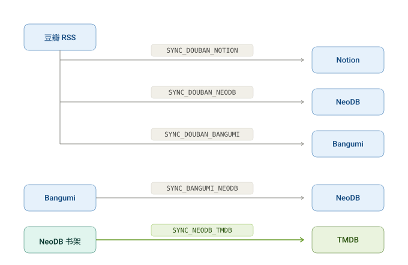

> **阅读分工**：本文件是使用说明与整体结构。平台读写边界、接口依据、数据格式样例、每次运行输出的逐字段契约，见[参考手册](docs/reference.md)。

## 总览

五条链路全部**单向、幂等**：①②③ 同源（豆瓣 RSS，任一豆瓣链路开启时抓取一次），④⑤ 独立读取各自的源。

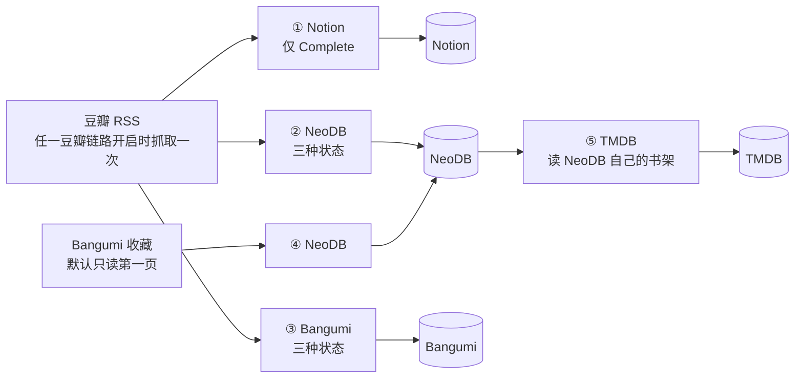

## 快速开始

**GitHub Actions（推荐）**：`sync` 工作流每周一 / 三 / 五 08:00 UTC 自动运行，按仓库配置的开关执行；
手动触发时可勾选 `full_sync`（⑤ 取消单轮上限）或 `bangumi_full_sync`（④ 遍历全部分页）。
每次运行结束后 `review-queue` 工作流自动汇总「待核对名单」，无需本地环境。

**本地运行**：要求 Node.js 20 或以上。

```bash
npm ci
cp .env.example .env          # 填写当前链路所需的 token
npm run verify:all            # 离线：单元测试 + 五项断言脚本
SYNC_DRY_RUN=1 npm run sync   # 空跑，不写任何目标端
```

PowerShell 中设置临时变量：

```powershell
$env:SYNC_DRY_RUN=1; npm run sync
```

确认空跑输出后再正式执行。全量导入：

```bash
npm run sync:bangumi-full      # Bangumi → NeoDB，遍历全部分页
npm run sync:neodb-tmdb-full   # NeoDB → TMDB，取消单轮条数与页数上限
```

## 五条链路

| #   | 源                      | 目标    | 默认 | 写入方式                             |
| --- | ----------------------- | ------- | ---- | ------------------------------------ |
| ①   | 豆瓣 RSS（仅 complete） | Notion  | 关   | 按分类建页，先查库内已有链接         |
| ②   | 豆瓣 RSS（全部状态）    | NeoDB   | 开   | `mergeNeodbMark` 四字段比对后 upsert |
| ③   | 豆瓣 RSS（全部状态）    | Bangumi | 开   | 外链 → 精确同名 → 年份软过滤         |
| ④   | Bangumi 收藏            | NeoDB   | 开   | 四字段合并，可选同步进度             |
| ⑤   | NeoDB 书架              | TMDB    | 关   | 读 `account_states` 后逐字段 diff    |

开关：`SYNC_DOUBAN_NOTION`、`SYNC_DOUBAN_NEODB`、`SYNC_DOUBAN_BANGUMI`、`SYNC_BANGUMI_NEODB`、`SYNC_NEODB_TMDB`。

### ① 豆瓣 RSS → Notion

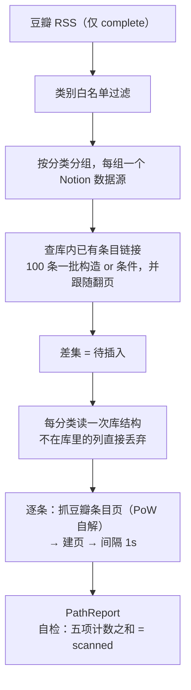

### ② 豆瓣 RSS → NeoDB

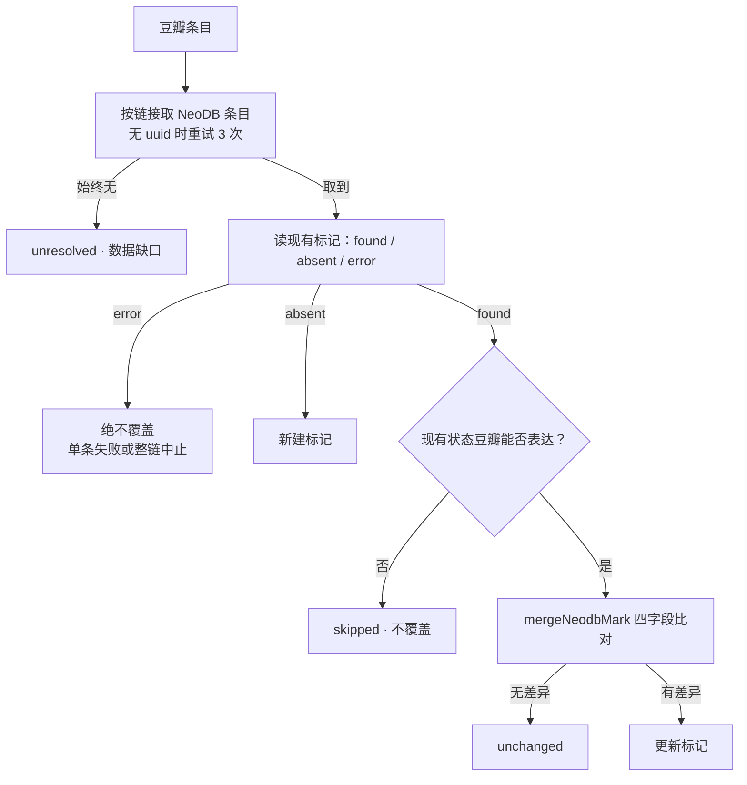

### ③ 豆瓣 RSS → Bangumi

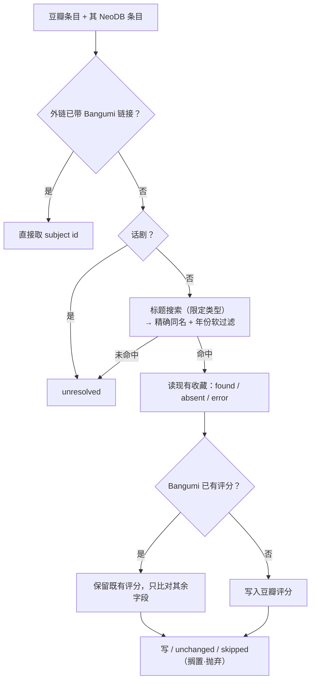

### ④ Bangumi 收藏 → NeoDB

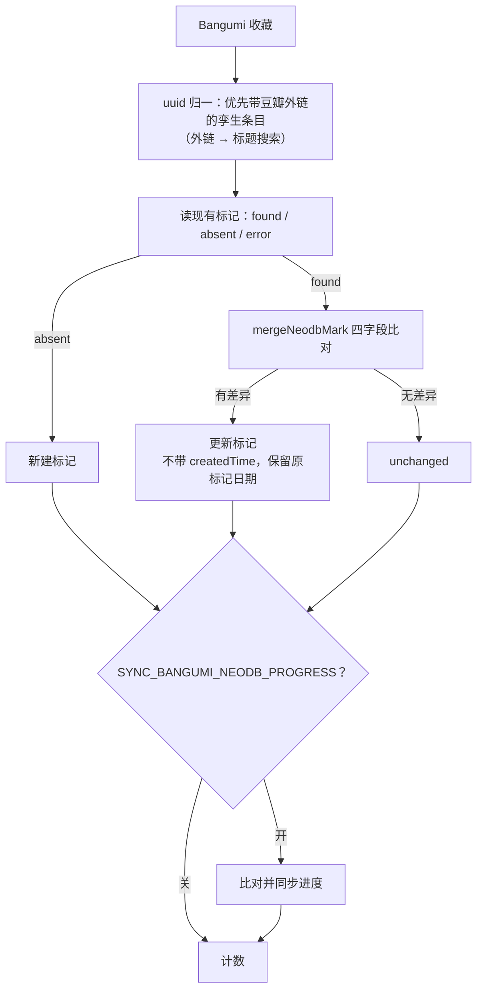

### ⑤ NeoDB 书架 → TMDB

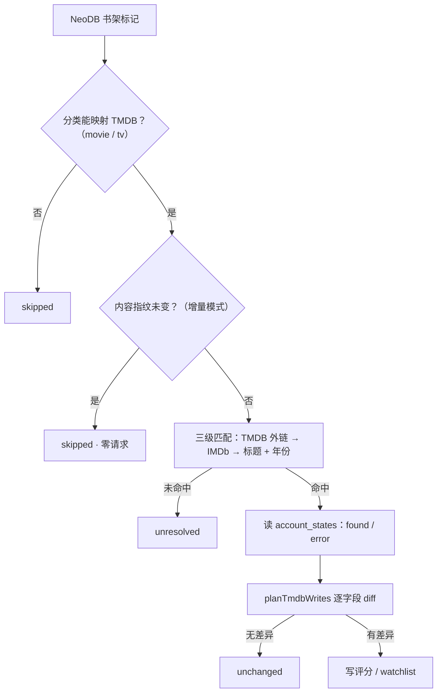

## 同步规则

三条规则适用于所有链路。

1. **先读后写**。目标端读取分 `found`、`absent`、`error` 三态；`error` 时一律不写，遇到 401/403 中止该链路。
2. **只写差异**。字段逐个比较，相同就跳过；`unchanged` 计数不代表出错。
3. **失败记录在报告里**。单条失败不影响同链路的其他条目；凭据失效等常见故障会被折成 `aborted`，其余链路继续。

三态由统一的分类规则判定：

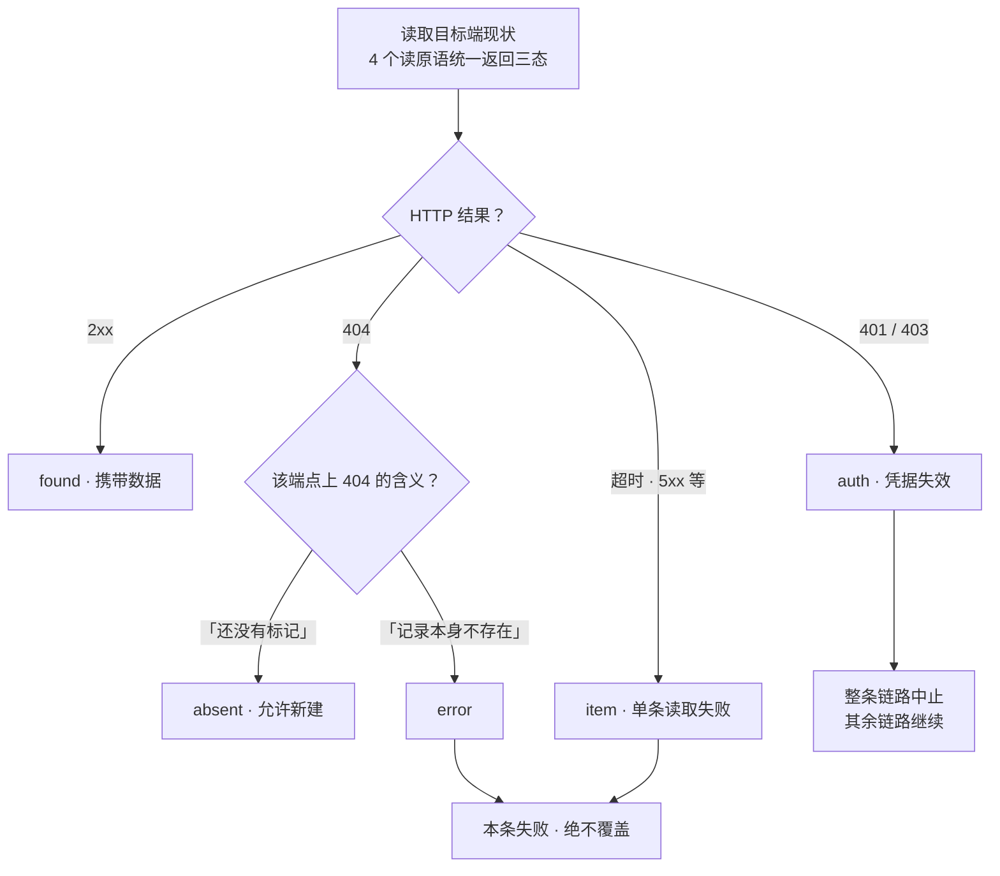

各链路的调用节奏：

| 链路 | 节流                                                                             |
| ---- | -------------------------------------------------------------------------------- |
| ①    | 建页间隔 1s（固定）                                                              |
| ②③④  | NeoDB 间隔 300ms（`NEODB_REQUEST_DELAY_MS`）；③④ 另有 Bangumi 间隔 400ms（固定） |
| ⑤    | TMDB 间隔 300ms（`TMDB_REQUEST_DELAY_MS`）+ 换分类时 NeoDB 间隔 300ms            |

## 结果与退出码

每轮结束后每条链路输出六个计数，`scanned` 是分母：

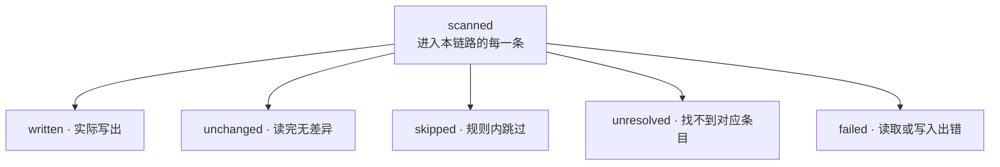

| 计数         | 含义           |
| ------------ | -------------- |
| `scanned`    | 检查过的条目   |
| `written`    | 实际写出       |
| `unchanged`  | 读完无差异     |
| `skipped`    | 规则内跳过     |
| `failed`     | 读取或写入出错 |
| `unresolved` | 找不到目标条目 |

满足 `written + unchanged + skipped + unresolved + failed = scanned`（按条目计，不按字段计）。

任一条路 `aborted` 或 `failed > 0` 时退出码为 1；`SYNC_DOUBAN_REQUIRED=0` 时豆瓣侧的失败标记为 `TOLERATED`，只展示、不参与退出码。

## 待核对名单

同步中「没把握」的条目会沉淀成一份跨轮维护的名单，由 `review-queue` 工作流在每次 `sync` 结束后自动生成：

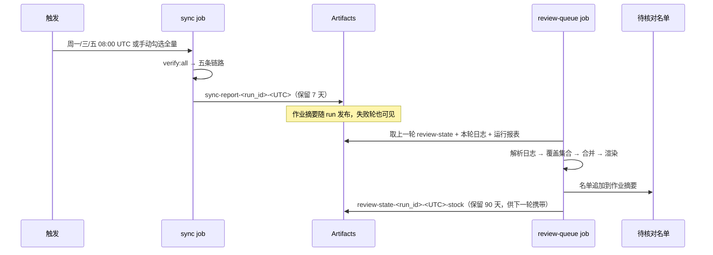

名单按 `链路 → 结果 → 类型 → 状态` 四级分组，条目保留标题、可点链接、reason 与已存在天数；
顶部另有「本轮新增 / 本轮移除 / 观察中」摘要块与「运行报表」对账小节：

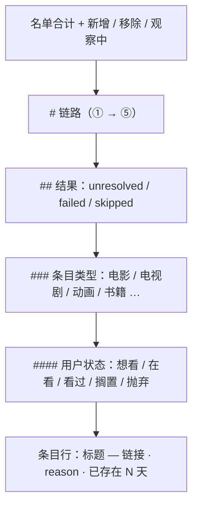

条目的去留由状态机决定——**「没被扫到」永远不等于「修好了」**：

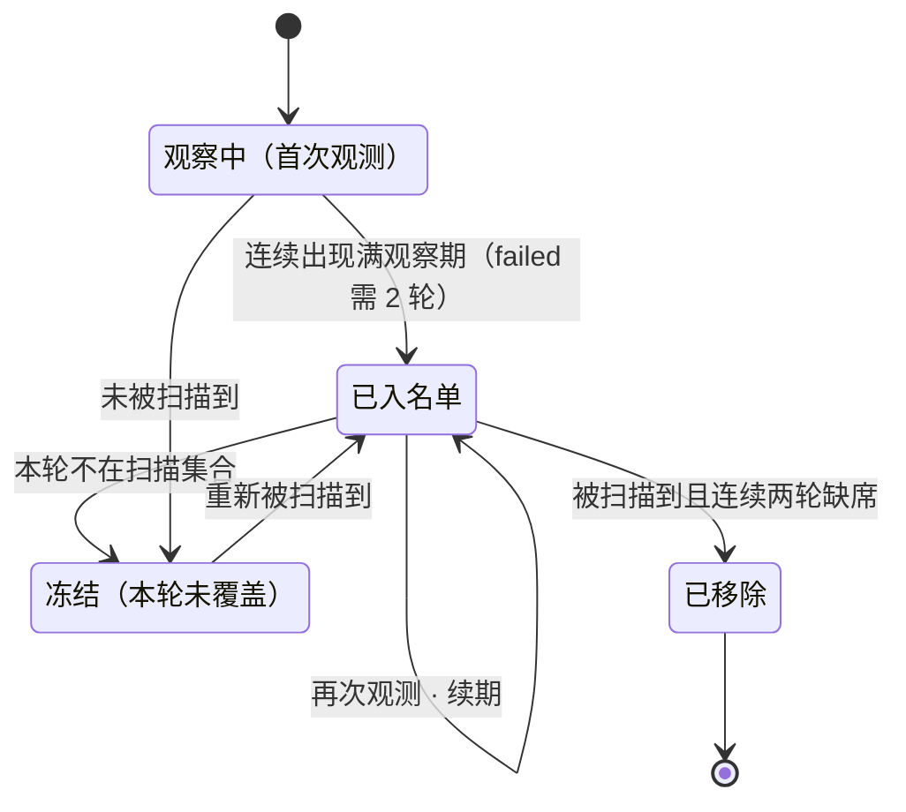

⑤ 的条目以**绝对化的 NeoDB 页面链接**为身份与匹配依据。解析器失效时名单整体冻结并在摘要顶部标红，绝不悄悄清空；
名单同时受运行报表对账：报表计得比日志解析出的多时，摘要会点名差异。
本地运行时未匹配条目另记录到 `.cache/unmatched.json`（CI 上置空不写）。

## 配置

完整变量与默认值见 [`.env.example`](.env.example)。常用项：

| 变量                              | 默认                                 | 说明                                                    |
| --------------------------------- | ------------------------------------ | ------------------------------------------------------- |
| `SYNC_DRY_RUN`                    | `0`                                  | `1` 时只打印计划，不写目标端                            |
| `SYNC_SHELF_TYPES`                | `wishlist,progress,complete,dropped` | ⑤ 处理的书架                                            |
| `SYNC_CATEGORIES`                 | `movie,tv`                           | ⑤ 处理的分类                                            |
| `SYNC_MAX_ITEMS`                  | `50`                                 | ⑤ 每个书架×分类的条目上限（默认 4×2×50=400）            |
| `SYNC_RATING_PROFILE`             | `tmdb_prefer`                        | 评分冲突时保留 TMDB；`neodb_prefer` 用 NeoDB 覆盖       |
| `SYNC_INCREMENTAL`                | `1`                                  | ⑤ 跳过内容未变的条目；CI 固定为 `0`                     |
| `SYNC_DOUBAN_REQUIRED`            | `1`                                  | `0` 时豆瓣失败不参与退出码                              |
| `SYNC_BANGUMI_NEODB_STATUS_GUARD` | `off`                                | `no-downgrade` 时不让 Bangumi 的想看/在读覆盖已看       |
| `SYNC_BANGUMI_NEODB_CREATED_TIME` | `target`                             | `source` / `source-newer` 才用 Bangumi 时间覆盖标记日期 |

注意 `neodb_prefer` 在两处的含义不同：⑤ 的 `SYNC_RATING_PROFILE` 表示用 NeoDB 覆盖 TMDB；②④ 的 `SYNC_*_NEODB_MERGE` 表示保留 NeoDB 已有的非空值。默认的 `neodb_prefer` 是**目标端优先**，只有 `overwrite` 才是源端覆盖。

## 目录结构

```text
src/
  index.ts                  入口，按开关依次执行链路
  sync-config.ts            环境变量解析
  sync-report.ts            控制台汇总
  sync-summary-markdown.ts  作业摘要
  read-guards.ts            读取三态与 401/403 处理
  types.ts                  共享类型与计数
  paths/                    各链路编排
  clients/                  平台客户端
  rules/                    映射、比对、匹配等纯逻辑
  bangumi-to-neodb-full-cli.ts
  neodb-to-tmdb-full-cli.ts
scripts/
  review-queue.mjs          待核对名单生成
  verify-*.ts               离线断言
tests/unit/                 单元测试
docs/reference.md           接口、输出与计数契约
cols.json                   Notion 列名映射
```

分层的依赖方向是单向的：`rules/` 不依赖任何模块（零 I/O、零环境变量），`clients/` 只依赖 `rules/` 与配置，`paths/` 编排两者，入口层只看报告。

| 层     | 模块                        | 职责                                                              |
| ------ | --------------------------- | ----------------------------------------------------------------- |
| 入口   | `index.ts` + 2 个全量 cli   | 按开关调度链路，折叠报告，决定退出码                              |
| 编排   | `paths/`（5 条链路）        | 每条链路的读取 → 比对 → 写入循环，产出 `PathReport`               |
| 客户端 | `clients/`（9 个平台模块）  | HTTP、鉴权、重试、节流；读原语统一返回三态                        |
| 规则   | `rules/`（10 个纯函数模块） | 状态映射、合并与写计划、标题匹配、名单词表                        |
| 支撑   | 配置 · 展示 · 状态          | `sync-config` · `sync-report` + `sync-summary-markdown` · `utils` |
| 翻译   | `read-guards.ts`            | 三态 → 值或异常：auth 中止整链，其余单条失败                      |
| 脚本   | `scripts/`                  | 待核对名单（读日志 + 报表）与离线契约断言                         |

## 已知限制

| 限制                        | 影响                                                      |
| --------------------------- | --------------------------------------------------------- |
| 豆瓣 RSS 每页约 10 条       | 两次运行间新增过多会漏                                    |
| 豆瓣可能拒绝 CI 出口 IP     | Actions 上豆瓣链路可能失败，可设 `SYNC_DOUBAN_REQUIRED=0` |
| Bangumi token 无 refresh    | 过期后 ③④ 返回 401，需重新生成                            |
| 完全单向                    | 源端删除不会传播到目标端                                  |
| TMDB 只承载评分与 watchlist | 短评、进度、图书/音乐/游戏等无法同步                      |
| 默认不全量                  | 老收藏可能长期轮不到，需显式跑全量入口                    |

## 开发

```bash
npm run sync                  # 按开关执行全部链路
npm run typecheck
npm run lint
npm run format:check
npm run verify:all
```

- `tests/unit/` 使用 vitest，覆盖 `paths/` 的接线与规则。
- `scripts/verify-*.ts` 是无框架断言，覆盖映射、解析器、日志与文档契约（`verify:all` = vitest + 五项断言脚本）。
- 新增链路：在 `src/paths/` 新建文件 → `src/index.ts` 调度 → `types.ts` 计数 → 对应测试与断言。

## 文档

- [`docs/reference.md`](docs/reference.md)：平台边界、接口依据、数据格式、运行输出与留档契约。

## 致谢

本项目的想法与技术路线来自 [bambooom/douban-backup](https://github.com/bambooom/douban-backup) 与 [viazure/douban-backup](https://github.com/viazure/douban-backup)，感谢两个项目的作者与贡献者。

## License

MIT
