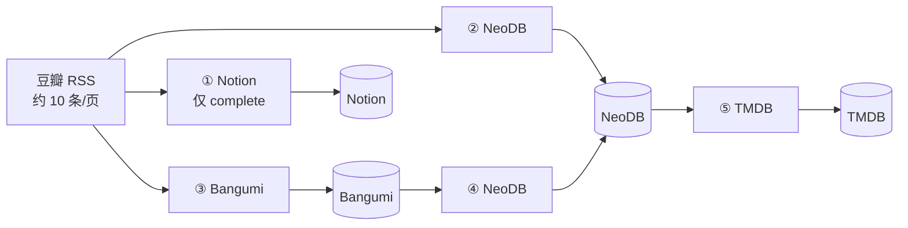
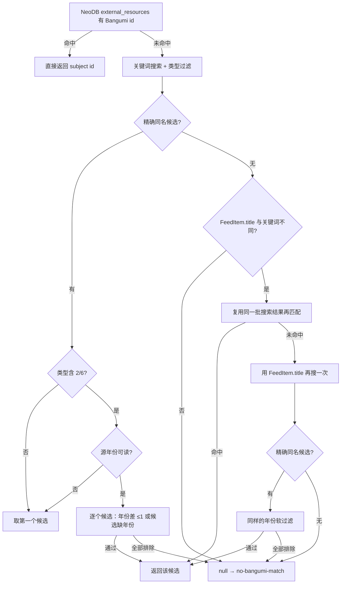
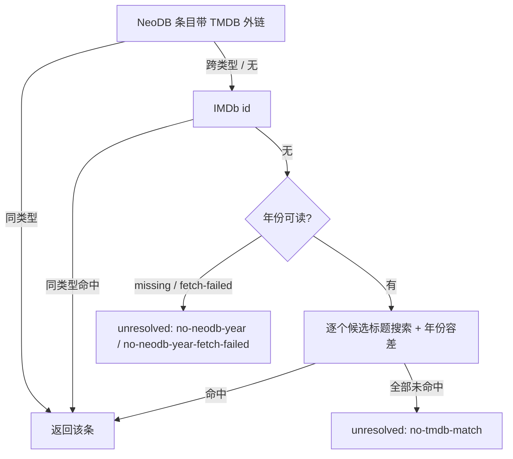
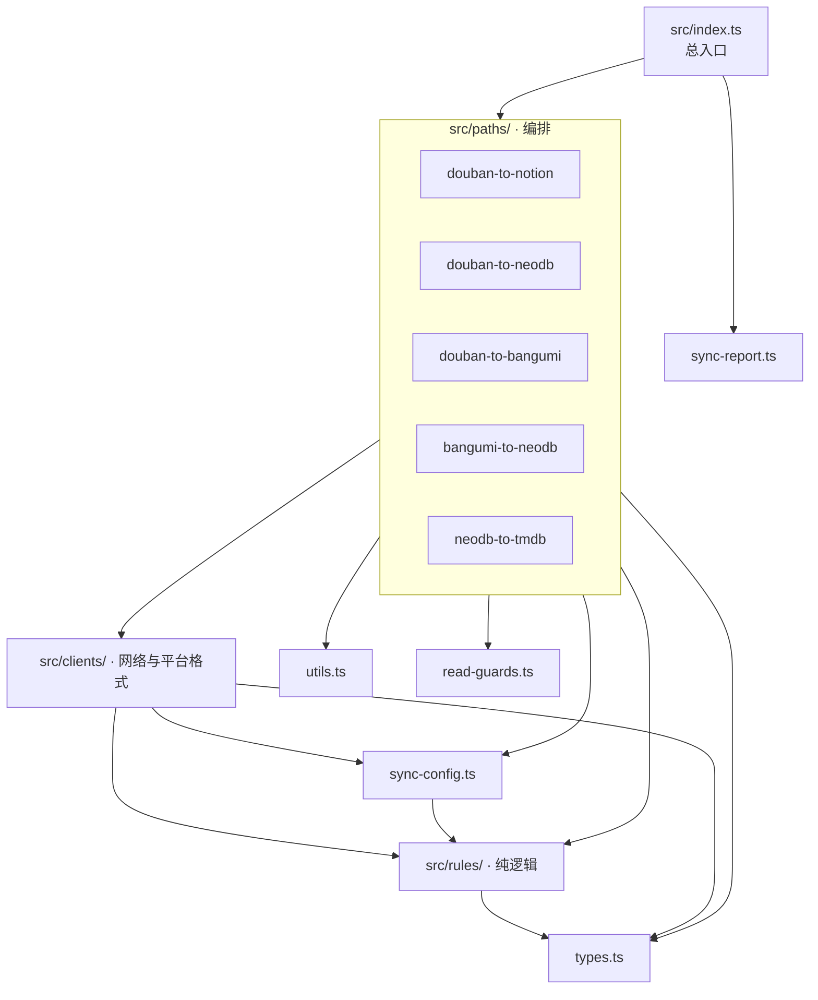

# Audiovisual-Transporter

把豆瓣、Bangumi、NeoDB 的书影音标记，单向、幂等地同步到 Notion / NeoDB / Bangumi / TMDB。
五条链路共用同一套「先读目标端、再逐字段比对、只写差异」的规则，每条链路都用 `PathReport` 记账：
凭据失效、读取失败这类常见故障会被链路自己折算成 `aborted`，后面的链路照常执行（意外异常仍可能截断后续链路，见「结果契约」）。



> 图的事实来源：`src/index.ts` 的调度顺序；`src/paths/*` 的读写目标；`src/clients/*` 的平台客户端。

## 快速开始

1. **选链路**：只开你要的开关；默认只有 ②③④ 开启。

   | 开关                  | 默认 | 链路              |
   | --------------------- | ---- | ----------------- |
   | `SYNC_DOUBAN_NOTION`  | `0`  | ① 豆瓣 → Notion   |
   | `SYNC_DOUBAN_NEODB`   | `1`  | ② 豆瓣 → NeoDB    |
   | `SYNC_DOUBAN_BANGUMI` | `1`  | ③ 豆瓣 → Bangumi  |
   | `SYNC_BANGUMI_NEODB`  | `1`  | ④ Bangumi → NeoDB |
   | `SYNC_NEODB_TMDB`     | `0`  | ⑤ NeoDB → TMDB    |

2. **填凭证**：复制 `.env.example` 为 `.env`，至少填当前开启链路所需的 token。
   完整变量清单（含每项注释）以 [`.env.example`](.env.example) 为准。

3. **本地验证**：

   ```bash
   npm ci
   npm run verify:all   # 离线：vitest + 五个 tsx 校验脚本，不需要网络与凭据
   npm run typecheck
   ```

4. **先空跑**：`SYNC_DRY_RUN=1 npm run sync`（PowerShell 用 `$env:SYNC_DRY_RUN=1; npm run sync`），
   确认计划无误后再去掉该变量。也可以直接写进 `.env`。
   全量导入用 `npm run sync:neodb-tmdb-full` / `npm run sync:bangumi-full`。

## 五条链路

| #   | 源                      | 目标    | 匹配方式                                      | 写入方式                                   |
| --- | ----------------------- | ------- | --------------------------------------------- | ------------------------------------------ |
| ①   | 豆瓣 RSS（仅 complete） | Notion  | 分类 → 数据库；先查库内已有链接               | 逐条建页，失败不影响其他条目               |
| ②   | 豆瓣 RSS（全部状态）    | NeoDB   | 豆瓣链接 → NeoDB 目录条目                     | `mergeNeodbMark` 四字段比对后 upsert       |
| ③   | 豆瓣 RSS（全部状态）    | Bangumi | 外链 → 精确同名 → （动画/真人）年份软过滤     | `resolveBangumiCollectionWrite` 三字段比对 |
| ④   | Bangumi 收藏（分页）    | NeoDB   | Bangumi URL / 标题 → NeoDB 条目（含孪生条目） | 四字段合并；可选同步观看进度               |
| ⑤   | NeoDB 书架（四类）      | TMDB    | TMDB 外链 → IMDb → 标题 + 年份                | 读 `account_states` 后逐字段 diff          |

### 状态对照

| 豆瓣    | NeoDB                         | Bangumi | TMDB                                       |
| ------- | ----------------------------- | ------- | ------------------------------------------ |
| 想看    | `wishlist`                    | 1 想看  | 加入 watchlist                             |
| 在看    | `progress`                    | 3 在看  | 加入 watchlist                             |
| 看过    | `complete`                    | 2 看过  | 有评分 → 写评分并移出 watchlist；无 → 加入 |
| —（无） | `dropped`（只由 ④ 产生）      | 5 抛弃  | 加入 watchlist（与「在看」同义）           |
| —（无） | `progress`（④ 把 4 搁置归入） | 4 搁置  | 加入 watchlist                             |

> 豆瓣没有「搁置 / 弃看」，所以 `dropped` 只可能来自链路④。TMDB 没有「弃看」态，
> ⑤ 只能把它当「还想看」处理；代价是弃看条目与想看无法区分（`docs/decisions.md` §13）。

### ① 豆瓣 → Notion

- 只处理 `complete` 状态的条目；按分类分组后写入对应数据库。
- 先抓取条目标题/图片/短评（`src/clients/douban-subject-page.ts`），再构造 Notion 属性
  （`src/rules/notion-payload.ts`）。
- 建页前先查库内已有链接，避免重复；单条失败记入明细，不终止整条链路。

### ② 豆瓣 → NeoDB

- 用豆瓣链接解析 NeoDB 目录条目，再读现有标记（`getNeodbMark` 三态）。
- `mergeNeodbMark` 比对四个字段：`shelf_type` 永远跟来源；`rating_grade` / `comment_text`
  按 `neodb_prefer` 或 `overwrite`；`visibility` 跟配置。
- 新建和更新都带 `created_time`（取 RSS 条目时间）。

### ③ 豆瓣 → Bangumi



- 年份过滤只对类型 2（动画）/ 6（真人）启用；双方都有年份且差 > 1 年才排除候选。
  任一侧缺年份（含读取失败）一律放行，源年份缺失时连候选详情都不请求。
- 外链命中、书籍 / 音乐 / 游戏、以及话剧的既有行为不变。
- 源码：`src/paths/douban-to-bangumi.ts:338`、`src/clients/bangumi.ts:302`。

### ④ Bangumi → NeoDB

- 常规运行只取第一页（`BANGUMI_COLLECTION_LIMIT`，默认 50）；全量入口会翻完，并用
  `.cache/bangumi-full-sync.json` 记游标，被超时打断后下次接着走。
- 状态映射：1→`wishlist`、3→`progress`、2→`complete`、5→`dropped`、4→`progress`
  （NeoDB 没有搁置态）。
- 类别 `manga` 只收 platform 为「漫画」的书籍：仅当白名单要漫画、又没要 `book` 时才查 platform，
  查不到按条目失败处理（不当作「不是漫画」）；`book` 覆盖全部书籍。
  `SYNC_BANGUMI_NEODB_PROGRESS=1` 时额外同步集/章/曲进度。
- 新建带 `created_time`；更新时刻意不带（Bangumi 的 `updated_at` 不足以可信到覆盖已有日期）。

### ⑤ NeoDB → TMDB



- 外链是唯一不做比较就采信的一级，但必须类型一致（movie 不能落到 tv）。
- IMDb 命中只接受同媒体类型；宁可漏配，不可错配。
- 年份读不到就**不搜索**：`missing` 与 `fetch-failed` 分开留档，避免端点故障看起来像目录缺口。
- 写入前读 TMDB `account_states`；`planTmdbWrites` 只写差异，评分永不删除。
- 书架默认四类，`dropped` 排最后；分类默认 `movie,tv`。
- 源码：`src/paths/neodb-to-tmdb.ts:696`（`resolveTmdbTarget`）、`src/rules/tmdb-mapping.ts:268`
  （`resolveTmdbOperations`）。

## 架构



| 层               | 规则                                                     | 位置                 |
| ---------------- | -------------------------------------------------------- | -------------------- |
| `rules/`         | 纯函数，零 I/O、零 env；所有映射与比对都在这里           | `src/rules/`         |
| `clients/`       | 只负责网络、鉴权、平台线格式；规则回调到 `rules/`        | `src/clients/`       |
| `paths/`         | 编排：过滤、调用、计数、留档；不实现平台细节             | `src/paths/`         |
| `read-guards.ts` | `found/absent/error` → 值 / 异常（401/403 中止整条链路） | `src/read-guards.ts` |
| `sync-config.ts` | 环境变量的唯一集中解析点；打印有效配置                   | `src/sync-config.ts` |

## 结果契约

每条链路返回一个 `PathReport`，入口据此打印汇总并决定退出码。

| 计数         | 含义                                         |
| ------------ | -------------------------------------------- |
| `scanned`    | 本轮检查过的条目                             |
| `written`    | 实际写出的条目                               |
| `unchanged`  | 读完发现无差异                               |
| `skipped`    | 设计内的跳过（分类、重复、指纹、书架开关等） |
| `failed`     | 出错（读取失败、写入失败、单条抛错）         |
| `unresolved` | 找不到目标条目                               |

- 自检等式：`written + unchanged + skipped + unresolved + failed = scanned`。
- `failedItems` / `skippedItems` 的长度必须分别等于 `failed` / `skipped`，不等时汇总会明说。
- 退出码 = 任一条路 `aborted` 或 `failed > 0`；`SYNC_DOUBAN_REQUIRED=0` 时豆瓣 RSS 的
  `aborted` 标为 `TOLERATED`，只展示、不参与退出码。
- **隔离的边界**：豆瓣三链路共用一次 RSS 抓取，也共用 `index.ts` 里的同一个 `try` —— ① 抛出会让
  本轮 ②③ 不执行，② 抛出会让 ③ 不执行；④ 没有外层兜底，它抛出会让 ⑤ 不执行；⑤ 有独立兜底。
  链路内部已把凭据失效等情形转成 `aborted`，所以只有意外异常才会触发上述跳过。

### 读取三态

| 读取结果 | 含义                       | 写入行为                           |
| -------- | -------------------------- | ---------------------------------- |
| `found`  | 目标端明确有记录           | 允许比对与写入                     |
| `absent` | 目标端明确回答「没有」     | 允许新建                           |
| `error`  | 读不到（5xx / 网络 / 401） | **一律不写**；401/403 中止整条链路 |

### 留档与待核对名单

- ②③④⑤ 把未匹配条目 upsert 到 `SYNC_UNMATCHED_LOG`（默认 `.cache/unmatched.json`，CI 中置空），
  按 `source::id` 保留 `firstSeenAt` / `lastSeenAt`；① 不写。跨轮留存只靠待核对名单 artifact。
- ⑤ 的 reason 有三种：`no-tmdb-match`（搜过没有）、`no-neodb-year`（没年份，没搜）、
  `no-neodb-year-fetch-failed`（取年份失败）。
- 跨轮名单由 `scripts/review-queue.mjs` 从日志解析，并用 `sync-report.json` 的
  `PathReport.scannedIds` 决定淘汰：只有「在扫描集合里且本轮没再出现」才计缺席，连续两轮才移除；
  被 `SYNC_MAX_ITEMS` / `NEODB_MAX_PAGES` 截断或未运行的条目不会误删。

## 配置

高频变量如下；**完整清单**（类别白名单、限流、合并策略、留档、书架、全量）及其默认值、
取值语义见 [`.env.example`](.env.example)，它同时就是可直接复制的模板。

| 变量                   | 默认                                 | 说明                                                  |
| ---------------------- | ------------------------------------ | ----------------------------------------------------- |
| `SYNC_DRY_RUN`         | `0`                                  | `1` = 只计算并打印计划，不写任何目标端                |
| `SYNC_SHELF_TYPES`     | `wishlist,progress,complete,dropped` | ⑤ 处理哪些书架；`dropped` 与 `progress` 同义          |
| `SYNC_CATEGORIES`      | `movie,tv`                           | ⑤ 同步哪些 NeoDB 分类                                 |
| `SYNC_MAX_ITEMS`       | `200`                                | ⑤ 单轮处理上限（按进入 TMDB 的条数计）                |
| `SYNC_RATING_PROFILE`  | `tmdb_prefer`                        | 评分冲突：保留 TMDB / `overwrite` 用 NeoDB 覆盖       |
| `SYNC_YEAR_TOLERANCE`  | `1`                                  | ⑤ 标题匹配允许的年份差；无年份则根本不搜索            |
| `SYNC_INCREMENTAL`     | `1`                                  | ⑤ 跳过内容指纹未变的条目；全量模式强制关闭            |
| `SYNC_DOUBAN_REQUIRED` | `1`                                  | `0` = 豆瓣 RSS 失败只标记 `TOLERATED`，不参与退出码   |
| `BANGUMI_FULL_SYNC`    | `0`                                  | `1` = ④ 遍历全部分页（默认只取第一页）                |
| `NEODB_TMDB_FULL_SYNC` | `0`                                  | `1` = ⑤ 取消上限并关闭增量（同样支持 `SYNC_DRY_RUN`） |

> `SYNC_RATING_PROFILE=neodb_prefer` 与 ②④ 的 `SYNC_*_NEODB_MERGE=neodb_prefer` **同名不同义**：
> ⑤ 把它归为 `overwrite`（用 NeoDB 覆盖 TMDB），②④ 则是「保留 NeoDB 已有非空值」。这是最容易配错的一处。

## 排错

| 现象                                  | 常见原因                              | 处理                                                              |
| ------------------------------------- | ------------------------------------- | ----------------------------------------------------------------- |
| 401 / 403，整条链路 `aborted`         | token 过期、权限不足、IP 被风控       | 重新生成 token；豆瓣 403 可先 `SYNC_DOUBAN_REQUIRED=0` 保其他链路 |
| ⑤ 大量 `unresolved`，但标题一个都不列 | 标题进了 `unresolvedTitles`，不打印   | 看 `.cache/unmatched.json` 的 reason；`no-neodb-year` 表示没搜    |
| 汇总说没失败，进程却退出 1            | 有链路 `aborted`，或逐条 `failed > 0` | 看逐链路汇总；`pathHasFailed` 把两者都算失败                      |
| CI 增量不生效                         | runner 是临时的，`.cache/` 不跨轮     | 这是预期；CI 默认 `SYNC_INCREMENTAL=0`                            |
| 豆瓣 RSS 为空                         | feed 窗口约 10 条，可能只是没有新条目 | 看日志是 `No new Douban RSS items` 还是抓取失败                   |
| 重复运行会重复写吗                    | 不会：每条先读现状再 diff             | 若仍重复，检查目标端读取是否返回 `error`（error 不写）            |

## 已知限制

| #   | 限制                             | 现实影响                                     | 缓解                                             |
| --- | -------------------------------- | -------------------------------------------- | ------------------------------------------------ |
| 1   | 豆瓣 RSS 只返回约 10 条          | 两次运行之间新增超过约 10 条会漏             | 每周三次 + 集中标记时手动触发                    |
| 2   | 豆瓣可能按出口 IP 拒绝 CI        | Actions 上整条豆瓣链路可能失败               | 本地跑，或 `SYNC_DOUBAN_REQUIRED=0`              |
| 3   | Bangumi token 会过期且无 refresh | 到期后 Bangumi 链路 401                      | 重新生成并更新 Secret                            |
| 4   | 完全单向                         | 源端撤销 / 删除不会传播到目标端              | 目标端手工清理                                   |
| 5   | 合并档位保护不了状态             | NeoDB 上手工改的状态会被源覆盖               | 关掉对应链路，或把状态改在源端                   |
| 6   | `dropped` 无法与「想看」区分     | 弃看条目会加入 watchlist（不移出、不写评分） | 这是明确取舍；见 `docs/decisions.md` §13         |
| 7   | TMDB 只能承载评分与 watchlist    | 短评、进度、图书/音乐/游戏/播客/演出整类丢失 | 以 NeoDB 为主库                                  |
| 8   | 默认不全量                       | 老游戏 / 老收藏可能一直轮不到                | `BANGUMI_FULL_SYNC=1` / `NEODB_TMDB_FULL_SYNC=1` |

## 开发

```bash
npm run sync                     # 按开关跑全部链路
npm run sync:bangumi-full        # ④ 全量（开关关闭时退出码 1）
npm run sync:neodb-tmdb-full     # ⑤ 全量（开关关闭时退出码 1）
npm run probe:neodb              # 抓一页书架，检查字段
npm run verify:all               # vitest + 五个离线校验脚本
npm run verify:docs              # 单独跑文档契约：env 清单、路径、命令、章节
npm run typecheck                # tsc --noEmit
npm run lint                     # eslint
npm run format:check             # prettier
```

- **测试分层**：`tests/unit/` 用 vitest + `vi.mock` 驱动 `paths/` 的真实接线；`scripts/verify-*.ts`
  是纯断言，覆盖规则、解析器、映射、日志契约与文档契约（env 清单 / README 路径与命令）。
- **改行为先改规则**：状态映射在 `src/rules/tmdb-mapping.ts`，写计划在
  `src/rules/tmdb-write-plan.ts`，两边都有离线断言。
- **日志是契约**：未匹配行的文案被 `scripts/verify-log-contract.ts` 锁定，改动会导致校验失败。
- **新增链路**：在 `src/paths/` 加文件 → `src/index.ts` 调度 → `types.ts` 计数器 →
  `sync-report.ts` 汇总；平台细节留在 `clients/`。

## 文档地图

| 文档                                           | 内容                                             |
| ---------------------------------------------- | ------------------------------------------------ |
| [`.env.example`](.env.example)                 | 全部环境变量与默认值，可直接复制为 `.env`        |
| [`docs/reference.md`](docs/reference.md)       | 平台接口依据、数据格式、运行输出、留档与计数契约 |
| [`docs/review-queue.md`](docs/review-queue.md) | 待核对名单的跨轮维护与淘汰规则                   |
| [`docs/decisions.md`](docs/decisions.md)       | 关键取舍与事故记录（为什么这样做）               |
| [`docs/history/`](docs/history/)               | 历史评审与迁移对照（不作为现行事实）             |

## License

MIT
