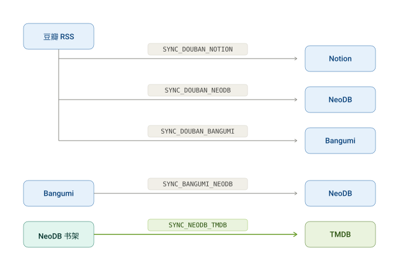
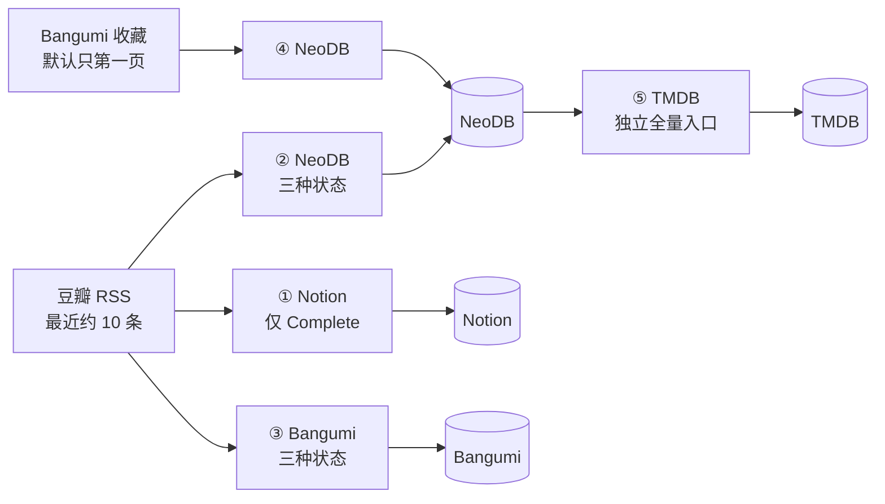
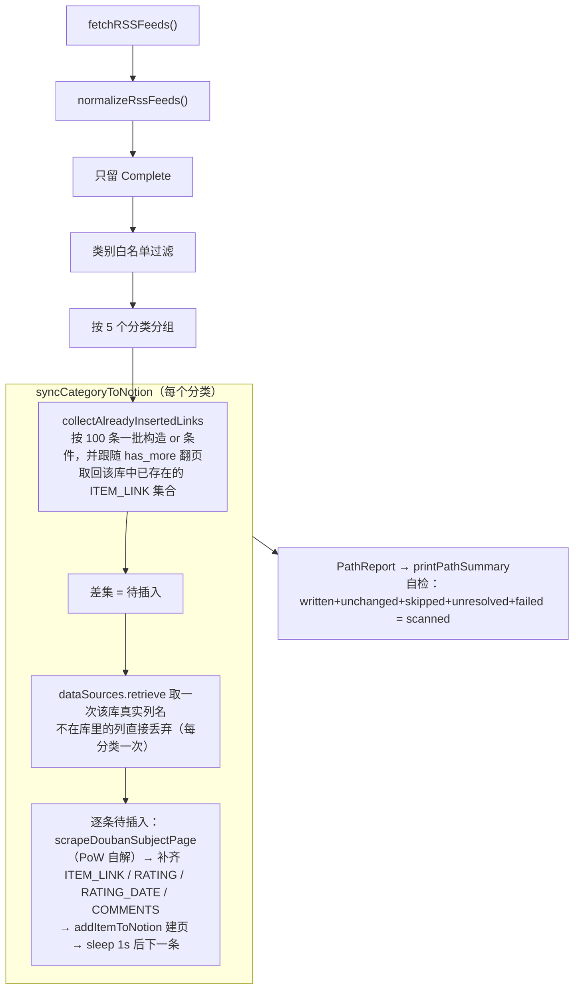
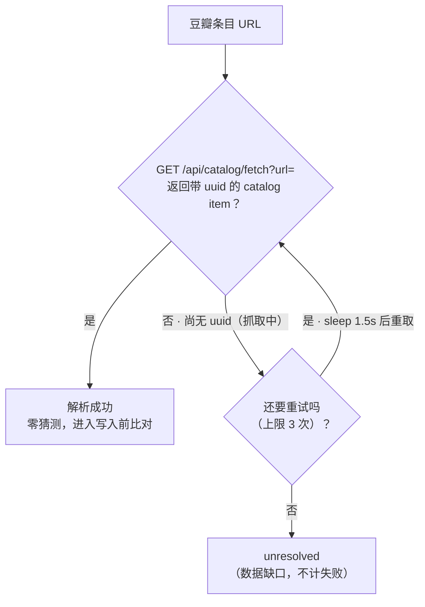
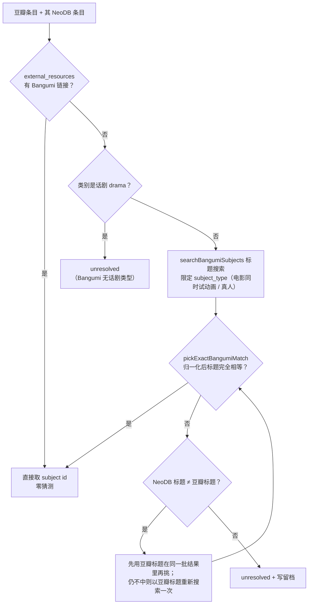
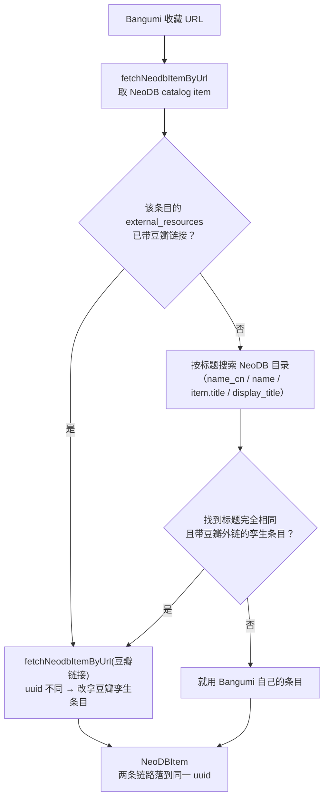
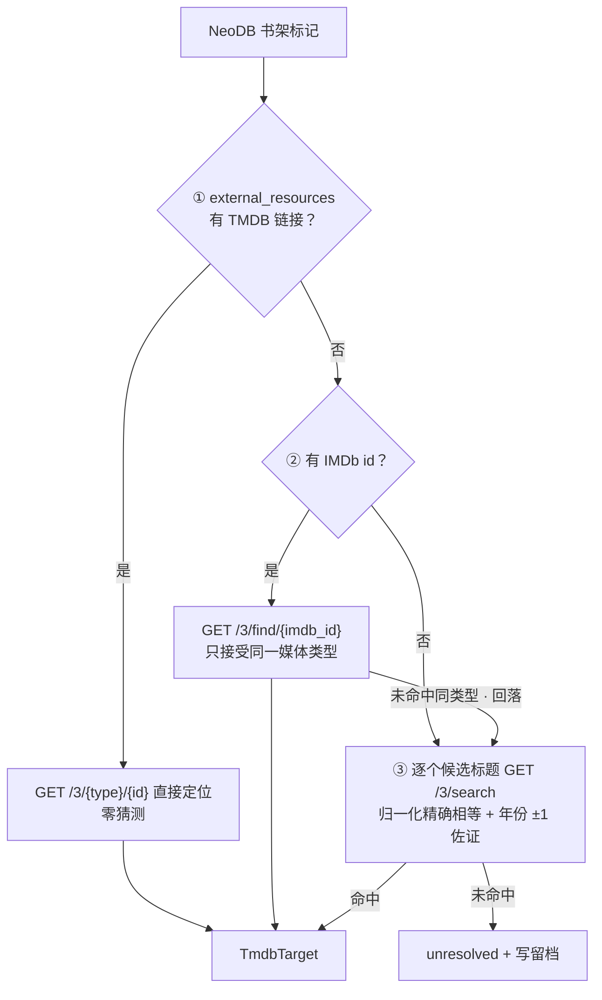
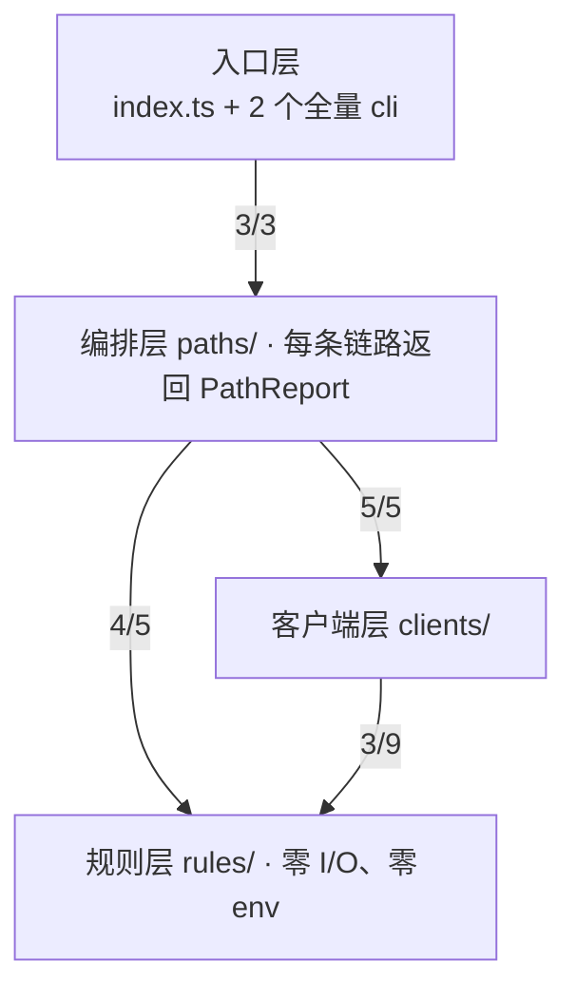

# Audiovisual-Transporter

个人书影音收藏的**跨平台归档与迁移**工具。把豆瓣、Bangumi、NeoDB、TMDB 四个平台的收藏标记打通：豆瓣的记录向外留档，Bangumi 的收藏回灌 NeoDB，NeoDB 的书架镜像到 TMDB。

TypeScript 编写，`tsx` 直跑，无需构建。技术基础延续 [douban-backup](https://github.com/viazure/douban-backup) 的全部能力，并新增 **NeoDB 书架 → TMDB** 单向同步。



> **阅读分工**：本文件是使用与设计说明。平台读写边界、接口依据、数据格式样例、每次运行的输出含义，见[参考手册](docs/reference.md)。

---

## 目录

| 我要…                        | 看这里                                                |
| ---------------------------- | ----------------------------------------------------- |
| 先跑起来                     | [快速开始](#快速开始) · [配置](#配置)                 |
| 搞懂每条链路                 | [五条链路](#五条链路) · [同步范围](#同步范围)         |
| 搞懂「已有数据会不会被覆盖」 | [目标端已有内容时怎么处理](#目标端已有内容时怎么处理) |
| 排错                         | [常见问题](#常见问题) · [已知限制](#已知限制)         |
| 查接口与输出                 | [参考手册](docs/reference.md)                         |

---

## 概述

**它解决什么问题**：豆瓣是中文书影音记录的主要入口，但数据不在你手里。这个工具做两件事——

1. **留档**：把豆瓣的收藏导出到 Notion（结构化表格）、NeoDB（开放社交平台）、Bangumi（动画/漫画强项），任一平台出问题都不至于全部丢失。
2. **打通**：把 NeoDB 的书架状态镜像到 TMDB，让 TMDB 上的观影记录与评分自动跟随 NeoDB。

### 数据流



- **执行顺序固定 ① → ② → ③ → ④ → ⑤，全部单向**。② 与 ④ 写同一批 NeoDB 标记，④ 后执行 —— 同轮内 ④ 是 NeoDB 的最后写入者。
- ①②③ **同源**（同一份归一化后的 `FeedItem[]`），④ 独立读 Bangumi 收藏，⑤ 独立读书架且有不带参数的专用入口。
- 每张图的匹配细节见[五条链路](#五条链路)；「已有数据时谁生效」见[目标端已有内容时怎么处理](#目标端已有内容时怎么处理)。

### 五条链路

| #   | 链路               | 开关                  |  默认  | 说明                                            |
| --- | ------------------ | --------------------- | :----: | ----------------------------------------------- |
| 1   | 豆瓣 RSS → Notion  | `SYNC_DOUBAN_NOTION`  |   关   | 抓取详情页建页，仅处理「看过/听过/读过/玩过」   |
| 2   | 豆瓣 RSS → NeoDB   | `SYNC_DOUBAN_NEODB`   | **开** | 写入标记、评分、短评（不写进度）                |
| 3   | 豆瓣 RSS → Bangumi | `SYNC_DOUBAN_BANGUMI` | **开** | 写入收藏标记（标题精确匹配）                    |
| 4   | Bangumi → NeoDB    | `SYNC_BANGUMI_NEODB`  | **开** | 反向补齐 NeoDB，支持全量同步                    |
| 5   | **NeoDB → TMDB**   | `SYNC_NEODB_TMDB`     |   关   | 书架镜像到 TMDB，见[链路 5](#链路-5neodb--tmdb) |

> 开关取值 `1`/`true`/`yes`/`on` 为开启；`0`/`false`/`off`/留空为关闭。关闭全部 `Douban→*` 时会跳过拉取豆瓣 RSS。**上表是全仓开关信息的唯一出处**。

### 状态对照

| 豆瓣状态词                | 中间状态 | NeoDB `shelf_type` | Bangumi collection type | TMDB 操作（链路⑤，经 NeoDB）                              |
| ------------------------- | -------- | ------------------ | ----------------------- | --------------------------------------------------------- |
| 看过 / 读过 / 玩过 / 听过 | Complete | `complete`         | 2 看过                  | 有评分 → 写评分 + 移出 watchlist；无评分 → 加入 watchlist |
| 在看 / 在读 / 在玩 / 在听 | Progress | `progress`         | 3 在看                  | 加入 watchlist（TMDB 无「在看」态）                       |
| 想看 / 想读 / 想玩 / 想听 | Wishlist | `wishlist`         | 1 想看                  | 加入 watchlist                                            |
| （豆瓣没有）              | Dropped  | `dropped`          | 5 抛弃                  | **跳过**，不做任何操作                                    |
| （豆瓣没有）              | —        | —                  | 4 搁置                  | 反向映射时归入 `progress`（NeoDB 无搁置态）               |

> 豆瓣没有「弃看」状态，所以链路②**不会写入** `dropped`；Bangumi 的第 4、5 类**只会由反向链路④产生**。

### 关键数字

| 项                    | 值                 | 说明                                                          |
| --------------------- | ------------------ | ------------------------------------------------------------- |
| 同步链路              | **5 条**           | 全部**单向、幂等**；①②③ 同源（豆瓣 RSS），④⑤ 独立             |
| `src/` 文件           | **28 个**          | `clients/` 9 · `rules/` 7 · `paths/` 5 · 顶层 7               |
| 离线断言              | **320 条 + 19 例** | `npm run verify:all`（vitest 与四个校验脚本），不需网络与凭据 |
| 环境变量              | **52 个**          | 用户可配置；另有 2 个 CI 注入变量。名称属于对外接口，不改名   |
| `process.exit()`      | **0 处**           | 无实际调用；失败一律走 `PathReport` → 退出码                  |
| 硬编码 `neodb.social` | **1 处**           | 仅 `sync-config.ts` 的默认值；全部请求走 `NEODB_BASE_URL`     |

### 三条设计原则

- **幂等** — 重复运行任意多次，结果一致。每条记录先读目标平台现状，逐字段比对，不需要的写操作一个都不发。
- **保留既有数据** — NeoDB 无评分时**绝不清除** TMDB 上已有的评分。删除会抹掉你手写的数据。
- **宁可漏配，不可错配** — 找不到精确匹配的条目直接跳过并记录，绝不「猜最接近的那个」。

### 与 douban-backup 的关系

|          | douban-backup           | 本项目                                                           |
| -------- | ----------------------- | ---------------------------------------------------------------- |
| 链路数   | 4 条                    | **5 条**（+ NeoDB → TMDB）                                       |
| 数据流向 | 豆瓣/Bangumi → 其他平台 | 增加平台之间的横向同步                                           |
| 代码关系 | —                       | 行为延续；代码经模块化重构（分层 / 拆文件 / 改名），并追加新模块 |

> **血缘**：[bambooom/douban-backup](https://github.com/bambooom/douban-backup) 是原版（豆瓣 → Notion / NeoDB），[viazure/douban-backup](https://github.com/viazure/douban-backup) 是增加了 Bangumi 功能的 fork——本项目的 Bangumi 链路即来自这一支。Bangumi 客户端的默认 UA 仍标识上游项目（`clients/bangumi.ts`，可用 `BANGUMI_USER_AGENT` 覆盖）；这是**刻意保留的运行时值**。

如果不需要 TMDB，把 `SYNC_NEODB_TMDB` 保持为 `0`，四条豆瓣/Bangumi 链路的行为与 douban-backup 一致。

---

## 快速开始

### 1. 决定开哪条链路

五条链路**各自独立开关、互不依赖**——开哪条只填哪条需要的参数，其余设为 `0`。

- **开箱即用的三条**（默认开）：豆瓣 → NeoDB、豆瓣 → Bangumi、Bangumi → NeoDB
- **需要显式开启的两条**（默认关）：豆瓣 → Notion、NeoDB → TMDB
- 三条 `Douban→*` 全关时不会拉豆瓣 RSS，`DOUBAN_USER_ID` 可以不填

### 2. 取凭证

| 凭证                                               | 需要条件                | 获取方式                                                               |
| -------------------------------------------------- | ----------------------- | ---------------------------------------------------------------------- |
| `NEODB_API_TOKEN`                                  | **所有链路**的基础      | 登录你的实例 → `/developer/` → Authorize                               |
| `DOUBAN_USER_ID`                                   | 开 `Douban→*`           | 豆瓣主页 URL 里的数字：`douban.com/people/1234567/` → `1234567`        |
| `BANGUMI_ACCESS_TOKEN`                             | 开 Bangumi 相关         | bangumi.tv → 个人设置 → 开放接口。**会过期且无 refresh**               |
| `TMDB_API_KEY`                                     | 开 `SYNC_NEODB_TMDB`    | themoviedb.org → Settings → API → "API Key (v3 auth)"                  |
| `TMDB_ACCESS_TOKEN` 或 `TMDB_SESSION_ID`           | 同上，写权限二选一      | 前者取 "API Read Access Token"（user-scoped 可直接写）；后者走三步授权 |
| `NOTION_TOKEN`                                     | 开 `SYNC_DOUBAN_NOTION` | Notion Integration Token                                               |
| `NOTION_{MOVIE,MUSIC,BOOK,GAME,DRAMA}_DATABASE_ID` | 同上，不导某类就留空    | Notion 打开该库 → URL 中 `?v=` 前的 32 位字符串                        |

> Notion 数据库的**列名与类型必须与项目根目录的 `cols.json` 一致**，否则写入会失败。

### 3. 填配置

```bash
git clone <your-repo-url> Audiovisual-Transporter
cd Audiovisual-Transporter
npm ci
cp .env.example .env      # Windows: copy .env.example .env
```

编辑 `.env`。全部变量与默认值见[配置](#配置)；`.env.example` 里每个变量都带注释。

### 4. 本地验证

```bash
npm run verify:all           # 离线自测：19 个路径测试 + 320 条断言，不联网
SYNC_DRY_RUN=1 npm run sync  # 空跑：只打印计划，不写任何数据
npm run sync                 # 正式同步全部链路
```

建议按顺序执行，尤其是**先空跑再实跑**。只跑单条链路的**全量**入口有两个：`npm run sync:neodb-tmdb-full`（链路⑤）与 `npm run sync:bangumi-full`（链路④）——两者都**取消常规上限**。只想跑某条链路的常规模式，用 `npm run sync` 配合开关（例如 `SYNC_NEODB_TMDB=0` 跳过链路⑤）。

### 5. 部署到 GitHub Actions

配置位置：仓库 → **Settings → Secrets and variables → Actions**。凭证放 **Secrets**（共 12 个），其余放 **Variables**（共 37 个）。

> 37 = 5 个路径开关 ＋ 下面配置章六组表里的 32 个（含 `SYNC_DOUBAN_REQUIRED`）。

**Secrets 清单（12 个）**

```
NEODB_API_TOKEN          DOUBAN_USER_ID           BANGUMI_ACCESS_TOKEN
TMDB_API_KEY             TMDB_ACCESS_TOKEN        TMDB_SESSION_ID
NOTION_TOKEN             NOTION_MOVIE_DATABASE_ID NOTION_MUSIC_DATABASE_ID
NOTION_BOOK_DATABASE_ID  NOTION_GAME_DATABASE_ID  NOTION_DRAMA_DATABASE_ID
```

**触发方式**

- **定时**：每周一、三、五 08:00 UTC（`cron: '0 8 * * 1,3,5'`）。三次而非一次，是因为豆瓣 RSS 只保留约 10 条——一周一次可能在集中标记时漏掉周初的条目。这**只是缩小**丢失窗口，不是消除：两次运行之间新增超过约 10 条仍会丢。
- **手动**：`workflow_dispatch`，两个互不影响的复选框，任一勾选都会把超时预算从 60 分钟提到 180 分钟：
  - `full_sync` → 本次 `NEODB_TMDB_FULL_SYNC=1`（取消链路⑤的两道单轮上限、关闭增量）。
  - `bangumi_full_sync` → 本次 `BANGUMI_FULL_SYNC=1`（链路④ 从「只取第一页」改为遍历全部页）。两种「全量」不是一回事：④ 没有条目上限可取消、也没有增量缓存可关，它本来每轮都重读并逐条比对，这项只决定**走完多少书架**。
  - 两个复选框都只对**本次**运行生效；仓库 Variables 里的同名值只作为兜底（长期全量仍可用 Variables，但一次性全量不必再去改一个会残留的开关）。
  - ⚠️ ④ 的全量**没有条目上限**，也不会断点续跑：几千条收藏可能吃满 180 分钟预算，且 `concurrency` 是 `cancel-in-progress: false`，这期间到点的定时运行会**排队**而不是取消。

> ⚠️ **变量只有在工作流里被引用才会生效**。GitHub 上设了 Variable 但 `sync.yml` 没声明，程序读到的仍是空值。
>
> ⚠️ **`SYNC_INCREMENTAL` 在 CI 中默认 `0`**：runner 是临时环境，`.cache/sync-state.json` 不跨次保留。退回依赖目标端「读后比对」，行为安全，只是多几次读请求。

工作流本身还有三道保险：`permissions: contents: read`（最小权限）、`concurrency`（不让两次同步重叠，`cancel-in-progress: false`——中断一次做到一半的同步比排队更糟）、`timeout-minutes`（常规 60 / 手动全量 180）；并且在 `npm run sync` **之前**先跑 `npm run verify:all`——规则若被改坏，会在写入任何数据之前拦下这一轮。

---

## 五条链路

### 通用约定

- **匹配原则**：优先使用平台之间已有的 ID 链接（零猜测），其次才做标题精确匹配——匹配不到就跳过并记录，绝不写到「看起来最像」的条目上。
- **类别过滤**：每条链路都能配类别白名单；填了值却**无可识别类别**时，该链路拒绝同步任何条目（fail-closed），避免拼写错误演变成意外全量写入。
- **异常隔离**：单条失败不中断整批；豆瓣链路整体失败也不会挡住后面的 Bangumi → NeoDB。

### 链路 1：豆瓣 RSS → Notion

默认关。五条链路里机制最特殊的一条：不做匹配、直接追加，且要抓取豆瓣详情页。

**前置过滤**：只处理 `Complete` 状态（看过 / 读过 / 玩过 / 听过）。在看、想看这类半途状态不建页面——因为没有「完成日期」可填。

**来源 → Notion 属性**

| 来源           | Notion 属性                                           | 说明                                         |
| -------------- | ----------------------------------------------------- | -------------------------------------------- |
| 标题           | 各库 TITLE 属性                                       | 电影 / 音乐 / 图书 / 游戏 / 话剧共五个数据库 |
| 海报 / 封面    | `POSTER` / `COVER`                                    | 豆瓣图（文件属性）                           |
| 评分（1–5 星） | `RATING`                                              | 多选属性，保留原始星数                       |
| 评分日期       | `RATING_DATE`                                         | 即条目完成时间；缺失则留空不写               |
| 短评           | `COMMENTS`                                            | 富文本，超 2000 字符截断                     |
| 条目链接       | `ITEM_LINK`                                           | 豆瓣 URL                                     |
| 通用元数据     | `YEAR` `GENRE` `IMDB_LINK` `RELEASE_DATE`             | 从豆瓣详情页抓取                             |
| 电影专属       | `DIRECTORS` `SCREENWRITERS` `ACTORS`                  | 导演 / 编剧 / 演员（≤5 人）                  |
| 图书专属       | `WRITER` `PUBLISHING_HOUSE` `ISBN` `PUBLICATION_DATE` | 作者 / 出版社 / ISBN / 出版日期              |
| 音乐专属       | `MUSICIAN`                                            | 音乐人                                       |

> 属性名与类型由 **`cols.json`** 定义，你的 Notion 数据库必须与之一致。写入时遍历 `clients/notion.ts` 的 `NOTION_COLUMN_TYPES`（类型上已排除 `NAME`），**不依赖 JSON 键顺序**；不在库里的列会在写入前被丢弃。

**执行流程**（箭头 = 执行顺序，不是 import 方向）



**去重的两个要点**（单次查询做不到，所以有 `collectAlreadyInsertedLinks`）：

1. **分批构造过滤条件**——Notion 对单个 `or` 的子句数量有上限，条目按 100 条一批发送；
2. **跟随分页**——查询响应是分页的，只读第一页会让后面几页的条目看起来「尚未插入」，从而被重复创建。

> ⚠️ 查询用 `url.contains(item.id)`（豆瓣数字 id 子串），判等却用**完整 URL 全等**（`found.has(item.link)`）。这是链路①唯一会重复建页的缺口，详见[已知边界](#已知边界)。

### 链路 2：豆瓣 RSS → NeoDB

默认开。官方文档：[NeoDB 开发者页面](https://neodb.social/developer/)

**共同前置处理**（链路②③共用）：

1. 用 `DOUBAN_USER_ID` 拉取豆瓣 RSS（三条全关时跳过）
2. 解析状态前缀（`看过` `在看` `想看` `读过` `在听` `玩过` …），归一为 Complete / Progress / Wishlist——三种状态两条链路都处理
3. 按该链路的类别白名单过滤（`SYNC_DOUBAN_*_CATEGORIES`）
4. 评分与短评写法相同：豆瓣 1–5 星 ×2 得 1–10（NeoDB `rating_grade` / Bangumi `rate`），短评原样写入

**匹配级联**（把豆瓣条目交给 NeoDB 自己解析；解析中的抓取会轮询重试）



> 请求本身抛错（网络 / 鉴权）时走同一条落点：`fetchNeodbItemByUrl` 的 catch 直接返回 `null`，上游按未解析跳过。

**逐条同步**（`paths/douban-to-neodb.ts` 的 `syncFeedItemToNeodb`）：

1. 解析不出 NeoDB 条目 → `unresolved`（数据缺口，不是错误，不让 CI 变红）
2. 读现有标记；现有状态是豆瓣表达不了的（`dropped`）→ **跳过不覆盖**
3. `mergeNeodbMark` 按 `SYNC_DOUBAN_NEODB_MERGE` 合并：状态永远跟随来源；`neodb_prefer`（默认）下 NeoDB 已有非空评分/短评予以保留
4. `markNeodbItem` 写入；`post_to_fediverse` 固定 `false`，同步永不发联邦帖
5. 条间等待 `NEODB_REQUEST_DELAY_MS`

### 链路 3：豆瓣 RSS → Bangumi

默认开。前置处理（状态归一、类别白名单、星级换算）与链路②共用，见[上节](#链路-2豆瓣-rss--neodb)。官方文档：[Bangumi API](https://bangumi.github.io/api/) · [个人令牌页面](https://next.bgm.tv/demo/access-token)

**匹配级联**（两级递进，越靠前越零猜测）



> 第二级**只认精确匹配**：搜索结果与候选关键词归一化后必须完全相等。换标题重搜只会发生在一级落空、且 NeoDB 标题与豆瓣条目标题确实不同的时候。

**类别限制**：话剧（drama）在 Bangumi 没有对应类型，只有 NeoDB 上已存在 Bangumi 链接时才会同步。

**写入前比对**：先读现有收藏，`type` / `rate` / `comment` 三字段相同则不写；目标端已是「搁置 / 抛弃」时**保留不覆盖**。未匹配 → `unresolved` 并写留档。

**评分不覆盖**：Bangumi 侧已有评分（`rate > 0`）时该评分被保留，豆瓣星级只用来填补空评分。判别与幂等由纯函数 `resolveBangumiCollectionWrite` 完成（`src/rules/bangumi-neodb.ts`）——「无差异」也按**保留后的**评分算，否则「Bangumi 8 分、豆瓣 6 分」会每轮被判为有差异而反复重写。副作用：豆瓣侧的改分不再传播到 Bangumi，要改就去 Bangumi 改（日志打印 `Bangumi keeps existing rate`）。

### 链路 4：Bangumi → NeoDB

默认开。

**匹配级联**（`resolveNeodbItemForBangumiUrl()`，四级，越靠前越对齐）



> 第三级的标题搜索**先按类别查一遍、找不到再不限类别查一遍**；候选取 Bangumi 的 `name_cn` / `name` 与 NeoDB 的 `title` / `display_title`，全部要求归一化后完全相等。

**为什么要这样对齐**：让 Bangumi → NeoDB 与豆瓣 → NeoDB **落在同一个 NeoDB 条目上**。否则同一部作品会在两个 uuid 下各存一份标记，你在 NeoDB 上会看到重复条目。

**字段映射**

| Bangumi 侧                 | NeoDB 侧       | 换算说明                                                                |
| -------------------------- | -------------- | ----------------------------------------------------------------------- |
| collection type            | `shelf_type`   | 见[状态对照](#状态对照)；搁置(4) 折叠为 `progress`，抛弃(5) → `dropped` |
| rate                       | `rating_grade` | 直接对应（同为 1–10）                                                   |
| comment                    | `comment_text` | 原样写入                                                                |
| `ep_status` / `vol_status` | progress       | 见下方进度映射                                                          |
| （无对应字段）             | `visibility`   | 由 `NEODB_VISIBILITY` 指定                                              |

**进度映射**（仅 `SYNC_BANGUMI_NEODB_PROGRESS=1` 时执行。这张表只讲**进度**，不代表类目支持范围）

| Bangumi subject_type | 类别        | NeoDB 进度类型 | 取值来源                           |
| -------------------- | ----------- | -------------- | ---------------------------------- |
| 2 / 6                | 动画 / 真人 | `episode`      | `ep_status`                        |
| 1                    | 书籍        | `chapter`      | `vol_status`，为空则用 `ep_status` |
| 3                    | 音乐        | `track`        | `ep_status`                        |
| 4                    | 游戏        | —              | **跳过进度**（标记照常同步）       |

> **游戏是完整支持的一类**：`game` 既在类别白名单里，也会映射成 `subject_type=4` 参与查询；标记、评分、短评、状态全部照常同步。只有**进度**不适用——Bangumi 的 `ep_status` 按官方 API 说明「只能用于修改书籍条目进度」，因此规则显式返回 `null`，开启进度同步时会打印 `NeoDB progress not applicable to game`。
>
> 若某些**较早标记**的游戏一直没同步到，通常不是类目问题，而是默认只取**第一页 50 条**收藏 —— 见[同步范围](#同步范围)，用 `BANGUMI_FULL_SYNC=1` 或 `npm run sync:bangumi-full` 跑一次即可补齐。

**本链路特有的异常处理**

- 进度类型与 NeoDB 条目类别不匹配时**不发请求**（例如给 movie 发 `episode` 会被 NeoDB 以 400 拒绝）
- 零进度不发送，**不会清空**既有进度
- 类别白名单只含 `manga` 不含 `book` 时，非漫画书籍**逐条**跳过（这类条目不视为未解析）
- 分页请求失败（401 / 网络 / 限流）→ 告警并**停止本趟遍历**，不会被误判为「没有更多收藏」

### 链路 5：NeoDB → TMDB

默认关。官方文档：[TMDB API](https://developer.themoviedb.org/docs)

**匹配级联（三级，越靠前越精确）**



> 上图只是**匹配级联**。完整链路在匹配之前还有两道**零成本闸门**：先按 `NEODB_CATEGORIES_WITHOUT_TMDB`（图书 / 音乐 / 游戏 / 播客 / 演出）做类别门控，TMDB 根本不存在的类别直接跳过、不发一个请求；再过内容指纹（`SYNC_INCREMENTAL`），未变化的条目在匹配前就返回。匹配成功之后才是 `account_states` 读后 diff。
>
> 第三级按 `display_title` → `title` → `localized_title` 的次序逐个候选（同名作品、译名差异、翻拍让它成为最容易错配的一级），所以只接受**精确匹配**；IMDb 命中也只接受**同一媒体类型**——一个 IMDb id 可能同时解析出电影与剧集，错配比漏配危害大。

**状态映射规则**（权威定义在 `src/rules/tmdb-mapping.ts` 的 `resolveTmdbOperations()`，改行为只改这里）

| NeoDB 状态      | 条件               | TMDB 操作                           | TMDB 能否承载                           |
| --------------- | ------------------ | ----------------------------------- | --------------------------------------- |
| `wishlist` 想看 | —                  | 加入 watchlist                      | ✅ 完整承载                             |
| `progress` 在看 | —                  | 加入 watchlist（TMDB 无「在看」态） | ⚠️ 与「想看」无法区分                   |
| `complete` 看过 | `rating_grade > 0` | **写入评分** ＋ **移出 watchlist**  | ✅ 评分是 TMDB 唯一能表达「看过」的方式 |
| `complete` 看过 | 无评分             | 加入 watchlist                      | ⚠️ 无评分时退化为与「想看」相同         |
| `dropped` 弃看  | —                  | **跳过**，不做任何操作              | —（TMDB 无对应状态，**不当作想看**）    |

**执行顺序固定为「先写评分 → 再调整 watchlist」**。因为 TMDB 的 `add-rating` 本身会隐式把条目移出 watchlist；先评分、后显式移除，最终状态就不依赖这个未写进官方文档的行为。

**执行节奏**：**全量扫描 + 幂等增量写入**。每次运行都完整遍历书架并逐条匹配（不先看一遍就无法知道哪些需要更新），但匹配后先读 TMDB 现状做差异比对，只写有差异的字段——已符合的条目一个请求都不发。

**冲突处理**

| 冲突场景                  | 处理方式                              | 可配置                   |
| ------------------------- | ------------------------------------- | ------------------------ |
| 两边都有评分              | 默认保留 TMDB 的，可改为 NeoDB 覆盖   | ✅ `SYNC_RATING_PROFILE` |
| NeoDB 无评分、TMDB 有评分 | **绝不清除**（只「不写」，不 DELETE） | —                        |
| 目标状态已满足            | 比对后相同则不发请求                  | —                        |
| 同一作品在多个书架        | 运行内按 `mediaType:id` 去重          | —                        |
| TMDB 找不到匹配           | 跳过并记入 `SYNC_UNMATCHED_LOG`       | —                        |
| 单条目失败                | 记录后继续，不影响整批                | —                        |

---

## 目标端已有内容时怎么处理

> 本章回答一个问题：**目标端已经有这条标记了，会发生什么？** 所有判定条件、字段名均取自代码实现；每条后面标注了位置，便于复核。

### 策略总览

| #   | 链路            | 策略           | 已存在时的动作         | 冲突时谁赢                          | 最终生效 |
| --- | --------------- | -------------- | ---------------------- | ----------------------------------- | -------- |
| ①   | 豆瓣 → Notion   | **只增不改**   | 跳过，无更新调用       | Notion                              | 已有数据 |
| ②   | 豆瓣 → NeoDB    | **字段级合并** | 四字段比对后按需写一次 | 状态跟豆瓣；评分/短评默认 NeoDB     | 混合     |
| ③   | 豆瓣 → Bangumi  | **整条覆盖**   | 三字段比对后 upsert    | 豆瓣（搁置/抛弃守卫、评分保留除外） | 本次写入 |
| ④   | Bangumi → NeoDB | **字段级合并** | 四字段比对后按需写一次 | 状态跟 Bangumi；评分/短评默认 NeoDB | 混合     |
| ⑤   | NeoDB → TMDB    | **逐字段差分** | 只写有差异的字段       | 评分默认 TMDB；watchlist 永远跟映射 | 混合     |

三种截然不同的策略：

- **① 是「只增不改」** —— 结构性不可覆盖，代码里根本没有更新调用。
- **②④ 是「字段级合并」** —— 一条标记拆成 4 个字段，各字段有自己的仲裁规则。
- **③ 是「整条覆盖但评分锁定」** —— type/comment 任一不同就整条写入，而 `rate` 在 Bangumi 已有评分时原样保留。
- **⑤ 是「逐字段差分」** —— 读 TMDB 实时状态，只对差异字段发写请求。

### ① 豆瓣 → Notion

**谁为准：Notion 永远赢。** 豆瓣只在 Notion 还没有这一页时提供初始值。

**冲突判定**

- 查询：`条目链接` 属性 `url.contains(item.id)`（`paths/douban-to-notion.ts:164-171`）；
- 判等：完整 URL 字符串全等 `found.has(item.link)`（收集于 `:176-179`，判等于 `:284`）；
- 命中 → 计入 `unchanged`，**零读改写**。

**合并规则：无。** 代码只有 `pages.create`（`clients/notion.ts`），全仓 `pages.update` / `.delete(` / `.patch(` / `.put(` / `.remove(` 在 `src/` 下**零命中**。

**一句话**：只增不改，目标端已有页面即跳过；链接形式变化（带/不带尾斜杠）可能导致重复建页。

### ② 豆瓣 → NeoDB

**谁为准：混合。状态永远跟豆瓣；评分/短评默认 NeoDB 优先；可见性按配置隐式覆盖。**

**冲突判定**

- 按豆瓣 URL 解析 NeoDB 条目（含最多 3 次轮询重试）；解析不到 → `unresolved`；
- 读取已有标记（`getNeodbMark`）；无标记 → 新建；
- **守卫**：已有状态不是 `wishlist / progress / complete`（即 `dropped`）→ `skipped`，绝不覆盖（`DOUBAN_EXPRESSED_STATUSES`，`rules/douban.ts:84-88`）；
- 字段级合并 `mergeNeodbMark`（`rules/neodb-mark-merge.ts`），默认 `neodb_prefer`：
  - `shelf_type`：永远跟源（守卫已拦 `dropped`）；
  - `rating_grade`：NeoDB 非 0 → 保留；为 0 → 用豆瓣；
  - `comment_text`：NeoDB 非空 → 保留；为空 → 用豆瓣；
  - `visibility`：用 `NEODB_VISIBILITY`；已有值 ≠ 配置值会触发写，属于「隐式单向覆盖」；
  - `created_time`：用 RSS 时间，**更新分支也会发送**；
- 四字段 `status / comment / rating / visibility` 全同 → `unchanged`；否则写一次。

**合并档位**

- `neodb_prefer`（默认）：保护评分和短评，**保护不了状态**；
- `overwrite`：评分/短评也用豆瓣值。

**一句话**：状态跟豆瓣，`dropped` 有守卫；评分/短评默认保留 NeoDB，只有 `overwrite` 才用豆瓣覆盖；可见性按配置单向覆盖。

### ③ 豆瓣 → Bangumi

**谁为准：豆瓣赢；Bangumi 的「搁置 / 抛弃」有守卫，已有评分有锁定。**

**冲突判定**

- 解析 Bangumi subject；失败 → `unresolved` + review log；
- 读取已有收藏（`getBangumiCollection`）；
- **守卫**：`existing.type ∈ {4, 5}`（搁置 / 抛弃）→ `skipped`，整条不覆盖（`BANGUMI_STATUSES_ABSENT_FROM_DOUBAN`）；
- **评分锁定**：`existing.rate > 0` → 沿用该值，豆瓣星级只填空分（`resolveBangumiCollectionWrite`，`rules/bangumi-neodb.ts`）；
- 三字段比对：`type`、**最终生效的 `rate`**、`comment` 全等 → `unchanged`；
- 否则 `upsert` 整条写入。

**合并档位：无。** 除守卫与评分锁定外豆瓣一律覆盖；`private` 每次都写但不参与比对。

**一句话**：三字段比对后整条覆盖；搁置/抛弃不可覆盖，已有评分不可覆盖；`private` 不参与比对，单独改配置不会触发写入。

### ④ Bangumi → NeoDB

**谁为准：混合。状态永远跟 Bangumi；评分/短评默认 NeoDB 优先；进度以 Bangumi 为准。**

**冲突判定**

- 解析 NeoDB 条目，优先带豆瓣外链的孪生条目；
- 读取已有标记；无标记 → 新建（带 `created_time`）；
- **无 `dropped` 守卫**：Bangumi 状态表达力 ≥ 豆瓣 RSS，`4 搁置 → progress`、`5 抛弃 → dropped` 显式映射；
- 复用 `mergeNeodbMark`，默认 `neodb_prefer`：
  - `shelf_type`：永远跟源，含 `dropped → progress` 的反向；
  - `rating_grade` / `comment_text`：默认保留 NeoDB 非 0/非空值；`overwrite` 时用 Bangumi；
  - `visibility`：同 ②；
  - `created_time`：**更新时不传**，保留 NeoDB 原标记日期；
- 四字段全同 → `unchanged`；否则写一次；
- 进度独立同步：Bangumi 为准，>0 才写；0 映射 `null` → **不清空**；类型不匹配不写；**只写进度也计入 `written`**。

**一句话**：字段级合并但无 `dropped` 守卫；状态永远跟 Bangumi；评分/短评默认保留 NeoDB；更新不覆盖 `created_time`；进度单独同步且 0 不清空。

### ⑤ NeoDB → TMDB

**谁为准：评分默认 TMDB 优先；watchlist 永远按 NeoDB 映射推平。**

**冲突判定**：写前必读 TMDB 实时 `account_states`，依次过闸门——

1. `dropped` → 跳过；
2. 分类无对应 / 未知 → 跳过（零请求）；
3. 增量指纹相同 → 跳过（零请求）；
4. 解析不到目标 → `unresolved`；
5. 本轮重复目标 → 跳过；
6. 与实时状态无差异 → `unchanged`；
7. 才写。

**仲裁规则**

- `rating`：
  - 默认 `tmdb_prefer`：TMDB 已有评分 → 保留 TMDB；无 → 写 NeoDB；
  - `overwrite` / `neodb_prefer`：用 NeoDB 覆盖；
  - `plan.rating === null` 时既不 POST 也不 DELETE，**永不删除评分**；
- `watchlist`：无档位，永远按映射：`true` → 加入，`false` → 移除；
- `dropped` 不产生任何动作，**不从 watchlist 移除**；
- `complete` 且无评分 → 加入 watchlist；
- 写顺序固定：**先评分，后 watchlist**。

**档位注意**：`neodb_prefer` 在 TMDB 链路上等同 `overwrite`（`resolveRatingProfile` 把两者都归为 `overwrite`），命名复用，极易误配。

**一句话**：实时差分逐字段写；评分默认保留 TMDB，只有 `overwrite/neodb_prefer` 才用 NeoDB 覆盖；watchlist 永远跟映射；永不删评分，`dropped` 不清 watchlist。

### 跨链路仲裁

| 冲突场景                         | 谁最终生效     | 原因                             |
| -------------------------------- | -------------- | -------------------------------- |
| ② 说「看过」，④ 说「在看」       | ④ 的「在看」   | ④ 后执行，状态永远跟源           |
| ② 写短评，④ 也带短评，默认       | ② 的短评       | `neodb_prefer` 让 ④ 保留已有非空 |
| ②④ 均设 `overwrite` 且都想改评分 | ④ 的值         | 后写者覆盖                       |
| ④ 改为 `dropped`，下一轮 ② 遇到  | `dropped` 保留 | ② 守卫                           |
| ②/④ 改了 NeoDB，⑤ 同轮           | ⑤ 读到改后值   | ⑤ 最后执行                       |
| ⑤ 已有 TMDB 评分，默认           | TMDB 旧评分    | `tmdb_prefer`                    |
| ③ 已有 Bangumi 收藏为「搁置」    | 搁置保留       | ③ 守卫                           |
| ③ 已有 Bangumi 评分 8，豆瓣 6    | Bangumi 的 8   | ③ 评分锁定                       |

> ⑤ 不回写 NeoDB；五条链路全部单向。

### 统一不变量

| #   | 不变量               | 说明                                                                   |
| --- | -------------------- | ---------------------------------------------------------------------- |
| 1   | 没有删除路径         | 源端撤销不传播到目标端                                                 |
| 2   | 写前必读，无差异不写 | ① 链接集合；②④ 四字段；③ 三字段；⑤ 实时状态                            |
| 3   | `written` ≠ 数据变了 | ②④ 至少一项变化；③ 载荷总带 `private`；⑤ 按字段计数，一条目最多 2      |
| 4   | 失败不掩盖           | `skipped / unresolved / failed` 严格区分，计数自检闭合，且三档各带明细 |
| 5   | 同步永不发帖         | `post_to_fediverse: false` 硬编码（`clients/neodb-shelf.ts:109`）      |

### 已知边界

按影响排序。前六条是**你可能会遇到**的，后六条是**设计上的取舍**。

| #   | 边界                                | 影响                                                                                      | 链路 |
| --- | ----------------------------------- | ----------------------------------------------------------------------------------------- | ---- |
| 1   | 查询用 id 子串、判等用完整 URL      | 链接形式变化（尾斜杠）会重复建页                                                          | ①    |
| 2   | 合并档位保护不了状态                | 手工改的状态被源覆盖（`dropped` 除外）                                                    | ②④   |
| 3   | `private` 不参与比对                | 改 `BANGUMI_PRIVATE` 无法单独生效                                                         | ③    |
| 4   | 可见性隐式单向覆盖                  | 改 `NEODB_VISIBILITY` 会引发全量改写                                                      | ②④   |
| 5   | 永不删除 TMDB 评分                  | NeoDB 撤销评分不传播                                                                      | ⑤    |
| 6   | `dropped` 不清理 watchlist          | 弃看条目会留在待看列表                                                                    | ⑤    |
| 7   | 增量指纹不含 visibility 且不读 TMDB | 增量模式无法纠正 TMDB 手工改动                                                            | ⑤    |
| 8   | 读失败被当成「无记录」              | 网络抖动退化为创建式覆盖                                                                  | ②③   |
| 9   | ② 更新仍发送 `created_time`         | 标记日期被推向 RSS 时间                                                                   | ②    |
| 10  | ④ 找不到孪生条目时落到自身          | 同一作品可能两条书架标记                                                                  | ④    |
| 11  | ③ 的评分单向棘轮                    | Bangumi 一旦有分，豆瓣改分不再生效                                                        | ③    |
| 12  | 明细清单有上限                      | `failed`/`skipped` 按原因折叠、`unresolved` 最多列 20 条（摘要 200 条），要看全部得翻留档 | 全部 |

> 第 8 条值得展开：`getNeodbMark` / `getBangumiCollection` 请求失败时返回 `null`，上游把它当成「目标端还没有记录」→ 走新建分支 → 用来源值覆盖。这是**唯一**会让「读失败」变成「写覆盖」的路径，也是网络不稳时重复运行要谨慎的原因。

---

## 同步范围

两条链路都**不遍历全部收藏**，但机制不同：

| 链路            | 默认行为                                                             | 全量模式                                                                            |
| --------------- | -------------------------------------------------------------------- | ----------------------------------------------------------------------------------- |
| Bangumi → NeoDB | **只取第一页**（`BANGUMI_COLLECTION_LIMIT=50`）                      | 手动勾选 `bangumi_full_sync`、`BANGUMI_FULL_SYNC=1`，或 `npm run sync:bangumi-full` |
| NeoDB → TMDB    | 逐书架翻页，最多 `NEODB_MAX_PAGES` 页 / 书架、共 `SYNC_MAX_ITEMS` 条 | `NEODB_TMDB_FULL_SYNC=1` 或 `npm run sync:neodb-tmdb-full`                          |

### Bangumi → NeoDB：第一页是怎么筛出来的

请求 `GET /v0/users/{username}/collections`，**只带 `limit` 与 `offset`，不传 `type` 参数**（`clients/bangumi.ts` 的 `listBangumiCollections`）。两个结论：

- **不按状态筛选**：`type` 留空即返回**全部收藏状态**，按 API 默认顺序排列（实践上约等于标记时间倒序），**不是**只取三种。代码里也没有二次排序。
- **不按类别筛选**：类别过滤发生在**取回之后**。白名单先折算成 `subject_type` 查询参数（如只填 `anime` 就只请求 `subject_type=2`），未指定的剩余类型才在本地逐条判断。

> 一个例外：漫画检查。白名单只含 `manga` 不含 `book` 时，需额外调 `GET /v0/subjects/{id}` 判断 `platform` 是否为「漫画」，非漫画书籍跳过——这是**逐条**请求，所以该模式下会显著变慢。

**开全量后是否覆盖全部收藏**：是。`fullSync` 时循环以 `offset += page.data.length` 持续翻页，直到 `offset >= page.total` 或 API 返回空页。但**仍受两道约束**：类别白名单照旧生效；状态映射照旧生效（「抛弃」仍跳过，没有 NeoDB 条目的仍记 `unresolved`）。

### NeoDB → TMDB：全量开关做了什么

它**默认就在尽量翻页**（不像 Bangumi 那样只取第一页），所以「全量」在它这里是**上限**问题。三道闸门：

| 机制               | 作用                                                                 |
| ------------------ | -------------------------------------------------------------------- |
| `SYNC_SHELF_TYPES` | 决定跑哪几个书架；`dropped` 通常排除以省请求（写了也是空操作）       |
| `NEODB_MAX_PAGES`  | 每个书架最多翻几页。翻到上限会打警告说「还有剩余」                   |
| `SYNC_MAX_ITEMS`   | **跨书架、跨类别的总熔断**，按**真正进入 TMDB 的条数**计，达到即停止 |

`NEODB_TMDB_FULL_SYNC=1`（或专用入口）一次性取消前两道，并关闭增量去重：

| 参数                                   | 常规模式 | 全量模式   | 说明                                                 |
| -------------------------------------- | -------- | ---------- | ---------------------------------------------------- |
| `SYNC_MAX_ITEMS`                       | 生效     | **忽略**   | 按进入 TMDB 的条数计；`0` 不是无限，会静默回落默认值 |
| `NEODB_MAX_PAGES`                      | 生效     | **忽略**   | 每书架页数上限；`0` 同样回落默认值                   |
| `SYNC_INCREMENTAL`                     | 生效     | **强制关** | 全量必须重扫，增量会跳过「指纹未变」的条目           |
| `SYNC_DRY_RUN`                         | 生效     | 生效       | 全量 + 空跑是推荐的第一步                            |
| `SYNC_SHELF_TYPES` / `SYNC_CATEGORIES` | 生效     | 生效       | 全量指「单轮不截断」，不是「无视你选的书架 / 分类」  |

**与 Bangumi 侧的三点不同**：

1. **覆盖面更广但有硬顶**：翻页上限远高于「只取第一页」，但每个书架的上限是硬性的，超出的旧记录不会被检查。
2. **受总熔断约束**：`SYNC_MAX_ITEMS` 与 `NEODB_MAX_PAGES` 是**两道独立的闸**，谁先到谁生效。熔断只中止本轮，剩余书架 / 分类**顺延到下一轮**（日志会提示）。
3. **日常模式本身已在翻页**：Bangumi 侧要显式开全量才离开第一页；链路⑤的常规模式默认就翻多个书架、多页，全量开关只是把两道上限一起拿掉。

**首次全量的推荐顺序**（前提：`SYNC_NEODB_TMDB=1`）

```bash
SYNC_DRY_RUN=1 npm run sync:neodb-tmdb-full   # 1) 空跑：看规模、估算耗时，不写任何数据
npm run sync:neodb-tmdb-full                  # 2) 实跑全量（workflow 手动跑时勾选 full_sync 等效）
# 3) 之后什么都不用设：NEODB_TMDB_FULL_SYNC 默认 0，回到常规封顶模式
```

**为什么默认只取最近一批**：日常变化的总在最近几条；全量留给首次补齐历史。注意 Bangumi 的 `updated_at` **不可靠**（代码注释明确说明），所以「最近」实际依赖 API 返回的默认顺序。

**增量在 CI 里为什么无效**：`SYNC_INCREMENTAL` 在 `.env` 里默认 `1`，在 workflow 里默认 `0`——runner 是临时环境，状态文件不跨次保留。此时第 ① 层失效（`skippedCached` 恒为 0），但第 ② 层仍生效，**重复运行依旧不会重复写入**，只是每条要多花一次 `account_states` 读取。

---

## 配置

所有配置通过环境变量传入，**代码中不写死任何凭证**。完整模板见 `.env.example`；本地 `.env` 与 CI Variables 用**同一套名字**，只是存放位置不同（工作流里 `|| '…'` 的兜底值与表内默认一致）。

> 路径开关不在此章复刻——见[五条链路](#五条链路)的表。本章覆盖其余全部变量：每张表的 `默认` 列即不设该变量时的行为。

### 类别白名单

留空 = 该链路同步全部类别。**填了值但无可识别类别时该链路拒绝同步任何条目**（fail-closed）。多值用逗号分隔。

| 变量                             | 默认       | 可选值                                       | 适用链路        |
| -------------------------------- | ---------- | -------------------------------------------- | --------------- |
| `SYNC_DOUBAN_NOTION_CATEGORIES`  | 空         | `movie` `music` `book` `game` `drama`        | 豆瓣 → Notion   |
| `SYNC_DOUBAN_NEODB_CATEGORIES`   | 空         | 同上                                         | 豆瓣 → NeoDB    |
| `SYNC_DOUBAN_BANGUMI_CATEGORIES` | 空         | 同上                                         | 豆瓣 → Bangumi  |
| `SYNC_BANGUMI_NEODB_CATEGORIES`  | 空         | `anime` `manga` `book` `music` `game` `real` | Bangumi → NeoDB |
| `SYNC_CATEGORIES`                | `movie,tv` | `movie` `tv`                                 | NeoDB → TMDB    |

> `SYNC_CATEGORIES` 的语义与上面四个略有不同：TMDB 只存在 movie / tv 两类，所以它**不是「留空=全部」**，而是默认就限定为这两类。

### 服务地址与限流

| 变量                     | 默认                           | 说明                                         |
| ------------------------ | ------------------------------ | -------------------------------------------- |
| `NEODB_BASE_URL`         | `https://neodb.social`         | 自建实例改这里                               |
| `NEODB_REQUEST_DELAY_MS` | `300`                          | NeoDB 请求间隔（毫秒）                       |
| `NEODB_MAX_PAGES`        | `10`                           | 每个书架最多翻几页                           |
| `NEODB_VISIBILITY`       | `2`                            | 写入标记可见性：0 公开 / 1 仅关注者 / 2 私密 |
| `TMDB_LANGUAGE`          | `zh-CN`                        | 搜索与详情语言                               |
| `TMDB_REQUEST_DELAY_MS`  | `300`                          | TMDB 请求间隔（毫秒）                        |
| `TMDB_BASE_URL`          | `https://api.themoviedb.org/3` | 走镜像或代理时使用                           |
| `TMDB_INCLUDE_ADULT`     | `false`                        | 搜索是否包含成人内容                         |
| `TMDB_ACCOUNT_ID`        | 自动获取                       | 填了可省一次请求                             |

### 合并策略

只影响**评分与短评**；状态永远以来源为准。

| 变量                       | 默认           | 说明                                                          |
| -------------------------- | -------------- | ------------------------------------------------------------- |
| `SYNC_DOUBAN_NEODB_MERGE`  | `neodb_prefer` | `neodb_prefer` 保留 NeoDB 已有非空值 / `overwrite` 用来源覆盖 |
| `SYNC_BANGUMI_NEODB_MERGE` | `neodb_prefer` | 同上                                                          |

> ⚠️ `SYNC_RATING_PROFILE` 里的 `neodb_prefer` 与这里**同名不同义**：在链路⑤它被归为 `overwrite`（用 NeoDB 覆盖 TMDB）。两处语义相反，是配置里最容易搞错的一点。

### Bangumi 与豆瓣 RSS

| 变量                          | 默认                            | 说明                                                                                               |
| ----------------------------- | ------------------------------- | -------------------------------------------------------------------------------------------------- |
| `BANGUMI_PRIVATE`             | `false`                         | 收藏是否私密                                                                                       |
| `BANGUMI_COLLECTION_LIMIT`    | `50`                            | 拉取收藏时每页数量                                                                                 |
| `BANGUMI_USER_AGENT`          | 空                              | 自定义 UA（被拦截时使用）                                                                          |
| `BANGUMI_FULL_SYNC`           | `0`                             | 设 `1` 时遍历全部分页（默认只取第一页）；`workflow_dispatch` 的 `bangumi_full_sync` 勾选时覆盖本值 |
| `BANGUMI_FULL_SYNC_STATE`     | `.cache/bangumi-full-sync.json` | 全量遍历的游标。**只有全量读它**；CI 里由 `actions/cache` 跨运行保存，被超时打断的全量下次接着走   |
| `SYNC_BANGUMI_NEODB_PROGRESS` | `0`                             | 是否同步观看进度（集 / 章 / 曲）                                                                   |
| `DOUBAN_RSS_USER_AGENT`       | 空                              | 豆瓣 RSS 与条目页共用；被拦截时替换 UA（403 多为 IP 级风控，改 UA 不保证解决）                     |
| `SYNC_DOUBAN_REQUIRED`        | `1`                             | `1` = 豆瓣 RSS 失败让整轮失败；`0` = 照常打印并标 `TOLERATED`，不参与退出码                        |

### 留档

| 变量                 | 默认                      | 说明                                                                                                                                             |
| -------------------- | ------------------------- | ------------------------------------------------------------------------------------------------------------------------------------------------ |
| `SYNC_UNMATCHED_LOG` | `.cache/unmatched.json`   | **四条链路共用**的未匹配条目留档位置。按 `source::id` upsert，记录 `firstSeenAt`/`lastSeenAt`。留空则关闭留档（仍打印计数与清单）                |
| `SYNC_SUMMARY_FILE`  | `.cache/sync-summary.md`  | 每轮结束渲染的 Markdown 摘要落在这里，覆盖写、不追加。CI 里由一个 `if: always()` 的步骤贴进 `$GITHUB_STEP_SUMMARY`，因此失败的运行也有摘要       |
| `SYNC_REPORT_FILE`   | `.cache/sync-report.json` | 同一轮的**机器可读**版本（`version` + 每条链路的完整 `PathReport`）。`sync.yml` 以 `sync-report-<run_id>` 上传，待核对名单用它对照自己的日志解析 |

> 这是**相对路径**，按进程的工作目录解析：`npm run sync` 下就是仓库根，落到 `<仓库>/.cache/unmatched.json`；在 CI 里则是 runner 上的 `$GITHUB_WORKSPACE/.cache/`，作业一结束随虚拟机销毁。日志里打印的是**解析后的绝对路径**；作业摘要只在**本地**打印绝对路径，CI 里只给条目数与体积并说明文件随 runner 销毁（那边给绝对路径等于指向一台已经不存在的机器）。两种情况下文件不在都明写 `not present`。所以「找不到文件」时的第一步是核对那条路径属于哪台机器。`.cache` 在 `.gitignore` 里，`git status` 与 GitHub Desktop 都看不到它。②③④⑤ 会写，① 不写（它的失败与未配置分类走 Notion 侧的明细）。

### NeoDB → TMDB

| 变量                    | 默认                           | CI 差异               | 说明                                                               |
| ----------------------- | ------------------------------ | --------------------- | ------------------------------------------------------------------ |
| `NEODB_TMDB_FULL_SYNC`  | `0`                            | 手动 `full_sync` 覆盖 | 全量：取消 `SYNC_MAX_ITEMS` / `NEODB_MAX_PAGES`，强制关闭增量      |
| `SYNC_SHELF_TYPES`      | `wishlist,progress,complete`   | —                     | 处理哪些书架。`dropped` 默认排除                                   |
| `SYNC_DRY_RUN`          | `0`                            | —                     | `1` = 只计算并打印计划，不写数据（全量模式下同样生效）             |
| `SYNC_MAX_ITEMS`        | `200`                          | —                     | 单次运行处理上限（熔断保护），按进入 TMDB 的条数计；`0` 会回落 200 |
| `SYNC_RATING_PROFILE`   | `tmdb_prefer`                  | —                     | 评分冲突：`tmdb_prefer` 保留 TMDB / `overwrite` 用 NeoDB 覆盖      |
| `SYNC_YEAR_TOLERANCE`   | `1`                            | —                     | 标题匹配时允许的年份差；NeoDB 侧年份取不到时**不进标题搜索**       |
| `SYNC_INCREMENTAL`      | `1`                            | **`0`**               | 跳过内容指纹未变的条目；全量模式强制关                             |
| `SYNC_STATE_FILE`       | `.cache/sync-state.json`       | —                     | 增量状态文件位置                                                   |
| `NEODB_ITEM_YEAR_CACHE` | `.cache/neodb-item-years.json` | **每次运行清空**      | ⑤ 的 `uuid → 年份` 缓存；CI 不跨轮保留，纯缓存，随时可删           |

> `NEODB_TMDB_FULL_SYNC=1` 时，`SYNC_MAX_ITEMS` 与 `NEODB_MAX_PAGES` **被忽略**、`SYNC_INCREMENTAL` **强制关闭**（启动行会打印 `fullSync=on` 与 `maxItems=∞, maxPages=∞`，可据此确认是否生效）；`SYNC_DRY_RUN`、书架与分类不受影响。

---

## 本地运行与架构

### 命令

```bash
npm run sync                  # 全部启用链路
npm run sync:bangumi-full     # 只跑链路④，且全量
npm run sync:neodb-tmdb-full  # 只跑链路⑤，且全量
npm run verify:all            # 离线（19 个路径测试 + 320 条断言）
npm run typecheck             # tsc --noEmit
npm run lint / lint:fix       # ESLint
npm run format / format:check # Prettier
npm run probe:neodb           # 探测 NeoDB 书架响应结构，原始 JSON 存 .cache/
```

### 目录结构

```
Audiovisual-Transporter/
├── src/                          核心源码（28 个文件）
│   ├── index.ts                  总入口：按开关调度所有链路，豆瓣 RSS 只抓一次
│   ├── neodb-to-tmdb-full-cli.ts 链路⑤全量入口（无参数；开关关闭则退出码 1）
│   ├── bangumi-to-neodb-full-cli.ts 链路④全量入口（无参数）
│   ├── sync-config.ts            配置中枢：集中解析环境变量并打印成一行便于审计
│   ├── types.ts                  共享词汇表 + cols.json 的唯一入口；PathReport 是结果契约
│   ├── utils.ts                  通用工具 + 增量状态 + 留档日志（原子写、按 source::id upsert）
│   ├── sync-report.ts            结果展示层：汇总、自检、三档明细清单、CI 注解与作业摘要
│   │
│   ├── clients/                  外部平台：传输 + 各平台线格式（9）
│   │   ├── douban-rss.ts                 RSS 拉取与归一化（状态解码、星级/短评提取）
│   │   ├── douban-subject-page.ts        条目页抓取：sha512 PoW 自解（上限 2000 万次）
│   │   ├── douban-subject-parsers.ts     条目页 → Notion 列值，纯函数（5 个 buildXxxItem）
│   │   ├── neodb-http.ts                 NeoDB 传输层：凭据、请求头、节流；唯一 base URL 来源
│   │   ├── neodb-catalog.ts              目录查询（按外链/标题解析）+ 孪生条目解析
│   │   ├── neodb-shelf.ts                标记读写、进度读写、书架分页
│   │   ├── bangumi.ts                    收藏读写、搜索（POST）、精确匹配、分页
│   │   ├── tmdb.ts                       凭据解析 v4→v3/Bearer、读现状、评分/watchlist 写
│   │   └── notion.ts                     SDK data_source 模式 + 列类型表 + 属性载荷构造
│   │
│   ├── rules/                    纯逻辑：零 I/O、零环境读取（7）
│   │   ├── douban.ts                     豆瓣词汇 + 星级换算（全仓唯一一处）
│   │   ├── bangumi-neodb.ts              Bangumi ↔ NeoDB 映射、守卫、评分保留
│   │   ├── neodb-mark-merge.ts           标记合并：评分/短评按 profile，状态恒跟来源
│   │   ├── tmdb-mapping.ts               状态映射定义 ★ 改行为改这里
│   │   ├── review-detail.ts              三档明细的分组与截断：按原因折叠、条数必须对得上
│   │   ├── tmdb-matching.ts              标题匹配；normalizeTitleKey 与之共用
│   │   └── tmdb-write-plan.ts            写入计划计算（幂等核心）
│   │
│   └── paths/                    5 条链路编排（各自返回 PathReport）
│       ├── douban-to-notion.ts           ① 分组、查重去重、抓详情页建页
│       ├── douban-to-neodb.ts            ② 白名单过滤后逐条同步标记
│       ├── douban-to-bangumi.ts          ③ 条目匹配后逐条 upsert 收藏
│       ├── bangumi-to-neodb.ts           ④ 收藏分页、孪生对齐、合并写入
│       └── neodb-to-tmdb.ts              ⑤ 书架遍历、三级匹配、读后 diff 写入
│
├── scripts/                      辅助脚本：probe-neodb-shelf.ts · verify-tmdb-mapping.ts · verify-rules.ts<br/>                                 verify-douban-parsers.ts · verify-log-contract.ts（slug 与日志哨兵）<br/>                                 image-downloader.d.ts · download-douban-note-images.ts（未接通）<br/>                                 review-queue.mjs（读日志 → 跨轮维护待核对名单）
├── tests/fixtures/               解析器断言用的 HTML fixture（5 个，手工构造）
├── tests/unit/                   vitest 用例：读取三态、`paths/read.ts` 的异常选择、④ 的三种出口、对账方向
├── docs/                         README 配图 + 参考手册（`reference.md`）+ 待核对名单机制（`review-queue.md`）<br/>                                 决策记录（`decisions.md`）+ 一次外部重构评审的完整结论（`refactor-review.md`）
├── archive/                      已废弃：旧爬虫与历史回填脚本，仅供追溯
├── userscript/                   浏览器用户脚本，手动导出用（src/ 不引用；eslint / prettier / tsconfig 均排除）
├── cols.json                     Notion 数据库列定义
├── .github/workflows/            定时同步（`sync.yml`）+ 待核对名单（`review-queue.yml`，`sync` 结束后触发）
├── .env.example                  配置模板
└── README.md
```

<details>
<summary><b>更名对照（历史文件名 → 现行位置）</b></summary>

`handle-notion.ts → paths/douban-to-notion.ts` · `handle-neodb.ts → paths/douban-to-neodb.ts` · `handle-bangumi.ts → paths/douban-to-bangumi.ts` · `handle-bangumi-neodb.ts → paths/bangumi-to-neodb.ts` · `handle-neodb-tmdb.ts → paths/neodb-to-tmdb.ts` · `handle-rss.ts → clients/douban-rss.ts` · `handle-douban.ts → clients/douban-subject-page.ts + douban-subject-parsers.ts` · `const.ts → rules/douban.ts + rules/bangumi-neodb.ts` · `neodb-merge.ts → rules/neodb-mark-merge.ts` · `tmdb-merge.ts → rules/tmdb-write-plan.ts` · `sync-tmdb-only.ts → neodb-to-tmdb-full-cli.ts`（中间名 `neodb-to-tmdb-cli.ts`，已并入全量入口） · `sync-bangumi-full.ts → bangumi-to-neodb-full-cli.ts` · `scripts/update-notion.ts → archive/update-notion.ts` · `db-notes-img-dl.ts → scripts/download-douban-note-images.ts`

</details>

### 分层与可执行边界

> 层间箭头是**粗粒度**的：表示「该层至少一个模块 import 下一层」，标签是实测的文件数比。



**层 × 基础模块引用矩阵**（import 实测）

| 被引用模块       | 入口层（3） |         编排层（5）         | 客户端层（9）                                | 规则层（6） |
| ---------------- | :---------: | :-------------------------: | -------------------------------------------- | :---------: |
| `types.ts`       |     3/3     |             5/5             | 8/9（除 `neodb-http`）                       |     6/6     |
| `sync-config.ts` |     3/3     |             5/5             | 3/9（`neodb-http` / `neodb-shelf` / `tmdb`） |     0/6     |
| `utils.ts`       |     0/3     | 4/5（除 `douban-to-neodb`） | 5/9                                          |     0/6     |
| `sync-report.ts` |     3/3     |             5/5             | 0/9                                          |     0/6     |

> 规则层对基础模块**只 import `types.ts`**：`NeodbMergeProfile` 类型已从 `sync-config.ts` 搬入 `types.ts`，规则层对配置中枢的依赖（连类型导入）已清零。

三条**可执行**的边界约束（不是口号，是 grep 命令）：

| 边界                        | 命令                                                                  | 期望   |
| --------------------------- | --------------------------------------------------------------------- | ------ |
| `rules/` 零 I/O、零 env     | `grep -rnE "got\|jsdom\|@notionhq\|process\.env\|node:fs" src/rules/` | 0 命中 |
| `clients/` 不反向依赖编排层 | `grep -rn "paths/\|sync-report" src/clients/`                         | 0 命中 |
| `paths/` 不直接发请求       | `grep -rn "from 'got'" src/paths/`                                    | 0 命中 |

### 离线断言

```bash
npm run verify:all      # 依次跑 vitest 与四个校验脚本；CI 在同步之前先跑它
```

- 分为两半：`npm test`（vitest，19 例，**带客户端替身**驱动 `paths/` 的真实接线）与四个 `tsx` 校验脚本（纯断言，无框架）。全部**不需要网络、不需要凭据**，几秒内跑完；`verify:mapping`（57 项）/ `verify:rules`（144 项）/ `verify:parsers`（75 项）/ `verify:log-contract`（47 项）可单独运行。
- **为什么路径层需要 vitest 而规则层不需要**：规则是纯函数，字面量进、字面量出，`tsx` 足够；`paths/` 要替换 `clients/` 才能在没有 NeoDB 的情况下验证「读失败不写」这类行为，而 `vi.mock` 是这里唯一够用的能力。三轮评审里出错的三处（漏检返回值、`switch` 缺分支、读错当不存在）全在这一层。
- **关于 `tests/fixtures/*.html` 的诚实说明**：这五个 fixture 的标记结构是**由解析器使用的选择器反推构造**的，并非从豆瓣抓取。它们能让每个分支都有用例、并把期望值（含若干「怪癖」）精确钉住，因此任何改变解析行为的编辑都会立刻失败；但**无法**证明这些选择器今天仍与线上一致。下次改动解析器时，请用真实抓取的 HTML 替换它们。
- **关于「唯一的 env 读取点」**：目前并非事实。除 `sync-config.ts` 外，还有 5 个文件直接读 `process.env`：`clients/bangumi.ts`、`clients/douban-rss.ts`、`clients/neodb-http.ts`、`clients/notion.ts`、`sync-report.ts`（2 个 CI 注入变量）。`sync-config.ts` 是**集中解析开关与配置的中心**，「所有 env 只此一处」仍是待办目标。

---

## 异常处理与结果契约

五条链路共用同一套契约：每条链路结束时返回一个 `PathReport`，由 `index.ts` 汇总并折算退出码。**六个计数的含义与统计口径见[参考手册](docs/reference.md#4-每次运行输出什么)**，这里是行为约定。

### 计数与退出码

| 计数         | 含义                                                   | 对退出码的影响                              |
| ------------ | ------------------------------------------------------ | ------------------------------------------- |
| `unresolved` | 目标平台没有对应条目（冷门 OVA 等）                    | ❌ **不**影响                               |
| `failed`     | 条目处理时抛异常或被目标端拒绝                         | ✅ 置为 1                                   |
| `aborted`    | 链路根本没跑起来（缺凭据等）                           | ✅ 置为 1                                   |
| `tolerated`  | `aborted`/`failed`，但被 `SYNC_DOUBAN_REQUIRED=0` 免除 | ❌ **不**影响（`State` 列显示 `TOLERATED`） |

`unresolved` 被刻意排除在退出码之外：它是**数据缺口**，不是缺陷。若计入，CI 会因为几条冷门条目在**每次运行**都变红，最终让人对红灯麻木。

> **豆瓣 RSS 抓不到时怎么显示**：它不是某条链路内部的一条计数，而是一条名为 `Douban RSS` 的 `aborted` 报告——会计入总表、计入退出码，并写进 CI 作业摘要。这样汇总标题、`State` 列与退出码同源，不会出现「汇总说全部成功、退出码却是 1」。设 `SYNC_DOUBAN_REQUIRED=0` 时该报告照旧打印，但标为 `TOLERATED` 且不参与退出码。

### 三类异常的统一处理（链路①②③）

| 场景                                 | → Notion                                             | → NeoDB                                    | → Bangumi                                                    |
| ------------------------------------ | ---------------------------------------------------- | ------------------------------------------ | ------------------------------------------------------------ |
| **目标端没有对应条目**               | 不适用（追加型目标，无需匹配）                       | NeoDB 解析不出条目 → 跳过，计 `unresolved` | 标题搜索无精确匹配 → 跳过，计 `unresolved` + 写留档          |
| **抓取 / 请求失败**                  | 详情页抓取失败 → 该条不建页面，计 `failed`，其余继续 | 请求失败 → 跳过该条                        | 请求失败 → 计 `failed`，继续                                 |
| **目标端已有「豆瓣表达不了的状态」** | 不适用                                               | `dropped` → **跳过不覆盖**                 | 「搁置 / 抛弃」→ **跳过不覆盖**                              |
| **已存在且内容相同**                 | 链接已在库 → 跳过，计 `unchanged`                    | 四字段比对相同 → 不写，计 `unchanged`      | 三字段比对相同 → 不写，计 `unchanged`（rate 按保留后的值比） |
| **该分类未配置目标**                 | 无 data source id → 跳过该分类，其余分类继续         | 不适用                                     | 不适用                                                       |
| **缺凭据 / 拿不到身份**              | —（Notion 无独立令牌检查，失败在建页时按条计）       | `aborted` + 告警，退出码 1                 | `aborted` + 告警，退出码 1                                   |

> ⚠️ **「启用了但跑不了」会算失败。** 某条链路开关开着、但缺少它需要的凭据（例如 `SYNC_DOUBAN_NEODB=1` 却没有 `NEODB_API_TOKEN`），该链路会报告 `aborted` 并让整轮以退出码 1 结束，汇总里显示 `FAILED`。这是刻意的：过去它是静默 no-op，日志看起来和「跑过且无事可做」一模一样。若只想跑部分链路，请把其余开关显式设为 `0`。

### 其他约定

- **单条失败不中断整批**：任何一条条目抛异常，记录后继续跑完该批次。
- **全仓无 `process.exit()` 实际调用**：失败一律记在 `PathReport` 上，最后统一折算成退出码——直接终止会连同后续链路与收尾汇总一起丢掉。
- **fail-closed 类别过滤**：白名单填了值但无可识别类别时，该链路拒绝同步任何条目，而不是退化成全量。
- **豆瓣侧整体故障不阻塞后续链路**：三条 `Douban→*` 的失败在 `index.ts` 被捕获，记成 `Douban RSS` 报告后继续，Bangumi → NeoDB 与 NeoDB → TMDB 照常执行。

---

## 常见问题

### 为什么「看过但没评分」的条目反而进了 watchlist？

TMDB 没有「已看」字段，评分是唯一能表达它的东西。所以一条看过但未打分的记录无处可去，只能退化为 watchlist——**看起来和「想看」一样**。这是映射规则的推论，不是 bug。若不能接受，在 NeoDB 上给该条目补一个评分，它就会走「写评分 + 移出 watchlist」的正路。

### 同步报 401，说 TMDB 无法写入？

说明凭证是 app-level 而非 user-level。**注意**：JWT 里出现 `"scopes":["api_read"]` 不能作为判据——已验证带该字段的 user-scoped token 仍可正常写入。

真正的判据是能否读到账号：用 `Authorization: Bearer <token>` 调 `GET /3/account`，返回账号信息即为 user-scoped ✓，返回 401 则是 app-level。解决方案：换用 user-scoped 的 `TMDB_ACCESS_TOKEN`，或创建 v3 session id 填到 `TMDB_SESSION_ID`。

### 重复运行会重复写入吗？

不会。三层保障：**增量指纹**（未变化的条目在匹配前就跳过，零请求）、**读后比对**（先读目标端现状，只写有差异的字段）、**运行内去重**（同一作品出现在多个书架时只处理一次）。机制细节见[参考手册 · 节流与写入前比对](docs/reference.md#5-节流与写入前比对)。

### 为什么有中文条目匹配不上 TMDB？

标题搜索依赖精确匹配（归一化后完全相等，并用年份 ±1 佐证）。中文译名差异大时可能失败。优先路径是**平台链接**：NeoDB 条目的 `external_resources` 里若有 TMDB 或 IMDb 链接，会直接取 ID，零猜测。匹配失败的条目会写入 `SYNC_UNMATCHED_LOG`，可据此人工处理。

### 汇总里「unresolved」很多，但为什么一个标题都不列？

清单读的是每条链路的 `unresolvedTitles`，**三条会产出未匹配条目的链路都会填充它**（豆瓣→Bangumi、Bangumi→NeoDB、NeoDB→TMDB）。若你看到 `… and N more` 却没有任何标题，说明该链路漏了填充——请附上日志反馈。

未匹配条目的**完整名单**始终在 `SYNC_UNMATCHED_LOG` 文件与 CI 的作业摘要里，**不依赖**这个清单；清单只是方便在终端里快速看一眼。

### 豆瓣 RSS 拉不到数据？

先看错误码：

- **403**：多数是**出口 IP 被风控**（CI / 机房 IP 尤其常见），不一定是 UA 问题。代码里的默认 UA 已是 Chrome 桌面版，设置 `DOUBAN_RSS_USER_AGENT` 可以试，但不保证有效。此时要么换网络（本地跑、住宅代理），要么把该环境下的三条 `SYNC_DOUBAN_*` 设为 `0` 只跑其余链路，要么设 `SYNC_DOUBAN_REQUIRED=0` 让失败**可见但不拦**（`TOLERATED`，退出码 0）。
- **401 / 解析失败**：多为 UA 或页面结构变化，可试 `DOUBAN_RSS_USER_AGENT`。
- **超时 / 5xx**：代码已对 GET 做 3 次退避重试；持续失败通常是网络问题。

无论哪种，失败都会以一条 `Douban RSS` 报告出现在总表与 CI 作业摘要里。

**豆瓣 RSS 每次只返回最近约 10 条**（含「想*」状态）。这是**豆瓣侧的限制**，不是本项目截断。工作流每周跑三次（周一、三、五 08:00 UTC），把丢失窗口从 7 天压到约 2–3 天；但**窗口本身仍是约 10 条**：两次运行之间新增超过这个数，较早的条目仍会被覆盖。集中标记时可以手动触发 workflow 立即补跑一次。

### GitHub Actions 里增量同步为什么不生效？

runner 每次都是全新环境，`.cache/sync-state.json` 不跨次保留，所以工作流里 `SYNC_INCREMENTAL` 默认即为 `0`——此时重复运行的安全性由目标端「读后比对」保证，行为依然安全。

### 会覆盖我手动在 TMDB 上做的修改吗？

默认**不会**覆盖已有评分（`tmdb_prefer`）。但状态类操作会以 NeoDB 为准，比如你在 TMDB 加进 watchlist、而 NeoDB 标记为「看过且有评分」，下一次运行会把它移出 watchlist。

### 会不会把我的凭证提交上去？

不会。`.gitignore` 已排除 `.env`、`.cache/`、`probe-output/`。在 CI 中请使用 GitHub Actions **Secrets**。

---

## 已知限制

按「会不会影响你的日常使用」排序。更完整的逐链路边界见[已知边界](#已知边界)。

| #   | 限制                             | 现实影响                                         | 缓解方式                                               |
| --- | -------------------------------- | ------------------------------------------------ | ------------------------------------------------------ |
| 1   | 豆瓣 RSS 只返回约 10 条          | 两次运行之间新增超过约 10 条，较早的会丢         | 已改为每周三次；集中标记时手动触发一次                 |
| 2   | 豆瓣可能按出口 IP 拒绝 CI        | Actions 上可能整条豆瓣链路失败                   | 本地跑、住宅代理，或 `SYNC_DOUBAN_REQUIRED=0` 让其不拦 |
| 3   | Bangumi Token 会过期且无 refresh | 到期后 Bangumi 链路 401                          | 重新生成并更新 Secret                                  |
| 4   | 完全单向                         | 源端撤销 / 删除**不会**传播到目标端              | 目标端手工清理                                         |
| 5   | 合并档位保护不了状态             | NeoDB 上手工改的状态会被源覆盖（`dropped` 除外） | 关掉对应链路，或把状态改在源端                         |
| 6   | TMDB 只能承载评分与 watchlist    | 短评、进度、图书/音乐/游戏/播客/演出整类丢失     | 以 NeoDB 为主库                                        |
| 7   | 默认不全量                       | 老游戏 / 老收藏可能一直轮不到                    | `BANGUMI_FULL_SYNC=1` / `NEODB_TMDB_FULL_SYNC=1`       |
| 8   | 找不到精确匹配就跳过             | 冷门条目需要人工处理                             | 看 `SYNC_UNMATCHED_LOG`，在 NeoDB 上补外链             |

---

## License

MIT
