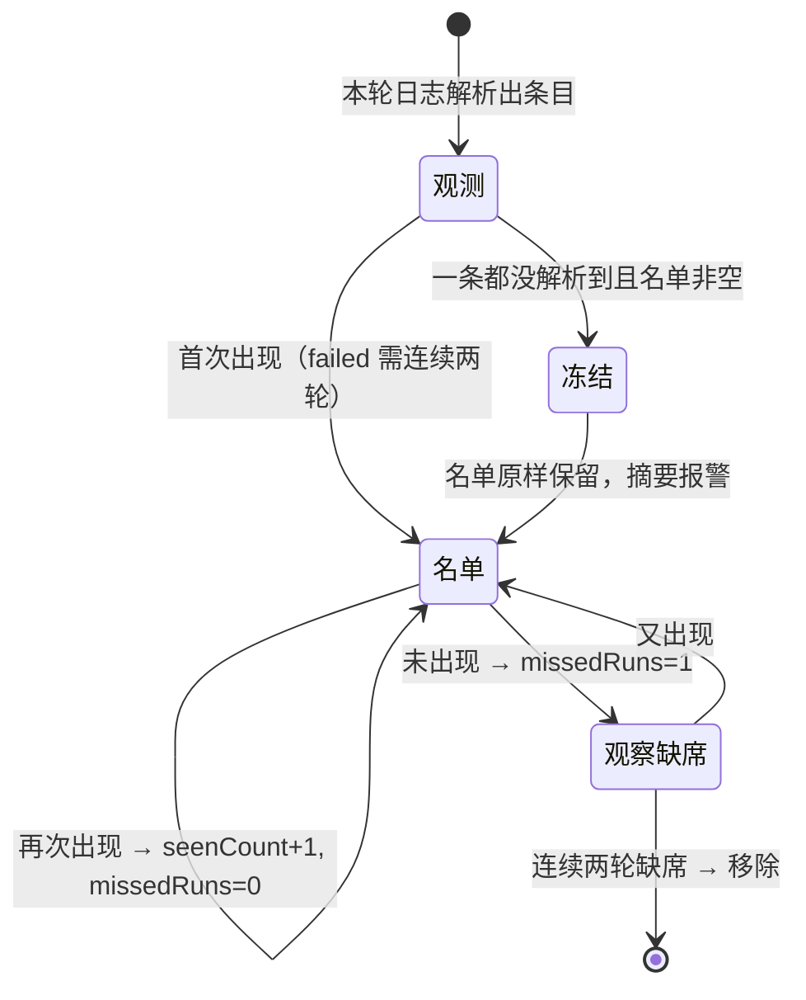
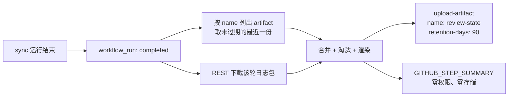

# 待核对名单：用 90 天 Artifact 跨轮维护

> 基线 `main@b147b4e`。实现只有两个新文件：`.github/workflows/review-queue.yml`（触发器）与 `scripts/review-queue.mjs`（解析 + 状态机）。`src/` 与 `.github/workflows/sync.yml` **逐字节未改动**。

## 1. 目标与硬约束

| 约束                             | 落地方式                                                                            |
| -------------------------------- | ----------------------------------------------------------------------------------- |
| 不改动现有代码逻辑               | 不碰 `src/`、不碰 `sync.yml`；新工作流只读日志、只写自己的 artifact                 |
| 仅用 Actions Artifact 作临时存储 | 每轮上传一份 `review-state`，`retention-days: 90`                                   |
| 数据不经过本地设备               | 下载日志、合并、上传全在 runner 内完成                                              |
| 不产生费用                       | 单份快照约 3–20 KB，90 天 × 39 轮 ≈ 0.1–1 MB，远低于账户 500 MB 的 Actions 存储额度 |
| 跨轮同一性 / 去重                | key = `source::(url │ bangumi-id │ title)`，命中即更新而非新增                      |
| 匹配成功后移除、增量更新         | 连续两轮未出现才删除；`firstSeenAt` 保留，`seenCount` 递增                          |

## 2. 为什么是这个形状（以及它付出的代价）

`sync` 结束前，runner 里唯一能代表「这一轮发生了什么」的东西是**控制台日志**；结构化留档文件 `.cache/unmatched.json` 不跨轮存在，也不会被上传。所以「不改代码」等价于「只能读日志」，而日志只包含同步**打印过**的条目。

这不是设计缺陷，是约束的直接后果。想清楚它的边界，比假装覆盖完整更有用：

| 链路            | unresolved                   | failed                           | skipped                                          |
| --------------- | ---------------------------- | -------------------------------- | ------------------------------------------------ |
| ① 豆瓣→Notion   | 无此概念                     | ✅ 逐条（`标题[链接] — reason`） | ◐ 缺库 ✅／白名单剪除 ✗                          |
| ② 豆瓣→NeoDB    | ✗ 只计数、无标题             | ✗ 静默                           | ✅ 目标端守卫（含标题）／白名单 ✗                |
| ③ 豆瓣→Bangumi  | ✅ 含豆瓣链接                | ✗ 静默                           | ✅ 目标端守卫（`subject/N`）                     |
| ④ Bangumi→NeoDB | ✅ Bangumi URL               | ✅ 逐条（catch 打印标题）        | ✗ 平台不符静默                                   |
| ⑤ NeoDB→TMDB    | ✅ 标题（无 id，key 靠标题） | ◐ 4 处仅部分打印                 | ◐ `Mark without a catalog item` 无标题，无法归属 |

> **2026-10-23 之后**：`src/` 已能打印三档明细（见 `docs/reference.md` 的「failed / skipped 明细的 reason 取值」），所以上表描述的是**解析器当前消费的那部分**，而不是日志的全部内容。新格式的行统一为 `· 标签 — reason`，且前面有一行可识别的节标题（`N failed item(s) — …` / `N skipped item(s) — …`）。本脚本目前只认领 ① 的失败行（原先的 `标题: 链接` 块已随源码一起删除）；要把 ②③④⑤ 的 failed / skipped 也纳入，只需按节标题带状态地解析这些行，不必再改 `src/`。

两条已知截断：`printPathSummary` 的标题清单上限 20（`src/sync-report.ts:23`），主要影响 ④；⑤ 的标签是 `display_title`（`src/paths/neodb-to-tmdb.ts:282`），所以它只能靠标题建 key——**改标题会让它看起来像新条目**。这一条在 ③ 不存在，因为 ③ 的标签带豆瓣链接。

## 3. 状态机



三个数值决定一切：

- `firstSeenAt`：只在新条目上写入，之后永不覆盖 —— 这是「这条我盯了多久」的唯一依据；
- `missedRuns`：未出现一次 +1，出现即清零，**到 2 才删除**（一次抖动不该删条目）；
- `seenCount`：出现次数，`failed` 用它实现「观察期」（`MIN_ROUNDS.failed = 2`）。

**降级保护**：如果本轮解析出 0 条而上一份名单非空，说明更可能是解析器失效而不是问题全修好了。此时冻结名单、不计数、在摘要顶部标红。这条比多解析几个字段重要得多——一个会把自己清空的监控，比没有监控更危险。

## 4. Artifact 作为状态载体



- **artifact 不可变、同名每轮唯一**，所以不能追加；每轮上传一份完整快照，下一轮用 `GET /repos/{repo}/actions/artifacts?name=review-state` 取 `expired == false` 中最新的一个，再 `.../artifacts/{id}/zip` 下载。
- `retention-days: 90` 只能**缩短**仓库设置，不能延长；公开仓库上限就是 90，私有仓库可到 400。请保持 Settings → Actions → Artifact and log retention ≥ 90。
- 链式依赖：只要 cron（周一三五）还在跑，最长间隔 3 天，永远不会落到 90 天之外；停跑超过 90 天才需要从空名单重建（`firstSeenAt` 重置，条目会重新入列）。
- 费用：单份 3.4 KB（7 条实测）；39 轮/90 天 ≈ 130 KB。即使名单涨到 50 条（约 14 KB），累计仍 < 1 MB，不触达 500 MB 免费额度。

## 5. 权限

```yaml
permissions:
  contents: read # 只读仓库，取默认分支上的脚本
  actions: read # 唯一新增：下载别的 run 的日志与 artifact
```

下载别的 run 的日志/artifact 必须显式给 `actions: read`（`GITHUB_TOKEN` 默认对当前 run 之外不可见）。没有 `issues`、没有 `contents: write`：本机制不写仓库任何内容。

## 6. 本地验证记录

用合成日志跑四轮（含 ANSI 前缀、中文标题、`标题[链接]` 标签）：

| 检查               | 结果                                       |
| ------------------ | ------------------------------------------ |
| 解析 + ANSI 剥离   | 7 条，标题为 `沙丘 2`（无转义残留）        |
| 第 2 轮同日志去重  | 7 → 7，`firstSeenAt` 不变，`seenCount` = 2 |
| `failed` 观察期    | 第 1 轮只在「观察中」，第 2 轮才进名单     |
| 连续两轮缺席       | 7 → 7（missed=1）→ 5（移除 2 条）          |
| 解析失败降级       | 名单保持 5 条不变，摘要标 `本轮未采信`     |
| `prettier --check` | `.mjs` / `.yml` 均 clean                   |

## 7. 已知局限与补齐路径

| 局限                         | 补齐代价                                                     |
| ---------------------------- | ------------------------------------------------------------ |
| ② 的 unresolved 完全没有标题 | 在 `douban-to-neodb.ts:98` 旁加一条记录（约 6 行），不动判定 |
| ②③⑤ 的 `failed` 静默         | 在 8 处 `failed += 1` 旁补日志（约 8 行）                    |
| `skipped` 只看到守卫与缺库   | 在源头区分白名单/增量/分类/重复（约 20 行）                  |
| ⑤ 的 key 依赖标题            | 日志里改打 uuid（1 行），或接受「改标题=新条目」             |

以上都只需要**追加记录**，不改变任何写入目标端的行为与退出码；一旦允许，覆盖率可从「✔ 部分」升到完整三档。当前版本选择先交付零改动、可回退的一层。
