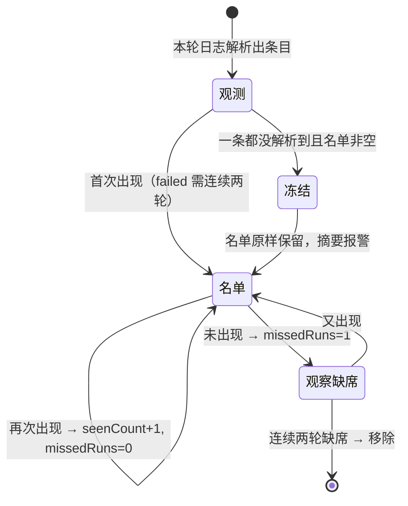
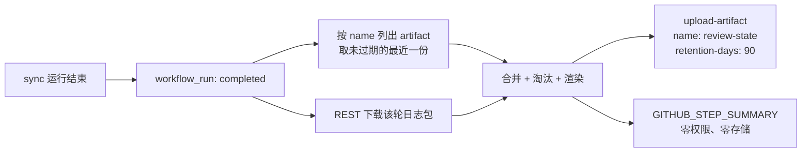

# 待核对名单：用 90 天 Artifact 跨轮维护

> **2026-10-25 起多了一个对账入口**：`sync.yml` 现在把同一轮的 `PathReport` 以 JSON 上传为 `sync-report-<run_id>`，名单作业会下载它、在摘要末尾追加一节「运行报表（JSON）」，比较「本轮实际计了多少 failed」与「日志解析出多少」。**名单内容仍由日志决定**——这一节只提示差值，不增删条目。缺 artifact 时该节整体不出现（旧运行、上传失败都走这条路）。
>
> 基线 `main@e13c482`。机制本身仍是两个文件：`.github/workflows/review-queue.yml`（触发器）与 `scripts/review-queue.mjs`（解析 + 状态机 + 渲染）。`.github/workflows/sync.yml` 现在多了一个 `if: always()` 的「发布作业摘要」步骤（与名单无关，见 `docs/reference.md` 的「CI 中的作业摘要」）；`src/` 的改动仍限于展示与日志层 —— ② 补了一条未匹配日志、⑤ 的条目级失败换了措辞，不涉及写入目标端的行为与退出码。

## 1. 目标与硬约束

| 约束                             | 落地方式                                                                                                                                       |
| -------------------------------- | ---------------------------------------------------------------------------------------------------------------------------------------------- |
| 不改动现有代码逻辑               | 机制本身只读日志、只写自己的 artifact；`src/` 的改动限于展示与日志（摘要编号、② 的未匹配日志、⑤ 的失败措辞），不动任何写入目标端的行为与退出码 |
| 仅用 Actions Artifact 作临时存储 | 每轮上传一份 `review-state`，`retention-days: 90`                                                                                              |
| 数据不经过本地设备               | 下载日志、合并、上传全在 runner 内完成                                                                                                         |
| 不产生费用                       | 单份快照约 3–20 KB，90 天 × 39 轮 ≈ 0.1–1 MB，远低于账户 500 MB 的 Actions 存储额度                                                            |
| 跨轮同一性 / 去重                | key = `source::(url │ bangumi-id │ title)`，命中即更新而非新增                                                                                 |
| 匹配成功后移除、增量更新         | 连续两轮未出现才删除；`firstSeenAt` 保留，`seenCount` 递增                                                                                     |

## 2. 为什么是这个形状（以及它付出的代价）

`sync` 结束前，runner 里唯一能代表「这一轮发生了什么」的东西是**控制台日志**；结构化留档文件 `.cache/unmatched.json` 不跨轮存在，也不会被上传。所以「不改代码」等价于「只能读日志」，而日志只包含同步**打印过**的条目。

这不是设计缺陷，是约束的直接后果。想清楚它的边界，比假装覆盖完整更有用：

| 链路            | unresolved                                    | failed                                                                                   | skipped                                          |
| --------------- | --------------------------------------------- | ---------------------------------------------------------------------------------------- | ------------------------------------------------ |
| ① 豆瓣→Notion   | 无此概念                                      | ✅ 逐条（`标题[链接] — reason`）                                                         | ◐ 缺库 ✅／白名单剪除 ✗                          |
| ② 豆瓣→NeoDB    | ✅ 标题 + 豆瓣链接（`No NeoDB match, skip:`） | ✅ `neodb-mark-rejected`                                                                 | ✅ 目标端守卫（含标题）／白名单 ✗                |
| ③ 豆瓣→Bangumi  | ✅ 含豆瓣链接                                 | ✅ `bangumi-write-rejected`                                                              | ✅ 目标端守卫（`subject/N`）                     |
| ④ Bangumi→NeoDB | ✅ Bangumi URL                                | ✅ 逐条（catch 打印标题）                                                                | ✗ 平台不符静默                                   |
| ⑤ NeoDB→TMDB    | ✅ 标题（无 id，key 靠标题）                  | ✅ `tmdb-item-threw` / 评分与 watchlist 写失败；◐ 无目录条目的名字是 `(unknown)`，只计数 | ◐ `Mark without a catalog item` 无标题，无法归属 |

> **2026-10-25 之后**：明细行不再按「① 的三条专用规则」认领，而是**按 reason slug 路由**。`src/` 里每个 `failedItems` / `skippedItems` 条目都带一个 slug，控制台明细打的是 `· 标签 — slug`，`scripts/review-queue.mjs` 的 `DETAIL_REASONS` 把它映射回「哪条链路 + 哪一档」。因此上表里 ②③⑤ 的 failed 也从「静默」变成了 ✅——它们本来就打印，只是没被认领。
>
> 两条刻意的留白：**slug 被多条链路共用的不猜**（`category-not-allowed` 属 ①②③、`guard-target-status` 属 ②④），名字是 `(unknown)` 的也不收（一条叫 "(unknown)" 的条目会同时代表所有无名失败，且永远勾不掉）。两者都计入名单顶部的「另有 N 处…无法归属」计数，而不是悄悄丢掉。

上表的五行也是名单的五个一级分组，顺序固定 ①→⑤：`Douban → Notion`、`Douban → NeoDB`、`Douban → Bangumi`、`Bangumi → NeoDB`、`NeoDB → TMDB`。这些字符串与 `src/paths/*.ts` 里的 `LABEL` 逐字相同，因此同一条链路在控制台日志、作业摘要、待核对名单里是同一个词，可以直接 grep 对齐。

两条已知截断：`printPathSummary` 的标题清单上限 20（`src/sync-report.ts:25`），主要影响 ④；⑤ 的标签是 `display_title`（`src/paths/neodb-to-tmdb.ts:282`），所以它只能靠标题建 key——**改标题会让它看起来像新条目**。这一条在 ③ 不存在，因为 ③ 的标签带豆瓣链接。

## 3. 名单结构

名单是两级：**链路 → 档位**。链路顺序固定 ①→⑤，档位顺序固定 `unresolved` → `failed` → `skipped`，只输出非空的分组。

```text
# 待核对名单（46 条）                    ← 名单条目总数
本轮运行：… / 计数行 / 降级提示           ← 原样保留
## Douban → Bangumi                     ← H2 = 链路，仅在该链路有内容时出现
### unresolved（2）                      ← H3 = 档位，仅输出非空档位
- [ ] **1.** 四郎探母 — https://… · no-bangumi-match · 已存在 3 天
- [ ] **2.** 天仙配 — https://… · no-bangumi-match · 已存在 3 天
## NeoDB → TMDB
### unresolved（44）
- [ ] **1.** Medalist (金牌得主 第二季) · no-tmdb-match · 已存在 0 天
## 观察中（2，下一轮仍出现才入名单）       ← 附属小节：不分层、不编号
---
脚注（原样保留）
```

| 规则      | 说明                                                                                                                                                                                                                                           |
| --------- | ---------------------------------------------------------------------------------------------------------------------------------------------------------------------------------------------------------------------------------------------- |
| 链路顺序  | 固定 ①→⑤，不按条数排序 —— 两轮之间可以直接对照                                                                                                                                                                                                 |
| 档位顺序  | `unresolved` → `failed` → `skipped`；空档位不产生 H3，也不留空行                                                                                                                                                                               |
| 编号      | 每个 H3 内从 1 开始，是「本节第几条」，不是全局序号；引用时请连链路与档位一起说。序号写在**条目正文**里（`**3.**`），不是列表标记 —— 原因见下面「复选框」一行                                                                                  |
| 组内顺序  | 等于 `state.json` 的 `items` 顺序（先沿用旧序、新增追加），渲染不重排 —— 条目不会在两轮之间跳位                                                                                                                                                |
| 未知 slug | `source` 不在映射表里时**原样作为 H2 显示名**，排在五条链路之后。这是兜底：一旦出现就说明 `SOURCE_LABELS` 漏了一项，而不是被伪装成一个正常标题                                                                                                 |
| 复选框    | `- [ ] **N.** 标题` 是 GFM 任务项。序号必须进正文：GitHub 给任务列表项设了 `list-style-type: none`，标记位让给方框，所以 `1. [ ] 标题` 这种写法渲染后只剩一排方框、看不到任何编号。面板是静态渲染，方框**不可点击**，复制进 issue 正文才可勾选 |
| 出现次数  | **不显示**。`seenCount` 只决定条目是否过了观察期（`MIN_ROUNDS`）与何时移除（`MISSES_BEFORE_REMOVAL`），写进正文只会让读者去反推一个自己动不了的阈值                                                                                            |
| 附属小节  | `本轮新增` / `本轮移除` / `观察中` 不分组、不编号，只把 slug 换成显示名                                                                                                                                                                        |
| 体量      | 46 条约 15 KB；`**N.**` 每行多约 7 字节、46 条约 +0.3 KB，两级标题开销 < 1 KB（H2 ≤5、H3 ≤15），远低于 issue 正文 65536 字符上限                                                                                                               |

## 4. 状态机



三个数值决定一切：

- `firstSeenAt`：只在新条目上写入，之后永不覆盖 —— 这是「这条我盯了多久」的唯一依据；
- `missedRuns`：未出现一次 +1，出现即清零，**到 2 才删除**（一次抖动不该删条目）；
- `seenCount`：出现次数，`failed` 用它实现「观察期」（`MIN_ROUNDS.failed = 2`）。

**降级保护**：如果本轮解析出 0 条而上一份名单非空，说明更可能是解析器失效而不是问题全修好了。此时冻结名单、不计数、在摘要顶部标红。这条比多解析几个字段重要得多——一个会把自己清空的监控，比没有监控更危险。

## 5. Artifact 作为状态载体



- **artifact 不可变、同名每轮唯一**，所以不能追加；每轮上传一份完整快照，下一轮用 `GET /repos/{repo}/actions/artifacts?name=review-state` 取 `expired == false` 中最新的一个，再 `.../artifacts/{id}/zip` 下载。
- `retention-days: 90` 只能**缩短**仓库设置，不能延长；公开仓库上限就是 90，私有仓库可到 400。请保持 Settings → Actions → Artifact and log retention ≥ 90。
- 链式依赖：只要 cron（周一三五）还在跑，最长间隔 3 天，永远不会落到 90 天之外；停跑超过 90 天才需要从空名单重建（`firstSeenAt` 重置，条目会重新入列）。
- 费用：单份 3.4 KB（7 条实测）；39 轮/90 天 ≈ 130 KB。即使名单涨到 50 条（约 14 KB），累计仍 < 1 MB，不触达 500 MB 免费额度。

## 6. 权限

```yaml
permissions:
  contents: read # 只读仓库，取默认分支上的脚本
  actions: read # 唯一新增：下载别的 run 的日志与 artifact
```

下载别的 run 的日志/artifact 必须显式给 `actions: read`（`GITHUB_TOKEN` 默认对当前 run 之外不可见）。没有 `issues`、没有 `contents: write`：本机制不写仓库任何内容。

## 7. 本地验证记录

用合成日志跑四轮（含 ANSI 前缀、中文标题、`标题[链接]` 标签）：

| 检查               | 结果                                                                                                                                   |
| ------------------ | -------------------------------------------------------------------------------------------------------------------------------------- |
| 解析 + ANSI 剥离   | 7 条，标题为 `沙丘 2`（无转义残留）                                                                                                    |
| 第 2 轮同日志去重  | 7 → 7，`firstSeenAt` 不变，`seenCount` = 2                                                                                             |
| `failed` 观察期    | 第 1 轮只在「观察中」，第 2 轮才进名单                                                                                                 |
| 连续两轮缺席       | 7 → 7（missed=1）→ 5（移除 2 条）                                                                                                      |
| 解析失败降级       | 名单保持 5 条不变，摘要标 `本轮未采信`                                                                                                 |
| 名单层级           | 链路按 ①→⑤ 出现，档位仅非空者；各 H3 编号均从 1 起                                                                                     |
| 空组不生成         | 只有 `Douban → Notion` 有 `failed` 时，其余四条链路不产生空 H2                                                                         |
| 未知 slug 兜底     | 手工把 `source` 改成 `foo→bar`：条目落到末尾 `## foo→bar`，`N` 仍等于各节之和                                                          |
| 任务项渲染         | `1. [ ] …` 的编号会被任务列表样式吃掉；改为 `- [ ] **N.** …`，本地预览与运行页均可见序号                                               |
| 连续编号 + 计数    | 三轮重跑：每节编号 1…n 连续无跳号，各 H3 之和恒等于 `# 待核对名单（N 条）`                                                             |
| ② 未匹配入名单     | 造 `No NeoDB match, skip: 四郎探母[https://…]`：两轮后出现在 `## Douban → NeoDB / ### unresolved`，key 用豆瓣链接                      |
| ③ failed 入名单    | 造 `· 摔跤吧！爸爸[https://…] — bangumi-write-rejected`：首轮进「观察中」，第二轮进 `### failed`（`MIN_ROUNDS.failed = 2`）            |
| ⑤ 失败不串链路     | `TMDB write threw, continuing:` 归 `NeoDB → TMDB`，`Item failed, continuing:` 仍归 `Bangumi → NeoDB`，两者不再混在一起                 |
| 无法归属只计数     | `category-not-allowed`（共用 slug）、`(unknown) — no-catalog-item`、`Mark without a catalog item` → 顶部「另有 3 处…」，名单不多出条目 |
| 摘要发布           | 有 `.cache/sync-summary.md` 时整份贴入；文件不存在时只写一行提示，两种情况都不影响退出码                                               |
| `prettier --check` | `.mjs` / `.yml` clean；Windows 检出为 CRLF 时需 `--end-of-line crlf`                                                                   |

## 8. 已知局限与补齐路径

| 局限                       | 补齐代价                                                                                     |
| -------------------------- | -------------------------------------------------------------------------------------------- |
| `skipped` 只看到守卫与缺库 | 在源头区分白名单/增量/分类/重复（约 20 行）；`category-not-allowed` 被 ①②③ 共用，得先拆 slug |
| ⑤ 的 key 依赖标题          | 日志里改打 uuid（1 行），或接受「改标题=新条目」                                             |
| 无名条目只能计数           | ⑤ 的 `(unknown)` 与 `Mark without a catalog item` 两条日志本来就没带名字，要在 `src/` 里补   |

第一、二条只需**追加记录**，不改变任何写入目标端的行为与退出码。③ 的 failed、② 的 unresolved、⑤ 的条目级失败已在 2026-10-25 补齐，不再列在这里。
